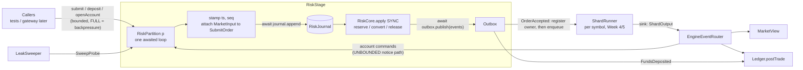

# Week 6: The Risk Stage, Reservations and the Double-Entry Ledger

One-week working document. Put it in `docs/WEEK-6.md`. It covers blueprint "Week 7: Risk stage, reservations and ledger", which the blueprint itself calls "the hardest design in the project". Week 7 (blueprint Week 8: circuit breaker and reconciliation) is previewed at the end.

**The theme of this week:** you proved in Week 4 that an account can overspend through an `await` race. This week you build the real fix: an account-partitioned **risk stage** that reserves cash or shares *before* an order reaches the matcher, converts those reservations on fills, releases them on cancels, and writes every movement to a **double-entry ledger** whose invariants you can test. At the end, one account trading three symbols through concurrent submissions can never spend money it does not have (test **C1**), and the naive version still overspends (test **C2**, kept forever).

Rule for this week: you hand-write **the reservation lifecycle in the risk core** (`onSubmitOrder`, `onFill`, `onClose`). That is the part you must be able to draw from memory. AI tools may help with the types, reference-price math, ledger, router, stage, sweeper, tests, and docs (section 9).

---

## 0. Status and carry-over

| # | Check | Done when |
|---|-------|-----------|
| V1 | Week 5 status is known. Run the Week 5 audit (`WEEK-5-AUDIT-PROMPT.md`) or read its report | You know what is done, unproven or missing. **Week 6 does not need Postgres**, so it can proceed, but you must know whether `SeqDeduper` exists (the router uses it) |
| V2 | Gate green: `npm ci`, build, lint, `check:boundaries`, `npm test`; `npm run test:flake` 20/20 | Green |
| V3 | You can still draw the Week 4 naive race and the serialized fix from memory | Done |
| V4 | Week 5 deferral acknowledged: **risk-stage dedupe lands this week** (on in-memory state; it becomes durable with the persistence work in Week 7+) | Noted in `PROGRESS.md` |

---

## 1. Goal and scope

**Goal:** a deterministic, replayable risk core plus the machinery around it, with the overspend guarantee proven by tests.

| In scope this week | Deferred |
|--------------------|----------|
| `RiskCore` (pure, synchronous): accounts, positions, reservations, deposits, order decisions, conversion, release, dedupe, rejection snapshots, invariants | Postgres persistence for risk and ledger (own work item, section 14). Risk state is in memory with an in-memory journal this week |
| Market-order conversion: reference-price fallback chain, protection band, tick rounding, hard price cap (blueprint 5.9) | Breaker, `symbol_halted` early rejection, `halt_timeout` force-cancel (Week 7) |
| `MarketView` fed from engine events; `EngineEventRouter` (engine outputs to account commands) | Kafka transport (Week 10) |
| `RiskStage`: N account partitions, awaited single loop each, journal before apply, backpressure, fail-stop | HTTP gateway and API (Week 8) |
| Deadlock-free two-way flow (commands bounded, engine notices not) | Amend, FOK, stop orders |
| Leak sweeper protocol (R4) | Fees, margin, short selling |
| `Ledger` (pure): append-only double-entry, per-asset zero-sum, reversal, idempotent by `txId` | Ledger persistence, `ledger_entries` table |
| Tests: U13, U14, K1 to K3, C1, C1b, R4, P5, P6, P9, P16 to P19 and the series in section 8 | Performance tuning (Week 11) |
| New workspace `packages/system-tests` for cross-package wiring tests | |

---

## 2. Deliverables and definition of done

- [ ] V1 to V4 handled (section 0)
- [ ] Dependency map, boundary checker and ESLint purity block updated (section 4.11), with proofs
- [ ] `common`: risk shared types, `AsyncQueue`, `acceptedToPlaceOrder`, `partitionOf`, constants
- [ ] `risk`: pure helpers (notional, cap, reference chain), `RiskCore`, `MarketView`, `EngineEventRouter`, `RiskStage` and partition runners, `LeakSweeper`, `InMemoryRiskJournal`
- [ ] `ledger`: `Ledger` with invariants
- [ ] `system-tests`: wiring helper and the cross-package tests
- [ ] All tests in section 8 pass; flake gate 20/20
- [ ] Week 4 prototypes kept: `NaiveRisk` and C2 still green, marked "superseded" where relevant
- [ ] Mutation table (section 8.8), decisions recorded, docs and `PROGRESS.md` updated
- [ ] You can draw the reservation lifecycle (placed, converted with improvement, released) and the leak-sweep timeline from memory

**Definition of done:** C1 and C1b pass, C2 still demonstrates the naive overspend, ledger and risk balances reconcile after random flows (P19), and you can draw the reservation lifecycle without notes.

---

## 3. Technologies and tech stack (this week only)

No new dependencies. Everything is plain TypeScript (strict), Vitest 4.1 and fast-check 4.x, as pinned. Postgres, Kafka, Redis and Fastify are not used.

| Piece | Purity rule |
|-------|-------------|
| `packages/risk/src/core/**` and `packages/ledger/src/**` | **Pure and synchronous**: no clock, no randomness, no I/O, no `process`, no timers, no `async`/`await`/`Promise`, no `node:*`, imports limited to relative files and `import type` from `@matchledger/common`. Enforced by a new ESLint block with the same ban list as `engine-core` (proven to fire) |
| `packages/risk/src` (stage, router, sweeper, journal) | May be async, but no `node:*` and no timers (delays and time are injected) |
| `packages/common` | Browser-safe: no `node:*`, no timers |
| `packages/system-tests` | Test and wiring code only; nothing may depend on it |

Money: all cash, prices, quantities, reservations and ledger amounts are `bigint`. Sequence numbers and timestamps are `number`. Cash is in **minor units** (the same units as engine prices), so `notional = price x quantity` exactly, with no division and no rounding. Amounts above `2^63 - 1` are rejected (they could not be stored later).

---

## 4. Architecture

### 4.1 Where the code goes

```
packages/common/src/
  risk-types.ts          // RiskCommand, RiskEvent, AccountSnapshot, MarketInput, StampedRiskCommand,
                         // RiskOutput, RiskJournalAppender, RiskConfig/InstrumentRiskConfig, constants
  async-queue.ts         // AsyncQueue<T>: unbounded single-consumer promise queue (no timers)
  order-translation.ts   // acceptedToPlaceOrder(OrderAccepted) -> engine PlaceOrder (ts placeholder)
  partition.ts           // partitionOf(accountId, partitions): FNV-1a 32-bit
packages/risk/src/
  money.ts               // notional(), ceilToTick(), floorToTick(), MAX_AMOUNT guard (pure helpers)
  reference.ts           // resolveReference(), computeMarketLimit() (pure)
  core/risk-core.ts      // RiskCore: apply(), checkInvariants(), snapshot(), view()       [lifecycle: hand-write]
  core/state.ts          // Account, Reservation types
  market-view.ts         // MarketView: apply(symbol, event), snapshotFor(symbol)
  router.ts              // EngineEventRouter
  stage.ts               // RiskStage + RiskPartition (single awaited loop per partition)
  sweeper.ts             // LeakSweeper
  in-memory-risk-journal.ts
  index.ts
packages/ledger/src/ledger.ts      // Ledger (pure)
packages/system-tests/
  src/wire.ts            // wirePipeline(): risk stage <-> shard runner <-> router <-> ledger (in memory)
  test/*.test.ts         // C1, C1b, K*, R4, P9, P16 to P19, DL1, replay
```

### 4.2 The v1 pipeline (one process, two stages, no Kafka)



Rules baked into the picture:
1. **One awaited loop per partition.** Messages for one account are handled strictly one after another; there is no `Promise.all` over messages. Accounts map to partitions by a stable hash, so one account never spans partitions.
2. **Journal before apply**, exactly as in the shard runner (Week 4). The risk core is a function of the stamped command stream, so replay reproduces it.
3. **Time and market data are inputs.** The stage stamps `ts`, and attaches a `MarketInput` (last trade, best bid and ask) to each `SubmitOrder` *before journaling*. The core never reads a clock or a view.
4. **Deadlock rule.** The stage waits on the shard (its outbox enqueues into the shard queue, which can be full), and the shard's sink feeds the router, which feeds the stage. If both paths were bounded, a full shard queue and a full stage queue would wait on each other forever. So: **caller commands are bounded; engine notices are never rejected** (the notice path is unbounded and non-blocking). The shard can always finish its batch, so the stage can always make progress.

### 4.3 State model (inside `RiskCore`)

```
accounts: Map<accountId, {
  cash: bigint,                       // total cash
  heldCash: bigint,                   // reserved by live BUY reservations
  positions: Map<symbol, { quantity: bigint, heldShares: bigint }>
}>
reservations: Map<orderId, {
  orderId, accountId, symbol, side: 'BUY'|'SELL',
  priceCap: bigint,                   // BUY: cap or limit; SELL: floor or limit (recorded for audit)
  qtyRemaining: bigint,               // unfilled, uncancelled quantity
  amountRemaining: bigint,            // BUY: priceCap x qtyRemaining (cash). SELL: qtyRemaining (shares)
  state: 'PENDING_ACK' | 'LIVE',      // PENDING_ACK until the matcher's first event for the order
  placedTs: number, placedSeq: number,
  appliedTradeIds: Set<string>        // dedupe of duplicate fills; dropped when the reservation closes
}>
decidedOrders: Set<orderId>           // dedupe of SubmitOrder (accepted OR rejected)
seenRequestIds: Set<string>           // dedupe of Deposit
```

Derived: `availableCash = cash - heldCash`, `availableShares = quantity - heldShares`. Closed reservations are removed from the map (the event log is the history). `decidedOrders` and `seenRequestIds` grow without bound in this version; that limitation is recorded and bounded later (snapshot plus sequence window, Week 10).

### 4.4 Commands and events

All commands are wrapped as `StampedRiskCommand { partition, seq, ts, command }`. The core never sees a clock.

| Command | Fields | Effect |
|---------|--------|--------|
| `OpenAccount` | accountId | Creates an empty account. Unknown accounts are never auto-created |
| `Deposit` | accountId, asset (`'CASH'` or `'SHARES:<symbol>'`), amount, requestId | Credits cash or shares; idempotent by `requestId` |
| `SubmitOrder` | orderId, accountId, symbol, side, type (`LIMIT` or `MARKET`), timeInForce, quantity, price?, **market: MarketInput** | Decide, reserve, emit `OrderAccepted` or `OrderRejected` |
| `OrderAcked` | orderId | `PENDING_ACK` to `LIVE` (from the engine's `OrderRested`) |
| `FillApplied` | orderId, tradeId, price, quantity | Convert part of the reservation (one command per participant) |
| `OrderClosed` | orderId, remaining, reason | Release the remaining reservation (engine `OrderCancelled`) |
| `OrderRejectedByMatcher` | orderId, reason | Release the whole reservation (engine `OrderRejected`) |
| `SweepProbe` | olderThanMs | Lists `PENDING_ACK` reservations older than the window |
| `ReleaseUnreached` | orderId | Releases a `PENDING_ACK` reservation proven never to have reached the matcher |

| Event | Meaning |
|-------|---------|
| `AccountOpened`, `FundsDeposited` | Account and deposit facts |
| `ReservationPlaced` | orderId, asset, amount, qty, priceCap |
| `OrderAccepted` | The message to the matcher: orderId, accountId, symbol, side, `timeInForce` (market becomes `IOC`), `price` (limit, or the computed cap or floor), quantity, `referencePrice` and `referenceSource` for market orders |
| `OrderRejected` | orderId, reason, `required`, and the **`AccountSnapshot` used for the decision** |
| `ReservationConverted` | orderId, tradeId, consumed, cost, improvement released |
| `ReservationReleased` | orderId, asset, amount, qty, reason (`CANCELLED`, `IOC_REMAINDER`, `MATCHER_REJECTED`, `NEVER_REACHED_MATCHER`) |
| `SweepCandidates` | the orderIds and symbols to cancel |
| `DuplicateIgnored`, `UnknownOrderIgnored` | Idempotency outcomes; no state change |

Rejection reasons: `INSUFFICIENT_BALANCE`, `INSUFFICIENT_POSITION`, `NO_REFERENCE_PRICE`, `UNKNOWN_ACCOUNT`, `UNKNOWN_SYMBOL`, `INVALID_ORDER`. `AccountSnapshot = { cash, heldCash, availableCash, positionQuantity, heldShares, availableShares }` for the order's symbol, taken **before** any change.

`RiskInvariantError` (fatal, never swallowed) is thrown for conditions that can only mean a bug upstream: a fill larger than `qtyRemaining`, a fill price above a BUY cap or below a SELL floor, an `OrderClosed.remaining` that disagrees with the reservation.

### 4.5 The reservation lifecycle (memorize this)

```
SubmitOrder BUY  (limit price L, or computed cap C; call it cap):
    need = cap x quantity                       -> reject INSUFFICIENT_BALANCE if cash - heldCash < need
    heldCash += need ; reservation{ qtyRemaining = quantity, amountRemaining = need, PENDING_ACK }
    emit ReservationPlaced, OrderAccepted(price = cap, TIF = IOC for market)
SubmitOrder SELL (quantity q):
    reject INSUFFICIENT_POSITION if quantity - heldShares < q      (no short selling)
    heldShares += q ; reservation{ qtyRemaining = q, amountRemaining = q }

FillApplied BUY  (price p <= cap, quantity f <= qtyRemaining):
    consumed = cap x f ; cost = p x f ; improvement = consumed - cost
    heldCash -= consumed ; cash -= cost ; position += f
    amountRemaining -= consumed ; qtyRemaining -= f ; state = LIVE
    emit ReservationConverted(consumed, cost, improvement)       // improvement is simply no longer held
    if qtyRemaining == 0: close (remove reservation)
FillApplied SELL (price p >= floor, quantity f):
    heldShares -= f ; position -= f ; cash += p x f ; qtyRemaining -= f ; close at 0

OrderClosed(remaining r):   r must equal qtyRemaining, else RiskInvariantError
    release = BUY: cap x qtyRemaining (cash)  /  SELL: qtyRemaining (shares)
    heldCash (or heldShares) -= release ; emit ReservationReleased ; close
```

Because a BUY reservation is exactly `cap x quantity` and each fill consumes `cap x f`, **no division and no rounding happen anywhere in the lifecycle**. The matcher enforces the cap as a hard limit (the IOC limit price), so `cost <= consumed` always: the reservation is a true upper bound (property **P9**).

### 4.6 Market orders (blueprint 5.9)

```
resolveReference(input: MarketInput, nowTs, cfg):
    1. input.lastTradePrice if (nowTs - input.lastTradeTs) <= cfg.maxReferenceAgeMs   -> source LAST_TRADE
    2. else midpoint of bestBid and bestAsk if both exist: (bid + ask) / 2, integer division (floor) -> MIDPOINT
    3. else cfg.referencePriceTicks if configured (> 0)                                -> STATIC
    4. else reject NO_REFERENCE_PRICE (no reservation placed)

band = min(cfg.protectionBandBps, cfg.maxBandBps)              // must satisfy 0 <= band < 10_000
BUY  cap   = ceilToTick( ceilDiv(ref x (10_000 + band), 10_000) )   clamped to cfg.maxPrice if set
SELL floor = floorToTick( floorDiv(ref x (10_000 - band), 10_000) ) never below one tick
```

A market order is accepted only as `IOC`; a market order with a price, or a limit order without one, is `INVALID_ORDER`. Rounding is chosen so the band is never narrower than requested (BUY rounds up, SELL rounds down); both are tested with fixed vectors. A stale or static reference can make the cap too tight or too wide: that is the documented trade-off, bounded by `maxBandBps`.

### 4.7 Router and `MarketView`

`EngineEventRouter.onShardOutputs(outputs)` is a **deterministic mapping** (it keeps `orderOwner: Map<orderId, { accountId, symbol, side }>`, filled when the stage's outbox emits `OrderAccepted`, before the order is enqueued to the shard):

| Engine event | Account commands |
|--------------|------------------|
| `OrderRested` | `OrderAcked` to the owner |
| `TradeExecuted` | `FillApplied` to the taker's owner **and** to the maker's owner (two commands); also `Ledger.postTrade`, and `MarketView` update |
| `OrderCancelled` | `OrderClosed` (reason from the event) |
| `OrderRejected` | `OrderRejectedByMatcher` |
| `CancelRejected(UNKNOWN_ORDER)` for a sweep-initiated cancel | `ReleaseUnreached` |

Outputs are deduplicated per symbol by `(symbol, seq)` (use `SeqDeduper` from `common` if Week 5 delivered it; otherwise a minimal per-symbol watermark inside the router, recorded as a deviation). An event for an order the router does not own is counted and ignored. When an order is fully closed the router removes it from `orderOwner`.

`MarketView.apply(symbol, event)` keeps a tiny Map-based picture per symbol: last trade (price, ts), resting orders (orderId to side, price, remaining) and per-price quantity on each side. `snapshotFor(symbol)` returns a `MarketInput`. It may be slightly stale (documented).

### 4.8 Leak sweeper (R4)

Problem: a reservation is placed, but the `OrderAccepted` never reaches the matcher (a dropped message, a crash between the stages). Releasing it blindly could double-spend if the order did reach the matcher. The protocol makes the release **provably safe**:

1. The sweeper tick sends `SweepProbe { olderThanMs }` through the partition queue. The core replies with `SweepCandidates` listing reservations still `PENDING_ACK` and older than the window (deterministic order).
2. For each candidate the stage sends a `CancelOrder` to the shard **through the same ordered channel** that the original order used, so the cancel cannot overtake the order.
3. If the order had reached the matcher, the cancel produces `OrderCancelled`, and the normal release path runs. If the order never arrived, the engine answers `CancelRejected(UNKNOWN_ORDER)`; the router, which knows this cancel was sweep-initiated, sends `ReleaseUnreached`, and the core releases with reason `NEVER_REACHED_MATCHER`.
4. A reservation that is no longer `PENDING_ACK` is never released by this path (`UnknownOrderIgnored`). A lost cancel is simply retried on the next sweep.

IOC orders that completed instantly also answer `UNKNOWN_ORDER` to a late cancel, but they cannot be `PENDING_ACK` at that point: their fills or cancel were delivered first, in order, on the same per-symbol stream.

### 4.9 Ledger

Pure, append-only, in memory. Entry: `{ txId, seq, accountId, asset, amount (signed bigint), direction: 'DEBIT'|'CREDIT', refEventId }`. Convention (from the blueprint): **DEBIT = value leaves the account (negative), CREDIT = value enters it (positive)**. A transaction is accepted only if its entries sum to zero **per asset**.

| Transaction | Entries |
|-------------|---------|
| Cash deposit `D` | account CASH CREDIT `+D`; `@EXTERNAL` CASH DEBIT `-D` |
| Share deposit `q` | account `SHARES:SYM` CREDIT `+q`; `@EXTERNAL` DEBIT `-q` |
| Trade `tradeId`, price `p`, qty `q` | buyer CASH DEBIT `-p*q`; seller CASH CREDIT `+p*q`; buyer `SHARES:SYM` CREDIT `+q`; seller DEBIT `-q` |
| Reversal of `T` | the negation of every entry of `T`, as a new tx `rev:T` |

Invariants: per-asset sum over all entries is zero (**P5**); per symbol, positions across all accounts including `@EXTERNAL` sum to zero (**P6**); posting the same `txId` twice is a no-op; no API mutates or deletes an entry. **Reconciliation (P19):** after the pipeline quiesces, every account's ledger CASH and `SHARES:SYM` balances equal the risk core's `cash` and `positions`.

### 4.10 Partitions and ordering

`partitionOf(accountId, P)` is FNV-1a (32-bit) over the account id's UTF-16 code units, modulo `P`. Same account, same partition, always. Within a partition everything is serialized; across partitions there is no ordering requirement because accounts are independent and fills are routed per account.

### 4.11 Dependency map, boundaries and lint

| Package | Change |
|---------|--------|
| `common` | Adds risk types, `AsyncQueue`, `acceptedToPlaceOrder`, `partitionOf`. Still no `node:*`, no timers |
| `risk` | May depend on `common` only. It never imports `engine-core` or `shard`: engine event types are reached through `ShardOutput` from `common` |
| `ledger` | May depend on `common` only this week (journal later) |
| `system-tests` | **New workspace** (a decision; the blueprint lists eleven backend packages). May depend on `engine-core`, `common`, `shard`, `risk`, `ledger`, `journal`; nothing may depend on it; contains wiring and tests only |
| ESLint | New block for `packages/risk/src/core/**/*.ts` and `packages/ledger/src/**/*.ts`: the `engine-core` ban list (clock, `Math.random`, `process`, timers, `async`, `await`, `Promise`, `node:*`), with type-only imports from `@matchledger/common` allowed. Prove it fires, then revert |

Update `scripts/check-boundaries.mjs` and `docs/BLUEPRINT.md` 4.4 in the same commit.

---

## 5. How to build it (day by day) and split points

Write the failing test first each day. All tests here are in memory (no Docker).

| Day | Hours | Do | Done when |
|-----|-------|----|-----------|
| 1 | 2 to 3 | V1 to V4. Boundaries and lint (4.11). Shared types, `AsyncQueue`, `partitionOf`, `acceptedToPlaceOrder`, pure money and reference math with U13, U14, MO1 to MO8 (Prompt 1) | Pure helpers green |
| 2 | 3 | `RiskCore` scaffolding and RL tests first; **you hand-write** the three lifecycle methods (Prompt 2) | RL1 to RL21 green |
| 3 | 2 to 3 | `Ledger`, `MarketView`, router, reconciliation (Prompt 3) | LG, MV, RT, P5, P6 green |
| **split point 1** | | Core, ledger and router are proven in isolation. This alone is a strong deliverable | |
| 4 | 3 | `RiskStage`, wiring, C1, C1b, K1 to K3, P9, P16 to P19, DL1 (Prompt 4) | C1 passes; C2 still demonstrates the bug |
| **split point 2** | | Stop here if short; the sweeper can slip | |
| 5 | 2 to 3 | Sweeper and R4, mutations, docs, gate (Prompt 5) | Everything green |
| 6 to 7 | 2 | Buffer, whiteboard, cleanup, flake gate | Done |

**Stuck protocol:** if a conservation bug costs more than 90 minutes, shrink it to one account, one symbol, two orders, and write the state after every command in a table (cash, heldCash, reservation amount, qtyRemaining). The invariant that breaks first points at the line.

---

## 6. Worked scenarios (use as fixtures)

### Scenario 1: partial fill with price improvement (RL7, K2)
Account `acc1`, cash 10,000. `BUY o1 limit 105 qty 10 GTC`.

| Step | Effect | cash | heldCash | available | position | reservation (qtyRem / amountRem) |
|------|--------|------|----------|-----------|----------|----------------------------------|
| after submit | reserve 105 x 10 = 1,050 | 10,000 | 1,050 | 8,950 | 0 | 10 / 1,050 |
| `FillApplied` 4 @ 101 | consumed 420, cost 404, improvement 16 | 9,596 | 630 | 8,966 | 4 | 6 / 630 |
| `OrderClosed` remaining 6 | release 630 | 9,596 | 0 | 9,596 | 4 | closed |

### Scenario 2: exactly at the balance (RL5, K1)
Cash 1,000, nothing held. `BUY q10 @ 100` needs 1,000: accepted. `BUY q10 @ 101` needs 1,010: `OrderRejected(INSUFFICIENT_BALANCE)` with `required 1010` and snapshot `{ cash 1000, heldCash 0, availableCash 1000, ... }`.

### Scenario 3: market buy from the static reference (U13, MO)
Instrument: tick 5, `protectionBandBps` 100, `maxBandBps` 500, `referencePriceTicks` 10,050, `maxReferenceAgeMs` 60,000. No trades, empty book. `BUY MARKET q3`: reference 10,050 (STATIC); band 100; `ceilDiv(10,050 x 10,100, 10,000) = ceilDiv(101,505,000, 10,000) = 10,151`; rounded up to tick 5 gives cap **10,155**; reservation `10,155 x 3 = 30,465`; `OrderAccepted` carries `price 10,155`, `IOC`, `referencePrice 10,050`, `referenceSource STATIC`. `SELL MARKET`: `floorDiv(10,050 x 9,900, 10,000) = 9,949`, rounded down to tick 5 gives floor **9,945**. Midpoint check: bid 100, ask 101 gives 100; bid 100, ask 102 gives 101.

### Scenario 4: leak sweep (R4)
Cash 1,000. `BUY o1 q5 @ 100` is accepted (reserve 500; available 500) at `ts 0`, but the accepted message is **dropped** before the shard. Window 5,000 ms. At `ts 6,000` the sweeper sends `SweepProbe`; `SweepCandidates [o1]`; the stage sends `CancelOrder o1` to the shard; the engine answers `CancelRejected(UNKNOWN_ORDER)`; the router sends `ReleaseUnreached`; the core releases 500 with reason `NEVER_REACHED_MATCHER`. Available is 1,000 again. Counter-case: if the order had reached the matcher and rested, the cancel would produce `OrderCancelled`, and the normal release would run; nothing is released twice.

### Scenario 5: overspend attempt across three symbols (C1)
One account, cash 100,000. 300 `BUY` orders (100 each on ACME, BETA, GAMMA) of quantity 10 at price 100 (each needs 1,000), all submitted in the same synchronous turn, with randomized journal delays. At most 100 orders are accepted; `heldCash <= cash` and `availableCash >= 0` hold at every observation (after every applied command).

---

## 7. Edge cases to handle

**Orders and reservations**
- Order exactly equal to available cash (accepted) and one unit above (rejected); same for shares
- SELL with shares already reserved by another open order (only the unreserved shares count)
- No short selling: SELL without position is `INSUFFICIENT_POSITION`
- Quantity zero or negative, price zero or negative, `MARKET` with a price, `LIMIT` without one, `MARKET` with `GTC`: `INVALID_ORDER`
- `price x quantity` above `2^63 - 1`: `INVALID_ORDER`
- Unknown account or unknown symbol: rejected with a snapshot-free reason (`UNKNOWN_ACCOUNT`, `UNKNOWN_SYMBOL`); never auto-create
- Duplicate `SubmitOrder` (same `orderId`, even after it was rejected or closed): `DuplicateIgnored`, no second reservation
- Matcher rejects an accepted order (tick, lot, duplicate id): full release

**Fills and releases**
- Partial fill with price improvement; several fills on one order; fills for both sides of a self-trade (same account) leave cash and position consistent
- Cancel releases only the remaining reservation, never the filled part
- IOC remainder release (`IOC_REMAINDER`); IOC with no liquidity releases everything; fully filled IOC produces no release event
- Duplicate `FillApplied` (same `orderId` and `tradeId`): `DuplicateIgnored`, state unchanged
- Fill or close for an unknown or already closed order: `UnknownOrderIgnored`
- Fill larger than `qtyRemaining`, fill price above a BUY cap or below a SELL floor, `OrderClosed.remaining` disagreeing: `RiskInvariantError`
- A fill arriving while still `PENDING_ACK` (IOC fills come without `OrderRested`): becomes `LIVE`

**Market data and conversion**
- Stale last trade falls through to midpoint, then static; one-sided book skips midpoint; no data at all and no static: `NO_REFERENCE_PRICE` with no reservation
- Band bounded by `maxBandBps`; SELL floor never below one tick; BUY cap clamped to `maxPrice`
- The market snapshot is captured **before journaling**, so replay does not depend on the view

**Concurrency and flow**
- Same account, many concurrent submissions across symbols: never overspends (C1)
- Delays injected at every await in the stage: results identical (C1b)
- Both queues tiny and flooded: no deadlock (DL1)
- Backpressure: a full caller queue returns `FULL`; engine notices are never rejected
- Fail-stop on any journal, outbox or invariant error; no command applied afterwards
- `stop({ drain: true })` finishes queued work; commands enqueued after stop return `CLOSED`

**Sweeper**
- Only `PENDING_ACK` and older than the window; acked reservations are never swept
- A late-arriving order is not released if it reached the matcher
- A dropped cancel is retried on the next sweep

**Ledger**
- Unbalanced transaction rejected; duplicate `txId` is a no-op; reversal restores balances through new entries; no mutation API
- Reconciliation with risk balances after random flows

---

## 8. Test cases to pass

IDs U13, U14, K1 to K3, C1, C2, R4, P5, P6, P9 come from the blueprint. The rest are new this week; add them to the blueprint tables.

### 8.1 Pure helpers (`common`, `risk`)

| # | Test | Expected |
|---|------|----------|
| U13 | Market buy, no trades, one-sided book, static reference configured (Scenario 3) | `OrderAccepted` is IOC with cap 10,155; reservation 30,465 |
| U14 | Market buy, no reference at all | `OrderRejected(NO_REFERENCE_PRICE)`; no reservation placed |
| MO1 | Chain order | Fresh last trade wins over midpoint; midpoint wins over static |
| MO2 | Stale last trade | Falls to midpoint when both sides exist |
| MO3 | One-sided book | Skips midpoint, uses static |
| MO4 | Rounding vectors | BUY: 10,150.5 becomes cap 10,155 (tick 5); SELL: 9,949.5 becomes floor 9,945; also exact multiples unchanged |
| MO5 | Effective band | `min(protection, max)` is used; band outside `[0, 10,000)` is a configuration error |
| MO6 | Clamps | SELL floor never below one tick; BUY cap clamped to `maxPrice` |
| MO7 | Market order validity | `MARKET` with price, `LIMIT` without price, `MARKET` + `GTC` are `INVALID_ORDER` |
| MO8 | Midpoint division | bid 100 / ask 101 gives 100; bid 100 / ask 102 gives 101 |
| PT1 | `partitionOf` vectors | FNV-1a 32 of `""` is 0x811c9dc5, of `"a"` is 0xe40c292c, of `"foobar"` is 0xbf9cf968 (verify against the published FNV test vectors); result always in `[0, P)` |
| PT2 | Stability and spread | Same input gives same output; 10,000 random ids spread across 8 partitions with no empty partition |
| AQ1 | `AsyncQueue` FIFO, `dequeue` waits then resolves, `close()` semantics | As `BoundedQueue` but never refuses |
| AQ2 | Second concurrent `dequeue` | Throws |
| AQ3 | No timers, no `node:*` | Boundary check |
| AQ4 | Property against an array model | Identical behavior |

### 8.2 Risk core (`RL` series; Scenario fixtures)

| # | Test | Expected |
|---|------|----------|
| RL1 | BUY limit accepted | `heldCash += cap x qty`; events in order `ReservationPlaced`, `OrderAccepted`; available reduced |
| RL2 | SELL limit accepted | `heldShares += qty`; cash untouched |
| RL3 | SELL without enough free shares | `INSUFFICIENT_POSITION` with snapshot |
| RL4 | BUY with insufficient cash | `INSUFFICIENT_BALANCE`, `required`, snapshot |
| RL5 / K1 | Exactly at the balance, then one unit above (Scenario 2) | Accepted; rejected with the right reason |
| RL6 | Full fill at the cap | Cash and position updated, reservation closed |
| RL7 / K2 | Scenario 1 | Every row of the table matches exactly |
| RL8 | SELL fill | `heldShares`, position and cash updated |
| RL9 | Close after a partial fill | Releases only the remaining amount |
| RL10 | IOC remainder close | Released with `IOC_REMAINDER` |
| RL11 | Matcher rejection | Full release |
| RL12 | Duplicate `SubmitOrder` (also after rejection and after close) | `DuplicateIgnored`; no state change |
| RL13 | Duplicate `FillApplied` | `DuplicateIgnored`; state unchanged |
| RL14 | Fill or close for an unknown order | `UnknownOrderIgnored` |
| RL15 | Fill larger than `qtyRemaining`; price above the BUY cap; `OrderClosed.remaining` mismatch | `RiskInvariantError` each |
| RL16 | Self-trade | Both legs apply; account totals consistent |
| RL17 | Deposit, duplicate `requestId`, share deposit | Credited once; duplicate ignored |
| RL18 | Unknown account or symbol | Correct rejection; no auto-creation |
| RL19 | Invalid orders (section 7) | `INVALID_ORDER`; overflow guard |
| RL20 | `checkInvariants()` after **every** command in every RL test | `[]` |
| RL21 | `SweepProbe` | Lists only `PENDING_ACK` reservations older than the window in placement order; acked ones excluded |
| K3 | Every `OrderRejected` carries the snapshot used; replaying the journaled commands from an empty core reproduces the identical rejection and snapshot | Equal |

### 8.3 Ledger, market view, router

| # | Test | Expected |
|---|------|----------|
| LG1 | Balanced deposit and trade | Accepted; per-asset sum zero |
| LG2 | Unbalanced transaction | `UnbalancedTransactionError`; nothing appended |
| LG3 | Duplicate `txId` | No-op |
| LG4 | Reversal | New entries negate the originals; balances restored; originals untouched |
| LG5 | Append-only | No mutation API; entries are frozen |
| LG6 | Balances and per-symbol positions | Correct, including `@EXTERNAL` |
| LG7 | Signed amounts and direction | DEBIT negative, CREDIT positive |
| LG8 | Amount bounds | Above `2^63 - 1` rejected |
| **P5** | Property: random valid trades and deposits | Debits equal credits per asset after every post |
| **P6** | Same sequences | Positions sum to zero per symbol across all accounts |
| MV1 | Last trade and top of book from events | Correct `MarketInput` |
| MV2 | Cancel and fill update resting quantity and levels | Correct best bid and ask |
| MV3 | Empty side | Best absent |
| MV4 | Maker partial fills | Remaining tracked from `makerRemaining` |
| MV5 | Property against a naive reference book built from the same events | Same top of book |
| RT1 | `OrderRested` | `OrderAcked` to the owner |
| RT2 | `TradeExecuted` | Two `FillApplied` (taker and maker owners) and one ledger post with buyer and seller identified correctly for both taker sides |
| RT3 | `OrderCancelled`, `OrderRejected` | `OrderClosed`, `OrderRejectedByMatcher` |
| RT4 | Duplicate `ShardOutput` | Ignored by `(symbol, seq)` |
| RT5 | Unknown order | Counted and ignored |
| RT6 | Fully closed order | Removed from `orderOwner` |
| RT7 | Sweep-initiated `CancelRejected(UNKNOWN_ORDER)` | `ReleaseUnreached`; a user-initiated one does not |
| RT8 | Self-trade | Two commands to the same account |
| RT9 | Output order | Commands emitted in event order |

### 8.4 Stage and flow (`system-tests` and `risk`)

| # | Test | Expected |
|---|------|----------|
| RP1 | Stamping | `ts` non-decreasing (clock steps back), `seq` contiguous per partition; caller `ts` ignored |
| RP2 | Market input | Attached to `SubmitOrder` before journaling; replay does not touch the view |
| RP3 | Journal before apply | With the journal held, the core has applied nothing and the outbox nothing |
| RP4 | Per-account order | Commands for one account applied in enqueue order |
| RP5 | Backpressure | Caller queue full gives `FULL`; notices are always accepted |
| RP6 | Fail-stop | Journal, outbox or `RiskInvariantError`: partition FAILED, `onFatal` once, nothing applied afterwards, `done` resolves |
| RP7 | Graceful stop | Drain completes queued work; later enqueue `CLOSED` |
| RP8 | Partition routing | An account always lands in the same partition; independent partitions progress independently |
| RP9 | Stamper restore-free determinism | A fresh core fed the journal reproduces events and snapshot (see P18) |
| DL1 | Deadlock | Stage queue and shard queue both tiny, 500 orders from 10 accounts: everything completes (use yield counts, no timers) |
| **C1** | One account, 3 symbols, 300 concurrent orders, balance far below demand (Scenario 5), partitions 1 and 4 | At most 100 accepted; `heldCash <= cash`, `availableCash >= 0`, `checkInvariants()` clean after every applied command |
| **C1b** | C1 plus counterparties, trades, cancels, and fast-check delay schedules at every await (journal, outbox) | Same invariants; outcomes identical across schedules for a fixed command order |
| **C2** | Week 4 `NaiveRisk` test | Still demonstrates the overspend (kept) |
| **P9** | Market BUY through the real engine: random books, random market orders | Total cost of fills is at most the reservation placed |
| **P16** | Property: random full-pipeline flows | Risk invariants hold at every observation |
| **P17** | Same flows | Every `OrderRejected` is justified by its own snapshot (`INSUFFICIENT_BALANCE`: `availableCash < required`; and so on) |
| **P18** | Same flows | Replaying the risk journal into a fresh core yields identical events and identical state snapshot |
| **P19** | Same flows after quiescence | Ledger balances equal risk balances for every account and asset; per-asset zero-sum; positions zero-sum per symbol |

### 8.5 Sweeper

| # | Test | Expected |
|---|------|----------|
| SW1 | `SweepProbe` selection | Only unacked reservations older than the window |
| SW2 | Acked or live reservations | Never selected |
| SW3 | Order that did reach the matcher | Cancel path releases once; nothing released twice |
| SW4 | Lost cancel | Retried on the next sweep; eventually released |
| **R4** | Scenario 4 | Leaked reservation released within the window; available restored; ledger and risk reconcile |

### 8.6 Determinism and flake gate

All tests are deterministic: no sleeps, no `setTimeout`, no `Math.random`; fast-check generates delay schedules and flows. `npm run test:flake` covers `risk`, `ledger`, `common`, `shard` and `system-tests`: 20 of 20.

### 8.7 What the numbers must show

Not benchmarks this week. The proof is behavioural: C1 and C1b pass, C2 still fails the naive design, P19 reconciles.

### 8.8 Mutation checks (prove the tests have teeth)

Apply each separately in a scratch branch, record which tests fail, revert:
1. Conversion forgets the improvement (releases `cost` instead of `consumed`): RL7, K2, P16.
2. Close releases the full reservation instead of the remainder: RL9, P16.
3. Market order reserves with the reference price instead of the cap: U13, MO, P9.
4. Balance check uses `>` instead of `>=`: RL5, K1.
5. Skip `SubmitOrder` dedupe: RL12.
6. Router sends the maker's fill to the taker's account: RT2, P19.
7. Stage applies before journaling: RP3.
8. Stage handles messages concurrently (no single loop): C1b, RP4.
9. Make the notice path bounded: DL1.
10. Sweeper releases directly without the cancel round trip: SW3, R4 counter-case.
11. Ledger posts only one leg of a trade: LG, P5, P19.
12. BUY cap rounding flipped to round down: MO4.
13. Rejection snapshot taken after the change: K3, P17.
14. Duplicate fill applied twice: RL13.

A surviving mutation is a test gap: strengthen the test, not the code.

---

## 9. Rules for this week

- `risk/src/core` and `ledger/src` are pure (section 3). No `Date`, `Math.random`, `await`, `Promise`, `node:*`. Time and market data enter as command fields.
- No `Promise.all` over ordered work in `risk/src`. Tests may launch independent concurrent submissions where a test explicitly requires it (C1).
- `engine-core` and `shard` are unchanged this week. `git diff` on them must be empty.
- Never swallow `RiskInvariantError`. It means a bug, not a condition.
- Every `OrderRejected` carries the snapshot; never construct it after mutating state.
- Commit after each green test; leave `PROGRESS.md` stating what is done and the next failing test.
- **AI tools this week.** Allowed: types, helpers, ledger, market view, router, stage, sweeper, wiring, tests, docs, reviews. **Not allowed:** `RiskCore.onSubmitOrder`, `onFill`, `onClose` (the lifecycle). You defend those line by line.
- Every number in the docs comes from a run you can point to.

---

## 10. Decisions to record in `docs/decisions.md`

Format: context, options, choice, trade-offs, how tested.

1. Reservations vs a global lock or one process (blueprint decision #6): why a two-stage pipeline with reservations. Trade-offs: extra hop, false rejects while funds are held, hot accounts serial.
2. A pure, synchronous risk core replayed from journaled commands (instead of async handlers over a store). Why this gives "every rejection is an event you can replay".
3. Cash in minor units; `notional = price x quantity`; no division in the lifecycle; the `2^63 - 1` guard.
4. Market data and time as command inputs, captured before journaling.
5. Reference-price chain, effective band `min(protection, max)`, rounding directions, clamps.
6. No short selling; sells reserve shares.
7. Account partitioning by FNV-1a; one awaited loop per partition.
8. The deadlock rule: bounded caller commands, unbounded engine notices. Trade-off: notice memory is bounded only by live orders.
9. The router and the orderId-to-owner map; why engine events carry no account ids and `engine-core` stayed unchanged.
10. The leak-sweep protocol and why it is safe (ordered channel, cancel round trip, `ReleaseUnreached` only from `PENDING_ACK`).
11. Dedupe sets grow without bound in this version; bounded later.
12. Ledger sign convention, `@EXTERNAL`, per-asset zero-sum, reversal-only corrections, idempotency by `txId`.
13. New `system-tests` workspace and why (cross-package wiring without a forbidden dependency edge).
14. Week 4 prototypes kept: `NaiveRisk` as proof, `SerializedRisk` superseded.
15. Risk and ledger persistence deferred; what that means for the crash-recovery claim (the matching engine recovers durably; the risk core is proven replayable, not yet durable).

---

## 11. Interview prep for this week

Be able to answer from memory:

- Why reservations instead of a lock or a single process? What do they cost? (Extra hop, false rejects while funds are held, a hot account is serial, market orders need a protection band.)
- Draw the lifecycle for a BUY of 10 at limit 105 with a partial fill of 4 at 101, then a cancel. Which numbers move at each step? Why does the improvement need no extra step?
- Why is the reservation a *true upper bound* for a market order? (The cap is also the matcher's hard limit.)
- Why can the core be pure while the stage is async? Where is the only place two things can interleave, and what stops it?
- Why attach the market input to the command before journaling?
- Explain the deadlock between the stage and the shard, and why unbounded notices fix it. What bounds the notices?
- How does the leak sweeper avoid releasing a reservation for an order that is actually live?
- What makes a rejection "explainable after the fact"? Show the snapshot.
- Why does the ledger have an `@EXTERNAL` account? What does "debits equal credits per asset" catch that a balance check does not?
- What breaks in a crash today, and what does not? (Be honest about the deferred persistence.)

**Whiteboard exercise (no notes):** Scenario 1 as a table of cash, heldCash, available, position, reservation after each step. Then Scenario 4 as a timeline: submit, dropped message, probe, cancel, `UNKNOWN_ORDER`, release. Then the stage pipeline with the two queues, marking which is bounded and why.

---

## 12. Common mistakes to avoid

- Doing the balance check and the reservation in different steps (a gap another message can use)
- Releasing the *original* reservation on cancel instead of the *remaining* one
- Forgetting to release price improvement, so cash stays held forever
- Using `number` for `price x quantity`
- Reading the clock or the market view inside the core
- Journaling the command without the market input, so replay differs
- Constructing the rejection snapshot after the reservation changes state
- Bounded notice queues (deadlock under load)
- A sweeper that releases without proving the order never reached the matcher
- Handling a duplicate fill as a second conversion
- Letting a `RiskInvariantError` be caught and logged
- Posting a trade to the ledger with only one leg, or with the buyer and seller swapped for a SELL taker
- Dedupe by `seq` alone for `SubmitOrder` (a re-sent order gets a new `seq`; dedupe by `orderId`)
- Touching `engine-core` or `shard` to make something fit

---

## 13. Progress log (copy into `PROGRESS.md` each day)

```
Day N:
- Done:
- Failing / blocked:
- Next failing test to write:
- Flaky tests seen (and root cause):
- Property-test seeds worth keeping:
- Decisions made:
```

---

## 14. Week 7 preview (blueprint Week 8: circuit breaker and reconciliation)

Next: the per-symbol **circuit breaker** (a state machine inside `engine-core/src/breaker`, driven by stamped time and `Tick` commands, so the engine journal gains Tick records), the halt policy (early rejection with `symbol_halted` in the risk core, `halt_timeout` force-cancel flowing back as `OrderClosed`), tests K4 to K12, and the **reconciliation job** (streamed CSV, break types, workflow, X1 to X6, ledger adjustments).

Schedule one more item soon, not at the end: **persistence for the risk stage and ledger** (an `OrderAccepted`-carrying risk journal in Postgres with the Week 5 codec generalized to risk commands and events, ledger entries table, recovery for the risk core, and an end-to-end kill test across both stages). Until it exists, the crash-recovery claim covers the matching engine; the risk core is proven deterministic and replayable (P18) but not yet durable. Say so in the README.

What Week 6 must hand over: a `RiskCore` whose behavior is fully specified by journaled commands, a ledger that reconciles with it, a router and stage that survive load without deadlock, and the reservation lifecycle you can draw from memory.