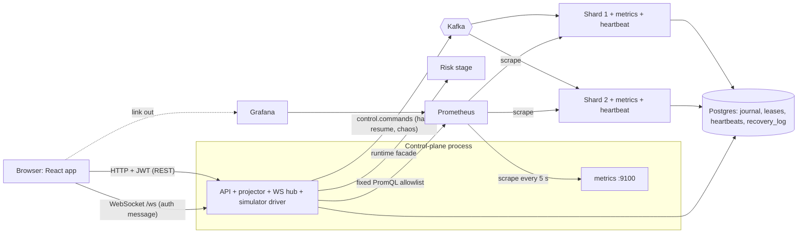

# Week 11: React UI, Observability and the Demo

One-week working document. Put it in `docs/WEEK-11.md`. It covers the blueprint's UI (3.4, tiers 1 and 2) and "Week 11: observability" (without the optimization half, which is Week 12). Prompts for Claude Code are in `WEEK-11-PROMPTS.md`. Week 12 (load tests, optimization, deployment, documentation) is previewed at the end.

**Scope call (read once).** Your Week 9 doc deferred the React UI, and the blueprint puts it in Week 9. Week 10 was Kafka. So this week carries the UI plus the metrics that make Week 12's numbers possible, and it must end with the 3-minute demo script running from the browser. File, class and table names below are proposals: check them against the repo, `docs/RUNTIME-API.md` and the Week 9 OpenAPI file, and never invent a facade method or endpoint.

**The theme of this week.** Until now the backend has been proven only by tests and logs. The UI is not the product, it is the evidence: every page exists to make one guarantee visible. Observability is the same idea for performance: you cannot honestly claim a number in Week 12 that you did not measure this week. Four claims have to become visible and testable:

1. **A 202 is not a success.** The order entry shows Received, then Accepted, Resting, Filled or Rejected, driven by events, and never says "success" on a 202.
2. **The UI never computes money with floats and never trusts itself for permission.** Strings in, strings out, `bigint` for estimates; every control is also refused by the server.
3. **The live view heals itself.** After a gap, reconnect, epoch change or conflation the screen resyncs from REST and says so.
4. **Every performance claim has a metric behind it.** Throughput, latency percentiles, queue depth, consumer lag, event-loop lag, lease epochs and recovery time are scraped, charted and visible on one page.

**Rule for this week:** you hand-write the stream resync reducer (`stream-state.ts`) and the lifecycle derivation (`lifecycle.ts`). AI tools may help with everything else (section 9).

**Budget:** about 18 to 24 hours of agent-assisted work plus your two hand-written pieces and review. UI is roughly half of it. The cut order is fixed in section 5.

---

## 0. Status and carry-over

| # | Check | Done when |
|---|---|---|
| V1 | Week 10 is proven, not reported: SP1 (full suite in `inproc` and `kafka`), R7, R11, E1 green; `check:no-placeholders` green | Gate green: `npm ci`, build, lint, `check:boundaries`, `npm test`, `npm run test:integration`, `npm run test:flake` 20/20 |
| V2 | Week 10 overflow decided: Phase B (`orders.submitted`, R9, R10) and the E2 run either done or listed here with a date | Written in `PROGRESS.md`. If E2 is not done, it merges into Week 12's load tests (section 5) |
| V3 | Flake gate clean. Your last run failed 1 in 20 on a WebSocket timeout | Root cause fixed, 20/20 |
| V4 | The 99 tests that were not passing (481 of 580) are explained | Each is Docker-dependent, skipped on purpose, or fixed; none is a hidden failure |
| V5 | Re-read the Week 9 OpenAPI file, `ENDPOINT_ROLES`, and the WebSocket protocol (4.9). The UI is built against these exactly | Notes of anything the UI needs that is missing, listed in `docs/UI-GAPS.md` |
| V6 | `web/` exists as a workspace (shell from Week 1) or is created; it depends on `common` only | `check:boundaries` knows about it |
| V7 | Compose runs the full stack in `kafka` mode with the demo profile, seeded | Login works as each of the four demo roles |

If V1 to V4 are not green, fix them first. A UI built on a flaky backend produces flaky UI tests.

---

## 1. Goal and scope

**Goal:** a browser demo that proves the backend's guarantees in three minutes, plus metrics and dashboards that give Week 12 a measured baseline.

| In scope this week | Deferred |
|---|---|
| Tier 1 pages: P1 Login, P2 Trading, P3 Portfolio, P4 Order detail and audit trail | P8 Admin (use `seed-demo` and plain API calls), P9 Assistant |
| Tier 2 pages: P5 Risk console, P6 Reconciliation, P7 System dashboard | Editable per-account limits table (there is no limits model; P5 shows breaker config read-only) |
| Shared page-role table in `common`; route guards from it | OAuth, registration, password reset |
| `useSocket` hook with epoch/seq/conflation resync (hand-written reducer) | Server-side rendering, PWA, mobile layout, i18n |
| New `telemetry` package: metrics registry, metrics server, metric catalogue | OpenTelemetry tracing (stretch) |
| Metrics in API, control plane and shard processes | Optimization and profiling (Week 12) |
| Prometheus and Grafana in compose with provisioned datasource and dashboard | k6 and Kafka load tests (Week 12) |
| System endpoints: `/system/shards`, `/system/recovery`, `/system/metrics/summary`, `/system/verify-replay` | Alert rules, long-term storage |
| Market simulator (seeded, deterministic) and its start/stop endpoints | Multi-process simulator, replaying real data |
| Demo-only chaos controls (kill or freeze a shard) over `control.commands` | A chaos UI beyond two buttons |
| `/admin/demo/reset` (re-seed, not wipe) | A true data wipe (that is `docker compose down -v`) |
| Playwright test of the demo script | Cross-browser matrix, visual regression |

---

## 2. Deliverables and definition of done

- [ ] V1 to V7 handled; `docs/UI-GAPS.md` written
- [ ] New dependencies pinned with `npm view` peer checks; boundary map, checker and lint updated with proofs (section 4.12)
- [ ] `common`: `PAGE_ROLES`, new zod schemas for the new endpoints, `ENDPOINT_ROLES` entries; ZS tests
- [ ] Migrations 017 and 018 and tests
- [ ] `telemetry` package: registry helpers, metrics server, label rules; TL tests
- [ ] Metrics wired in API, control plane and shard; heartbeat writer; recovery log
- [ ] System endpoints, simulator, chaos, demo reset, OpenAPI entries; OC1 and OC2 still green
- [ ] Prometheus config, Grafana provisioning and one dashboard JSON; GD tests
- [ ] `web`: client, auth, guards, `useSocket`, pages P1 to P7; UZ, UG, US, UL, UF, UA, UP tests
- [ ] Playwright DEMO1 to DEMO5 pass against the compose stack
- [ ] All tests in section 8 exist with their IDs in the titles and pass; test-ID table in `PROGRESS.md`; flake gate 20/20
- [ ] Mutation table (section 8.11), decisions, README limitations, `PROGRESS.md` updated
- [ ] You can run the demo script from memory and explain each page's claim in one sentence

**Definition of done:** with the stack running in the demo profile, a reviewer can log in with one click as each role; watch the simulator move the book; place an order and watch Received to Accepted to Filled; place one that is rejected and read the account snapshot behind the decision; halt a symbol as the risk officer and see the incident clock; kill a shard and see it recover on the System page while the invariants stay green; upload a statement and resolve a break with a reason; and open Grafana to see the same run as charts. Every page also refuses the wrong role, because the server does.

---

## 3. Technologies and tech stack (this week only)

Run `npm view <pkg> version peerDependencies` for every new package, pin exact, and record in `docs/versions.md`. Do not install anything else.

| Package | Used by | Why | Check |
|---|---|---|---|
| react 19.2.x, react-dom | web | UI | Already in the matrix |
| react-router 7.x | web | Routing, guards | Already in the matrix |
| @tanstack/react-query 5.x | web | REST cache, polling | Already in the matrix |
| vite 8.x, @vitejs/plugin-react 6.x | web | Build, dev proxy | Needs Node 20.19+ or 22.12+; fine on 24 |
| vitest 4.1.x (same version as backend) | web | Unit tests | jsdom or happy-dom environment, pick one and pin it |
| @testing-library/react, @testing-library/user-event, @testing-library/jest-dom | web tests | Component tests | Peer range must include React 19 |
| @playwright/test | e2e | Demo script test | Pin exact; browsers installed by Playwright's own command on your machine, not in CI images you do not control |
| prom-client | telemetry | Metrics | Already used by api; now also shard and runtime |
| prom/prometheus v3.x, grafana/grafana 13.1.x | compose | Scrape and charts | Exact tags that you pulled; no `latest` |

**Not used:** Redux or any state library beyond TanStack Query, a component library, a chart library (P7 uses hand-written SVG sparklines and links to Grafana for real charts), Redis, OpenTelemetry, Storybook, a CSS framework. Styling is plain CSS (CSS modules are built into Vite).

**Where impure APIs may appear:** `web` (DOM, fetch, WebSocket, timers), `telemetry` (`node:http`, `perf_hooks`), `api`, `runtime`, `shard`, `simulator` driver. `common` stays browser-safe; `engine-core` and the cores stay pure.

---

## 4. Architecture

### 4.1 Where the code goes

```
packages/common/src/api/
  roles.ts            // + PAGE_ROLES (page route -> roles, read-only roles); ENDPOINT_ROLES gains the new system routes
  schemas.ts          // + ShardsResponse, RecoveryResponse, MetricsSummary, VerifyReplayBody/Response, SimulatorBody/Status, ChaosBody
packages/telemetry/                   // NEW workspace (decision); depends on prom-client, node:http
  src/registry.ts     // createRegistry(processName), collectDefaultMetrics, helpers counter()/gauge()/histogram() that enforce label rules
  src/catalogue.ts    // the metric catalogue: name, type, help, allowed labels, buckets (single source for code, dashboard check and docs)
  src/server.ts       // startMetricsServer(registry, port): GET /metrics and GET /healthz only
  src/eventloop.ts    // event-loop delay sampler (perf_hooks.monitorEventLoopDelay) feeding gauges
packages/journal/migrations/017_shard_heartbeats.sql, 018_recovery_log.sql
packages/journal/src/heartbeats.ts, recovery-log.ts
packages/shard/src/heartbeat.ts       // writes shard_heartbeats every HEARTBEAT_MS (injected scheduler), unfenced upsert
packages/shard/src/metrics.ts         // wires runner/host events to the catalogue
packages/shard/src/chaos.ts           // demo-only: KILL and FREEZE handlers for control.commands
packages/runtime/src/metrics.ts       // control-plane metrics (projector lag, consumer lag, breaker state, invariants)
packages/simulator/
  src/prng.ts         // mulberry32(seed): pure
  src/flow-model.ts   // FlowModel: next orders for a tick, pure and deterministic
  src/driver.ts       // SimulatorDriver: injected scheduler, SubmitPort, backoff on 503
packages/api/src/routes/system.ts     // + shards, recovery, metrics/summary, verify-replay, simulator, chaos
packages/api/src/system/prom-queries.ts  // the fixed PromQL allowlist (no user-supplied query text)
packages/api/src/routes/admin.ts      // + demo reset (demo profile only)
ops/prometheus/prometheus.yml
ops/grafana/provisioning/datasources/prometheus.yml, dashboards/dashboards.yml
ops/grafana/dashboards/matchledger-overview.json
web/
  index.html, vite.config.ts          // dev proxy: /api and /ws to the API; no CORS needed
  src/main.tsx, router.tsx, App.tsx
  src/api/client.ts   // fetch wrapper: bearer header, problem+json parsing, one refresh retry on 401
  src/api/queries.ts, keys.ts         // TanStack hooks per endpoint
  src/auth/AuthProvider.tsx, token-store.ts, guards.tsx
  src/ws/useSocket.ts, stream-state.ts   // stream-state.ts is the pure reducer   [hand-write]
  src/lib/lifecycle.ts                   // deriveLifecycle(order) -> strip steps [hand-write]
  src/lib/money.ts (re-exports common), format.ts, estimate.ts, depth.ts
  src/pages/Login.tsx, Trade.tsx, Portfolio.tsx, OrderDetail.tsx, Risk.tsx, Recon.tsx, ReconBreak.tsx, System.tsx
  src/components/BookLadder.tsx, TradesTape.tsx, OrderEntry.tsx, OpenOrders.tsx, LifecycleStrip.tsx,
                 BreakerBadge.tsx, ConnectionIndicator.tsx, DataTable.tsx, Sparkline.tsx, Banner.tsx
  src/styles/*.css
  test/*.test.ts(x)   e2e/demo.spec.ts
scripts/check-dashboard-metrics.mjs, scripts/seed-demo.mjs (extended)
```

### 4.2 Request pipeline and what talks to what



Rules baked into the picture:

1. **The browser talks only to the API.** It never sees Kafka, Postgres, Prometheus or the shard processes. Grafana is a link, not a dependency.
2. **The server decides every permission.** The page-role table only decides what to show; the endpoint role table (unchanged rules from Week 9) decides what is allowed.
3. **Metrics never leave on the public port.** Each process exposes `/metrics` and `/healthz` on its own metrics port, restricted by network, no auth.
4. **P7 polls; it does not subscribe.** `/system/shards`, `/system/metrics/summary` and `/system/invariants` are refetched every 2 to 5 seconds by TanStack Query. No new WebSocket topic.
5. **Chaos goes through the same ordered channel as halt and resume** (`control.commands`), handled inside the shard process, so no Docker socket is mounted anywhere.
6. **The UI is eventually consistent by design.** It shows pending states until an outcome event or a refetch confirms.

### 4.3 Schema (migrations 017 and 018; adapt names to your codec, keep the semantics)

```sql
-- 017_shard_heartbeats.sql  (observational; plain upsert, NOT fenced: a zombie's heartbeat must not matter)
CREATE TABLE shard_heartbeats (
  instance_id text NOT NULL,
  lease_id text NOT NULL,                              -- 'shard-<partition>'
  ts timestamptz NOT NULL DEFAULT now(),
  queue_depth integer NOT NULL CHECK (queue_depth >= 0),
  last_seq_json jsonb NOT NULL,                        -- { "<symbol>": <seq> }
  loop_p99_ms numeric NOT NULL,
  rss_bytes bigint NOT NULL,
  PRIMARY KEY (instance_id, lease_id));

-- 018_recovery_log.sql
CREATE TABLE recovery_log (
  id bigint GENERATED ALWAYS AS IDENTITY PRIMARY KEY,
  stream_id text NOT NULL,
  kind text NOT NULL CHECK (kind IN ('SHARD','RISK_PARTITION','CONTROL_PLANE')),
  instance_id text NOT NULL,
  started_at timestamptz NOT NULL,
  duration_ms integer NOT NULL CHECK (duration_ms >= 0),
  snapshot_seq bigint,                                 -- null when recovery replayed from the start
  tail_records integer NOT NULL CHECK (tail_records >= 0));
CREATE INDEX recovery_log_recent ON recovery_log (kind, started_at DESC);
```

No change to `journal`, `shard_leases`, `consumer_offsets` or any projection table. `/system/shards` joins `shard_leases` (owner, epoch), `shard_heartbeats` (queue depth, loop delay, last seq), `snapshots` (latest `last_seq` per stream) and the journal (max seq per stream).

### 4.4 Metric catalogue (single source: `telemetry/src/catalogue.ts`)

Prefix `ml_`. Default process metrics from `collectDefaultMetrics` stay (they include the event-loop lag percentiles, GC and memory; confirm the exact names with a scrape on Day 4).

| Metric | Type | Labels | Where | Meaning |
|---|---|---|---|---|
| `ml_shard_commands_total` | counter | `partition`, `type` | shard | Commands journaled and applied |
| `ml_shard_batch_size` | histogram | `partition` | shard | Commands per batch |
| `ml_shard_journal_append_seconds` | histogram | `partition` | shard | Fenced append latency |
| `ml_shard_apply_seconds` | histogram | `partition` | shard | Engine apply time per batch |
| `ml_shard_publish_seconds` | histogram | `partition` | shard | Kafka transaction time per batch |
| `ml_shard_queue_depth` | gauge | `partition` | shard | Runner queue size |
| `ml_shard_queue_full_total` | counter | `partition` | shard | `FULL` backpressure events |
| `ml_shard_lease_epoch` | gauge | `partition` | shard | Epoch held |
| `ml_shard_ownership_changes_total` | counter | `partition`, `kind` (`assign`,`revoke`,`lost`) | shard | Lifecycle events |
| `ml_shard_last_seq` | gauge | `symbol` | shard | Last journaled seq |
| `ml_recovery_seconds` | gauge | `kind` | all | Duration of the last recovery |
| `ml_recovery_tail_records` | gauge | `kind` | all | Tail length of the last recovery |
| `ml_order_lifecycle_seconds` | histogram | `stage` (`accepted`,`resting_or_filled`,`terminal`) | control plane | Stamped-time delta from `received_ts` to the stage event (ms resolution; one host, one clock) |
| `ml_risk_decisions_total` | counter | `result`, `reason` | control plane | Accepted or rejected with a bounded reason enum |
| `ml_consumer_lag` | gauge | `topic`, `partition` | control plane | End offset minus stored next_offset, polled every 5 s |
| `ml_projector_lag_seq` | gauge | `stream_kind` | control plane | Max journal seq minus checkpoint |
| `ml_ws_connections` | gauge | none | api | Open sockets |
| `ml_ws_conflations_total` / `ml_ws_slow_closes_total` | counter | `topic` / none | api | Slow-client policy events |
| `ml_breaker_state` | gauge | `symbol` | control plane | 0 closed, 1 half-open, 2 open |
| `ml_dedupe_set_size` | gauge | `partition` | control plane | Risk dedupe set sizes |
| `ml_invariant_ok` | gauge | `check` | control plane | 1 pass, 0 fail, updated by the invariants job |
| `ml_simulator_orders_total` | counter | `outcome` | api | Sent, backed off |

**Label rules (enforced by `telemetry` helpers and test TL2):** allowed label values are bounded: partition (4), symbol (a handful), type, reason, stage, kind, topic, check, outcome, HTTP route template. Forbidden: account id, order id, client order id, user id, raw URL path, error message text. A helper that is given a forbidden label name throws at startup.

**Buckets (seconds):** latency histograms `[0.0005, 0.001, 0.0025, 0.005, 0.01, 0.025, 0.05, 0.1, 0.25, 0.5, 1, 2.5]`; apply time `[0.00001, 0.00005, 0.0001, 0.0005, 0.001, 0.005, 0.01, 0.05]`; batch size `[1, 2, 5, 10, 25, 50, 100, 250]`.

**Fixed PromQL allowlist** in `prom-queries.ts` (the only queries the API ever sends; the endpoint takes no query text from the client): total command rate, p50/p95/p99 of `ml_order_lifecycle_seconds` for the `terminal` stage over 1 minute, max `ml_shard_queue_depth`, max `ml_consumer_lag`, max event-loop lag p99, and per-shard command rate. Each is a named constant with a test.

### 4.5 New endpoints (add to `ENDPOINT_ROLES` and `openapi.yaml`; OC1 must stay green)

| Method and path | Role | Body / response | Notes |
|---|---|---|---|
| `GET /system/shards` | ADMIN | `{ shards: [{ leaseId, owner, epoch, instanceId, heartbeatAgeMs, stale, queueDepth, loopP99Ms, streams: [{ streamId, lastSeq, lastSnapshotSeq }] }] }` | `stale` when heartbeat older than 3 intervals |
| `GET /system/recovery` | ADMIN | `{ recent: [{ streamId, kind, durationMs, snapshotSeq, tailRecords, startedAt }] }` | last 20 |
| `GET /system/metrics/summary` | ADMIN | `{ available, windowSeconds, commandsPerSec, latencyMs: {p50,p95,p99}, queueDepthMax, consumerLagMax, eventLoopP99Ms, byShard: [{ leaseId, commandsPerSec }] }` | Prometheus unreachable: `available: false`, other fields null, still 200 |
| `POST /system/verify-replay` | ADMIN | `{ streamId }` to `{ streamId, upToSeq, equal, checksum }` | Replays the journal into a scratch engine up to the latest snapshot's seq and compares canonical checksums. No effect on live state |
| `GET /system/simulator` | ADMIN | `{ running, ratePerSec, symbols, seed, sent, backedOff }` | |
| `POST /system/simulator/start`, `/stop` | ADMIN | start body `{ ratePerSec, symbols, seed?, scenario: 'steady' \| 'breaker-demo' }` | Demo profile only; 404 otherwise; rate capped by config |
| `POST /system/chaos/kill-shard`, `/freeze-shard` | ADMIN | `{ shardId }`, freeze also `{ ms }` | Demo profile only; 404 otherwise; 202. System controls are not trading data, so ADMIN may write here |
| `POST /admin/demo/reset` | ADMIN | none | Demo profile only; stops the simulator, cancels the simulator accounts' open orders, re-seeds deposits and reference prices. Does not touch journals |

`GET /system/invariants` and `GET /system/health` already exist from Week 9; health gains the metrics port status.

### 4.6 The simulator

Pure model, impure driver.

- **PRNG:** `mulberry32(seed)`; no `Math.random`, no clock inside the model.
- **FlowModel (pure):** per symbol, a random-walk mid price in integer ticks (bounded by the instrument's band); market makers post limit GTC orders at mid plus or minus 1 to 5 ticks and cancel and replace some of them; takers send IOC orders that cross the spread, sized in lots with a geometric distribution. `scenario: 'breaker-demo'` adds a periodic large aggressive sweep so volatility trips the breaker for the demo. Every generated order is on the tick grid, a multiple of the lot size, and inside the max bounds.
- **SimulatorDriver:** an injected scheduler pulls `ratePerSec / ticksPerSec` orders per tick and calls a `SubmitPort` (the same internal service `POST /orders` uses, not HTTP, so there is one code path and the same 202-after-journal rule). On `FULL` or 503 it backs off and counts `backedOff`; it never queues without bound. Accounts: a configurable set of seeded simulator accounts holding both cash and shares, so sells are possible.
- **Demo-only:** the module is loaded only when `PROFILE=demo`.

### 4.7 Chaos controls

`POST /system/chaos/kill-shard { shardId }` publishes `Chaos{ action: 'KILL', target: shardId }` to `control.commands`. The shard host with that `SHARD_ID` (demo profile only) logs and calls `process.exit(137)`. The supervisor restarts it; its recovery appears in `recovery_log`. `freeze-shard { shardId, ms }` publishes `Chaos{ action: 'FREEZE', ms }`; the host blocks its event loop for `ms` (the Week 10 loop-blocking hook), the consumer leaves the group, the partition moves, and when the loop resumes the old writer is fenced and exits (Week 10 Scenario 4). Messages with `Chaos` are ignored with an error log if the shard's profile is not `demo`, and the API refuses the endpoints outside `demo`.

### 4.8 Pages: what each shows, from where, and what it proves

| Page | Route | Data (REST / WS topic) | Proves |
|---|---|---|---|
| P1 Login | `/login` | `POST /auth/login`; demo role buttons call the same endpoint with seeded credentials | RBAC is real; nav is by role but the server enforces |
| P2 Trading | `/trade/:symbol` | `GET /instruments`, book and trades snapshots, `GET /orders`; WS `book.{s}`, `trades.{s}`, `breaker`, `user.orders`, `user.account` | Price-time priority, async lifecycle, reservation estimate, breaker state |
| P3 Portfolio | `/portfolio` | `GET /accounts/{id}/balances`, `/positions`, `/pnl`, `/reservations`, `/ledger` (tier-2 add-on); WS `user.account` | Reservation model, double-entry ledger, available vs held |
| P4 Order detail | `/orders/:id` | `GET /orders/{id}`, `/orders/{id}/events`; WS `user.orders` | Event sourcing; a rejection with its account snapshot and a plain-English sentence |
| P5 Risk console | `/risk` | `GET /risk/breakers`, `/risk/rejections`; `POST /risk/symbols/{s}/halt`, `/resume`; WS `risk.rejections`, `breaker` | Breaker state machine, halt policy, incident clock |
| P6 Reconciliation | `/ops/recon`, `/ops/recon/breaks/:id` | `POST /recon/runs` (multipart), `GET /recon/runs`, `/breaks`, `/breaks/{id}`, `/audit`; `POST .../status`, `/resolve` | Break detection, workflow, audit, idempotent re-upload |
| P7 System | `/system` | `GET /system/shards`, `/metrics/summary`, `/invariants`, `/recovery`, `/simulator`; `POST` simulator, chaos, verify-replay | Measured performance, fencing epochs, invariants, crash recovery |

Page-role table (`PAGE_ROLES` in `common`, derived from the endpoint roles; the server still enforces):

| Page | Visible to | Writes allowed to |
|---|---|---|
| P1 | everyone | n/a |
| P2 | TRADER, ADMIN | TRADER (ADMIN read-only) |
| P3 | TRADER, RISK, OPS, ADMIN | none (RISK, OPS, ADMIN pick an account first) |
| P4 | TRADER (own), RISK, OPS, ADMIN | none |
| P5 | RISK, ADMIN | RISK (halt, resume) |
| P6 | OPS, ADMIN | OPS (upload, status, resolve) |
| P7 | ADMIN | ADMIN (demo-only controls) |

### 4.9 Live data: `useSocket` and the resync reducer (you hand-write `stream-state.ts`)

One hook owns one WebSocket. Per topic it keeps `StreamState = { epoch, seq, status: 'idle' | 'syncing' | 'live' | 'stale', snapshot, pending }`. The reducer is pure: `reduce(state, event) -> { state, effects }` where `effects` may contain `REFETCH_SNAPSHOT`.

Rules (these are the Week 9 resync rules, implemented exactly):

1. On socket open: send `{op:'auth', token}`; on `auth.ok`, subscribe to wanted topics. No token in the URL.
2. On subscribe the server sends a snapshot message with its seq; the reducer sets `status = 'live'` and stores epoch and seq.
3. A delta with `epoch` different from the stored epoch: effect `REFETCH_SNAPSHOT`, status `syncing`.
4. A snapshot with `conflated: true`: replace state (do not merge), show the "conflated" badge.
5. For `user.*`, `breaker`, `risk.rejections`, `system`: `seq > last + 1` means a gap: `REFETCH_SNAPSHOT`.
6. For `book.*`: seq is the durable engine seq, monotonic but not necessarily contiguous, so a gap alone does not resync. Apply only deltas with a seq higher than the snapshot's; ignore lower or equal.
7. On disconnect: status `stale`, reconnect with exponential backoff and jitter (capped), and on reconnect refetch all snapshots.
8. Close code 4401: clear the token, go to login. Close code 1013: reconnect and resync. Close code 1001: reconnect.
9. The reducer never reads a clock; the backoff timer lives in the hook and is injected in tests.

### 4.10 Order lifecycle strip (you hand-write `lifecycle.ts`)

`deriveLifecycle(order, now) -> { steps, current, pending, terminal }`. Steps: Received (202), Accepted, Resting or Partially filled, then Filled, Cancelled or Rejected (with reason). Inputs are the REST status (`RECEIVED`, `ACCEPTED`, `RESTING`, `PARTIALLY_FILLED`, `FILLED`, `CANCEL_REQUESTED`, `CANCELLED`, `REJECTED`) plus filled quantity. Rules: a 202 alone shows Received with a spinner and the text "durably received, not yet accepted"; nothing is ever labelled "success" until a terminal fill; a `FILLED` beats a recorded cancel request (same precedence as the server's `deriveOrderStatus`); `CANCEL_REQUESTED` shows "cancel requested, waiting for the engine"; if no outcome arrives within `PENDING_HINT_MS` (default 10 s) show "still processing, open order detail" without changing the status. It is pure and total.

### 4.11 Money, forms and the estimate

- All money and quantity strings come from the API; `parseDecimalToMinor` and `formatMinor` from `common` are the only converters. The UI never uses `parseFloat`, `Number(...)` on money, or JSON numbers for money.
- Order form: side, type (LIMIT or MARKET), time in force (GTC or IOC), price, quantity. Inline validation mirrors the server rules: tick, lot, maximums, decimals (more than the instrument's decimals is an error), MARKET requires IOC and no price, quantity as a string.
- Reservation estimate = `price x quantity` as `bigint`, labelled "estimate". For MARKET orders no estimate is shown (the cap is computed by the risk stage); the text says the cap appears after acceptance.
- Submit: the button is disabled while a submit is in flight; `clientOrderId` is generated per attempt and reused if the user retries after a network error (so the server dedupes). A 409 shows "this id was used with different details". A 429 shows the `Retry-After` time. A 503 says nothing was submitted and offers retry. A 202 adds the order to the lifecycle strip.

### 4.12 Dependency map and lint

| Package | May depend on | Must not |
|---|---|---|
| `web` | `common` (browser-safe), React, React Router, TanStack Query | any backend package, `node:*`, `pg`, Kafka |
| `telemetry` (new, decision) | `prom-client`, `node:http`, `node:perf_hooks` | `engine-core` runtime imports, `risk` cores, `web` |
| `shard` | existing plus `telemetry`, `journal` (heartbeats, recovery log) | `api`, `web` |
| `api` | existing plus `telemetry`, `simulator` | `shard` internals |
| `simulator` | `common` (model and port types); the driver is wired by `api` | Kafka client, `api` internals |
| `runtime` | existing plus `telemetry` | `web` |

Update `scripts/check-boundaries.mjs` and `docs/BLUEPRINT.md` 4.4 in the same commit and prove the checker fails on a seeded violation, including a `web` file importing `node:fs`. ESLint for `web`: a rule banning `parseFloat`, `Number(` applied to anything named `price`, `amount`, `quantity`, `cash` (a no-restricted-syntax pattern is enough), and a ban on `localStorage` for the token (see decision 4). `engine-core`, the shard run loop, the risk core and the ledger core are unchanged.

---

## 5. How to build it (day by day) and cut lines

Write the failing test first each day. Tier 1 UI is days 1 to 3, backend observability days 4 to 5, tier 2 and the demo days 6 to 7.

| Day | Hours | Do | Done when |
|---|---|---|---|
| 0/1 | 3 to 4 | V1 to V7, deps, `web` scaffold, `PAGE_ROLES`, API client, auth, guards, money and format helpers, you hand-write `stream-state.ts`, `useSocket` | UZ, UG, UA, US green |
| 2 | 3 to 4 | P1 Login and demo buttons; P2 Trading: ladder, tape, order entry, open orders, banner, connection indicator; you hand-write `lifecycle.ts` | UL, UF, UP1 to UP6 green |
| 3 | 3 | P3 Portfolio, P4 Order detail with audit timeline and rejection explanation | UP7 to UP10 green |
| split point 1 | | | Tier 1 complete and demoable against the stack |
| 4 | 3 to 4 | `telemetry`, metrics in API, control plane and shard, heartbeat writer, recovery log, Prometheus and Grafana in compose, dashboard JSON | TL, HT, RG, GD green; targets up in Prometheus |
| 5 | 3 to 4 | System endpoints, simulator, chaos, demo reset, OpenAPI entries; P7 | SY, SM, CH, MS green; OC1 and OC2 green |
| split point 2 | | | The numbers exist and are visible |
| 6 | 3 | P5 Risk console, P6 Reconciliation, polish, seed data so no page loads empty | UP11 to UP16 green |
| 7 | 3 | Playwright DEMO1 to DEMO5, mutations, docs, decisions, flake gate, record the demo once for yourself | Everything green, CI green |

**Cut lines, in this order, decided now:** (1) P6 break-detail side-by-side view shrinks to a table row plus the resolve form, (2) P5 keeps the rejections feed and the breaker table with halt and resume, and drops everything else, (3) the E2 re-run with dashboards merges into Week 12's load tests, (4) the Playwright test shrinks to DEMO1 and DEMO2 plus a written manual checklist for the rest. **Never cut:** tier 1 pages, the resync reducer tests, the metrics catalogue and its label rules, P7's shard table and invariants panel, the chaos endpoints' demo-only gating.

**Stuck protocol:** if a UI bug costs more than 60 minutes, reproduce it as a failing reducer or component test with a fake API and a fake socket first. If a metric looks wrong, scrape the process directly (`/metrics`), compare with the log line for the same event, and only then touch Prometheus or Grafana.

---

## 6. Worked scenarios (use as fixtures)

**Scenario 1: the happy path in the browser (UP, DEMO1).** Log in as the demo trader. The simulator is running. Select ACME; the ladder shows ten levels per side with cumulative depth bars and the spread. Enter BUY LIMIT GTC, quantity 10, price 105.00. The estimate shows 1,050.00 and the cash that would remain available. Press submit: the strip shows Received (202) with a spinner, then Accepted, then Resting; when a taker crosses, Partially filled then Filled. At no point does the page say "success" before the fill.

**Scenario 2: rejection is an event (UP, DEMO2).** Available cash 98.00; enter BUY 1 @ 101.25. The response is 202, the strip shows Received, then Rejected with reason INSUFFICIENT_BALANCE. Open order detail: the timeline shows the OrderRejected event, the snapshot (available 98.00, required 101.25) and the sentence "Rejected: needed 101.25, available 98.00".

**Scenario 3: the socket heals itself (US).** A client is live on `book.ACME` at epoch E1 seq 500. (a) A delta arrives with epoch E2: the reducer emits a refetch and shows syncing, then live with the new snapshot. (b) The server sends a snapshot with `conflated: true`: state replaced, badge shown. (c) A `user.orders` delta jumps from seq 12 to 15: refetch. (d) A `book.ACME` delta jumps from 500 to 507: applied, no refetch, because book seq is not contiguous. (e) The socket closes with 1013: stale indicator, reconnect with backoff, refetch all.

**Scenario 4: halt and the incident clock (UP, DEMO3).** The risk officer halts ACME with the reason "demo". The Risk console shows OPEN, the trip reason, the incident clock against `maxHaltDuration` and the number of resting orders and held funds. The trader's page shows the banner; the trader cancels a resting order and Portfolio shows held cash drop. Resume returns the state to HALF_OPEN, never straight to CLOSED.

**Scenario 5: kill a shard and watch it recover (SY, CH, DEMO4).** On the System page, shard table shows two shards with epochs. Press Kill on shard 2. Within a few seconds the row goes stale, the other shard's row shows the extra partitions with a higher epoch for them, then shard 2 returns, a new row appears in recovery with duration and tail length, and the invariants panel stays green. Grafana's epoch panel shows the step.

**Scenario 6: reconciliation (UP, DEMO5).** The ops user uploads the seeded statement. Four breaks appear. Uploading the same file again shows "already processed, no new breaks". Resolve one with a reason; the audit trail shows the change; the trader's balance reflects the adjustment after the projector runs.

**Scenario 7: Prometheus is down (MS).** Stop Prometheus. `GET /system/metrics/summary` returns 200 with `available: false`. P7 shows "metrics unavailable" in the summary card and keeps the shard table and invariants working.

**Scenario 8: a stale heartbeat (HT).** Block a shard's loop for longer than three heartbeat intervals. `GET /system/shards` reports it `stale: true` with a growing `heartbeatAgeMs`, while the lease row (epoch, owner) is unchanged until the group moves the partition.

---

## 7. Edge cases to handle

**Auth and session**
- Token expired during use: one automatic refresh through `POST /auth/refresh`; if that fails (session too old), clear the token and go to login with the original route remembered
- Two tabs: both hold their own socket; logging out in one does not crash the other (its next 401 sends it to login)
- Token storage: kept in `sessionStorage` so a reload keeps the demo alive (decision 4); never in a URL, a cookie readable by scripts is not used; cleared on logout and on 4401
- Wrong role opening a URL directly: the guard shows a "not available for your role" page; the server's 403 or 404 is still handled by the API client if the guard is bypassed
- Demo buttons exist only when the server reports the demo profile (a field on a public config or health response, verify it exists; otherwise a build-time flag)

**Orders and forms**
- Double click on submit: second click is ignored while in flight; the same `clientOrderId` is reused on a retry after a network error, a new one only after the user edits the form
- Network error after the request left: the UI cannot know if it arrived; it shows "unknown, retrying with the same id" and the server's dedupe makes the retry safe
- Quantity or price with too many decimals, negative, empty, `1e3`, huge: inline error, never sent
- MARKET with a price typed: price field disabled and cleared
- 202 received but no event for `PENDING_HINT_MS`: hint text appears; the status does not change
- Cancel of a terminal order: server returns 409; the UI shows "already finished" and refetches
- Cancel pressed twice: second is disabled while `CANCEL_REQUESTED`
- Order for a halted symbol: accepted with 202, then rejected SYMBOL_HALTED; the lifecycle strip shows the reason (the banner explains why)

**Live data**
- Opening a page before the socket is authenticated: subscriptions queue until `auth.ok`
- Subscription forbidden for the role: error message from the server; the UI shows the panel as "not available" and keeps the rest
- Many messages in a burst: state updates are batched per animation frame; rendering never blocks the reducer
- The book from a snapshot with fewer than ten levels: shows empty rows, never undefined
- Cumulative depth uses `bigint`; bar widths use a ratio of two bigints converted only for CSS
- The tab is hidden for a long time: on becoming visible, resync if the last message is older than a threshold
- Server restarts (new epoch): everything refetches; the banner says "reconnected, data refreshed"

**Pages**
- Empty account: balances 0.00, positions empty, never `null` money; missing mark price shows an em dash, never 0 (matches the server's null unrealized P&L)
- RISK, OPS and ADMIN on Portfolio must pick an account first
- P4 for an order that is not journaled: 404 page, not a crash
- P6 upload: wrong type or two files is a 400 shown inline; over the limit is a 413 with the limit; same bytes again shows the existing run
- P6 resolve without a reason is blocked client-side and refused by the server anyway
- P7 polling continues only while the page is visible; invariants "run now" shows pass or fail with the offending rows, not just a colour
- Long tables are paginated by the API cursor; no client-side sort of an unpaginated list

**Metrics and observability**
- A metric label with a high-cardinality value must never be created (TL2)
- Two processes expose the same metric names: Prometheus distinguishes them by the `instance` and `job` labels from the scrape config
- A shard restarts: counters reset; dashboards use `rate()` so resets are handled
- Event-loop delay sampler and heartbeat run on the same loop they measure; they must be cheap (the sampler uses the built-in histogram)
- `/system/metrics/summary` never forwards client input into PromQL
- Lifecycle latency uses stamped timestamps in milliseconds from one host; on multiple hosts clock skew would make it meaningless, and the README says so
- Grafana dashboard JSON references only metrics that exist in the catalogue (GD1)

**Process-level**
- Chaos and simulator endpoints return 404 outside `PROFILE=demo`, including when called with an ADMIN token
- `/admin/demo/reset` while the simulator runs: stops it first; idempotent
- Metrics server failing to bind: the process logs and exits (fail-stop), it does not run blind
- Playwright runs against the compose stack with a seeded database and a fixed simulator seed; it waits on UI conditions, never on fixed sleeps

---

## 8. Test cases to pass

All new; add the IDs to the blueprint tables. Every ID must appear in a real test title. Web unit and component tests run in the unit project (jsdom or happy-dom); API and Postgres tests in the integration project; Playwright DEMO tests in a separate `e2e` project run against the compose stack. Time and sockets are injected; no sleeps.

### 8.1 Shared contracts and boundaries

| # | Test | Expected |
|---|---|---|
| ZS6 | `PAGE_ROLES` | Every page route has visible-to and writable-to sets; writable is a subset of visible; consistent with `ENDPOINT_ROLES` for the endpoints the page calls |
| ZS7 | New zod schemas | Round trip the documented examples; reject unknown fields and negative numbers where not allowed |
| ZS8 | `ENDPOINT_ROLES` new entries | No duplicate keys; chaos and simulator routes marked demo-only |
| BD1 | Boundary checker | Fails on seeded violations: `web` importing `node:fs` or a backend package, `telemetry` importing a core, `simulator` importing Kafka |

### 8.2 Web library tests

| # | Test | Expected |
|---|---|---|
| UZ1 | Money format and parse round trip (fast-check) | Identity, no float, correct for 0, max safe, and instrument decimals |
| UZ2 | Display formatting | Thousand separators and decimals correct; negative P&L; null renders an em dash |
| UZ3 | Estimate = price x quantity as bigint | Exact for large values; MARKET returns no estimate |
| UZ4 | Cumulative depth | Correct for random books; bar ratio never exceeds 1 |
| UZ5 | ESLint rule | `parseFloat` or `Number()` on a money-named identifier fails lint (negative proof) |
| UG1 | Route guard | Each role sees exactly its pages from `PAGE_ROLES`; others get the not-available page |
| UG2 | Unauthenticated | Redirect to login, original route remembered |
| UG3 | Read-only roles | Write controls disabled or absent for ADMIN on P2 to P6 |
| UG4 | Nav items | Match the role; never rely on hiding for security (server tests cover refusal) |
| UA1 | API client | Adds bearer header; never puts the token in a URL |
| UA2 | 401 handling | One refresh retry, then logout and redirect |
| UA3 | problem+json | Parsed into a typed error with code, detail, request id, field errors |
| UA4 | 429 and 503 | `Retry-After` surfaced to the caller |

### 8.3 Stream reducer and `useSocket`

| # | Test | Expected |
|---|---|---|
| US1 | Auth then subscribe order | No subscribe before `auth.ok`; no token in the URL |
| US2 | Epoch change | Refetch effect, status syncing, then live |
| US3 | `conflated: true` snapshot | State replaced, badge flag set |
| US4 | Gap on `user.*`, `breaker`, `risk.rejections`, `system` | Refetch effect |
| US5 | `book.*` non-contiguous seq | Applied, no refetch; lower or equal seq ignored |
| US6 | Disconnect and reconnect | Stale, backoff with jitter (injected timer), refetch all on reconnect |
| US7 | Close codes 4401, 1013, 1001 | Logout, resync, reconnect respectively |
| US8 | Property: random message sequences with a model | Reducer state equals the model; never applies a lower seq; always eventually live after a refetch |
| US9 | Burst batching | N messages in one frame cause one render, same final state |

### 8.4 Lifecycle and forms

| # | Test | Expected |
|---|---|---|
| UL1 | Truth table of statuses to steps | Matches 4.10, including FILLED beating a cancel request |
| UL2 | 202 only | Received with spinner and the "not yet accepted" text, never "success" |
| UL3 | Pending hint after `PENDING_HINT_MS` | Hint appears, status unchanged |
| UL4 | Rejected | Reason shown, terminal, no spinner |
| UL5 | Partial then filled | Filled quantity shown against total |
| UL6 | Property: any permutation of status updates | Final strip equals the strip for the final status (order-independent) |
| UF1 | Validation matrix | Tick, lot, decimals, negative, zero, `1e3`, huge, MARKET with price, MARKET with GTC: right inline errors, nothing sent |
| UF2 | Double submit | One request while in flight |
| UF3 | Retry after network error | Same `clientOrderId`; changes after the form is edited |
| UF4 | 409, 429, 503 handling | Right messages; 503 says nothing was submitted |
| UF5 | Estimate label | Always labelled "estimate" |

### 8.5 Page tests (fake API, fake socket)

| # | Test | Expected |
|---|---|---|
| UP1 | Login with demo buttons | Each role logs in and lands on its home page |
| UP2 | Trade page loads | Ladder, tape, entry, open orders render from snapshots; empty states are not blank |
| UP3 | Live updates | Book delta changes the ladder; trade delta prepends to the tape |
| UP4 | Scenario 1 | Strip progresses Received, Accepted, Resting, Filled from events |
| UP5 | Breaker banner | Appears on OPEN and HALF_OPEN with reason and incident timer |
| UP6 | Connection indicator | Shows stale and conflated states |
| UP7 | Portfolio | Cash card, held-by-symbol with reason, positions, reservations; account picker for non-traders |
| UP8 | Null mark | Unrealized P&L shows an em dash |
| UP9 | Order detail timeline | Events in display order with seq, ts, type, payload |
| UP10 | Scenario 2 on detail | Snapshot and the sentence "Rejected: needed 101.25, available 98.00" |
| UP11 | Risk console | Breaker table with incident clock; rejections feed filters; halt requires a reason |
| UP12 | Halt and resume | Calls the right endpoint; resume goes to half-open in the UI after the server confirms |
| UP13 | Recon upload | Success shows the run; same file shows "already processed" |
| UP14 | Break detail and resolve | Reason required; audit trail renders; illegal transition shows the 409 message |
| UP15 | System page | Shard table with epochs and stale flag; invariants with pass/fail rows; summary card handles `available: false` |
| UP16 | Demo controls | Visible only in the demo profile |

### 8.6 Telemetry, heartbeats, recovery log, dashboards

| # | Test | Expected |
|---|---|---|
| TL1 | Registry helpers | Names have the `ml_` prefix and match the catalogue; unknown metric throws |
| TL2 | Label rules | A forbidden label name throws at startup; values outside the bounded set are rejected or bucketed |
| TL3 | Metrics server | Serves `/metrics` and `/healthz` only; 404 elsewhere; not bound to the public port |
| TL4 | Event-loop sampler | A forced block raises the p99 gauge |
| TL5 | Shard metrics wiring | A runner processing N commands increments `ml_shard_commands_total` by N per type and observes histograms |
| TL6 | Ownership counters and epoch gauge | Assign, revoke, lost increment the right kind; epoch gauge equals the lease epoch |
| HT1 | Heartbeat writer | Upserts every interval (injected scheduler), unfenced, survives a fenced journal |
| HT2 | `/system/shards` | Joins leases, heartbeats, snapshots and journal max seq correctly |
| HT3 | Stale detection | Older than 3 intervals is `stale` (Scenario 8) |
| RG1 | Recovery log | Each recovery writes one row with duration, snapshot seq and tail length |
| RG2 | `/system/recovery` | Last 20, newest first |
| RG3 | Recovery gauges | `ml_recovery_seconds` equals the logged duration |
| GD1 | `check-dashboard-metrics.mjs` | Every `ml_` metric in the Grafana JSON exists in the catalogue (negative proof with a seeded typo) |
| GD2 | Prometheus config | Parses; targets cover control plane and every shard service in compose |
| GD3 | Provisioning files | Datasource and dashboard provisioning parse; dashboard has the panels listed in 4.13 |

### 8.7 System endpoints, simulator, chaos

| # | Test | Expected |
|---|---|---|
| MS1 | `/system/metrics/summary` with a fake Prometheus | Maps the fixed queries to the response shape |
| MS2 | Prometheus unreachable | 200, `available: false` (Scenario 7) |
| MS3 | PromQL allowlist | No client input reaches a query; each query constant is covered by a test |
| MS4 | Role matrix | ADMIN only; other roles 403; extends RBM |
| SY1 | `/system/verify-replay` | Replays to the latest snapshot seq; `equal: true` on a healthy stream; a corrupted snapshot yields `equal: false` |
| SY2 | `/system/invariants` still green after recovery in `kafka` mode | Pass |
| SM1 | PRNG | Same seed, same sequence; different seed, different sequence |
| SM2 | FlowModel determinism | Same seed and config give identical orders for N ticks |
| SM3 | FlowModel validity (fast-check) | Every order on the tick grid, a lot multiple, within bounds and bands |
| SM4 | Driver rate | Injected scheduler: the right number of submits per tick |
| SM5 | Backoff | On FULL or 503 the driver backs off and counts; never queues unboundedly |
| SM6 | `breaker-demo` scenario | Against the engine in a test, volatility trips the breaker |
| SM7 | Start/stop endpoints | State transitions; 404 outside demo |
| SM8 | Simulator accounts | Cannot overdraw; rejections are asynchronous events as for any trader |
| CH1 | `kill-shard` | Publishes `Chaos KILL` to `control.commands`; the target host exits; others unaffected |
| CH2 | `freeze-shard` | Target blocks its loop for the requested time; fencing follows (Week 10 Scenario 4) |
| CH3 | Profile gating | API 404 and shard ignores the message outside demo |
| CH4 | Recovery after kill | A `recovery_log` row appears; invariants stay green |
| CH5 | `/admin/demo/reset` | Stops the simulator, cancels its open orders, re-seeds; journals untouched; idempotent |

### 8.8 End to end (Playwright against the compose stack)

| # | Test | Expected |
|---|---|---|
| DEMO1 | Login as trader, place an order | Received, Accepted, then Filled shown; no "success" before the fill |
| DEMO2 | Over-balance order | 202, Rejected, detail page shows the snapshot and sentence |
| DEMO3 | Risk officer halts a symbol | Banner on the trader view; cancel releases held funds |
| DEMO4 | Admin kills a shard | Shard row goes stale, then recovers; recovery row appears; invariants green |
| DEMO5 | Ops uploads a statement twice and resolves a break | Second upload shows no new breaks; audit trail records the resolution |

### 8.9 Determinism and flake gate

No `setTimeout` sleeps in unit tests; the reducer, backoff, heartbeat, simulator and polling use injected clocks and schedulers; the model client for US8 and the simulator use fixed seeds that are logged on failure. Playwright waits on UI conditions only. `npm run test:flake` covers unit and integration including `web`, `telemetry`, `simulator`, `api`: 20 of 20. The e2e project is run 3 times in a row locally before you call the week done.

### 8.10 Regression

Every earlier test passes unmodified: all Week 9 IDs (including OC1, OC2, RBM with the new routes added, MT1, E2E1, E2E2), all Week 10 IDs (including SP1, R7, R11), and every earlier week's suite.

### 8.11 Mutation checks (prove the tests have teeth)

Add to `tools/mutations-week11.json` and run `scripts/mutate.mjs`. A survivor means a test gap (add a test, not a production change):

1. Reducer ignores epoch change: US2.
2. Conflated snapshot merged as a delta: US3.
3. `book.*` seq gap forces a refetch (or user topics do not): US4, US5.
4. Lower seq delta applied: US5, US8.
5. Token placed in the WebSocket URL: US1, UA1.
6. 202 labelled "success": UL2, DEMO1.
7. `FILLED` loses to `CANCEL_REQUESTED`: UL1, UL6.
8. Money parsed with `Number`: UZ1, UZ5.
9. Estimate shown for MARKET orders: UZ3.
10. Retry generates a new `clientOrderId`: UF3.
11. Double submit allowed: UF2.
12. Route guard table drifts from `PAGE_ROLES`: UG1, ZS6.
13. Write controls shown to ADMIN on P2: UG3.
14. Metric helper accepts an `accountId` label: TL2.
15. Metrics server also serves another path: TL3.
16. Heartbeat is fenced (zombie suppresses its own staleness): HT1.
17. Stale threshold off by one: HT3.
18. Summary forwards client input into PromQL: MS3.
19. Prometheus failure returns 500: MS2.
20. Chaos endpoint active outside demo: CH3.
21. Simulator uses `Math.random`: SM2.
22. Simulator emits an off-tick price: SM3.
23. Dashboard references a metric that does not exist: GD1.
24. Demo reset wipes journals: CH5.
25. Placeholder tests (`it.todo`, `skip`) in `web`: NP1.

---

## 9. Rules for this week

- `engine-core`, the shard run loop, the risk core and the ledger core are unchanged. `git diff` on them must be empty. Facade additions only as recorded in `docs/RUNTIME-API.md`; API additions only as listed in 4.5.
- `web` depends on `common` only and runs in the browser: no `node:*`, no backend package.
- The UI never decides permission and never computes money with floating point. Every write is also refused server-side (RBM extended).
- A 202 is never shown as success.
- Metric labels are bounded. No account, order, user or raw path in any label.
- Chaos, simulator and demo reset exist only in the demo profile, and the shard checks too.
- The API never forwards client text into PromQL.
- Tokens never appear in URLs or logs.
- No placeholders: no `it.todo`, `it.skip`, TODO, "placeholder", "NOT IMPLEMENTED", constant-returning fakes or invented test names. `check:no-placeholders` covers `web` and the new packages.
- Test IDs are exact; never weaken or edit an existing test to make it pass.
- Every number in the docs comes from a run you can point to.
- Your own git identity commits everything; the agent never runs git write commands.
- AI tools this week. Allowed: everything except two pieces. Not allowed: `stream-state.ts` and `lifecycle.ts`. You defend those line by line.

---

## 10. Decisions to record in docs/decisions.md

Format: context, options, choice, trade-offs, how tested.

1. The UI is evidence, not the product: tiers, and what was cut (P8, P9, editable limits).
2. Plain CSS, no component or chart library; P7 uses sparklines and links to Grafana.
3. TanStack Query for REST, one `useSocket` hook, a pure reducer for resync; no Redux.
4. Token in `sessionStorage` (survives a reload for the demo; trade-off: readable by scripts on the page; mitigated by no third-party scripts and a strict content security policy in Week 12), not `localStorage`, not in URLs.
5. `PAGE_ROLES` in `common`, derived from `ENDPOINT_ROLES`, server still enforces.
6. MARKET orders show no estimate; the cap is decided by the risk stage.
7. Lifecycle strip precedence matches the server's `deriveOrderStatus`.
8. P7 polls; no new WebSocket topics.
9. New `telemetry` workspace; one metrics server per process; separate ports.
10. Metric catalogue as the single source; label rules; bucket choices.
11. Heartbeats in Postgres, unfenced, so P7's shard table does not depend on Prometheus; summary endpoint depends on Prometheus and degrades.
12. Fixed PromQL allowlist.
13. Lifecycle latency from stamped timestamps; valid on one host only.
14. Simulator is seeded and deterministic; runs in the API process in the demo profile through the same submit path.
15. Chaos over `control.commands`, handled in the shard; no Docker socket.
16. Demo reset re-seeds; it never wipes journals.
17. Playwright against the compose stack; why it waits on UI conditions.
18. What the UI still does not do: single API instance, no mobile layout, no i18n.

---

## 11. Dashboard and Prometheus configuration

**4.13 Grafana dashboard panels** (`matchledger-overview.json`, provisioned; GD3 checks the list):

| Panel | Query basis |
|---|---|
| Throughput, commands per second by shard | `rate(ml_shard_commands_total[1m])` summed by partition |
| Order lifecycle latency p50, p95, p99 | `histogram_quantile` over `ml_order_lifecycle_seconds_bucket`, terminal stage |
| Journal append latency p99 and apply time p99 | `ml_shard_journal_append_seconds`, `ml_shard_apply_seconds` |
| Queue depth and `FULL` rate | `ml_shard_queue_depth`, `rate(ml_shard_queue_full_total[1m])` |
| Consumer lag by partition | `ml_consumer_lag` |
| Event-loop lag p99 per process | the default-metrics percentile gauge (confirm name) |
| Lease epoch by partition (step graph) | `ml_shard_lease_epoch` |
| Ownership changes | `increase(ml_shard_ownership_changes_total[5m])` by kind |
| Breaker state per symbol | `ml_breaker_state` |
| Projector lag | `ml_projector_lag_seq` |
| WebSocket connections, conflations, slow closes | `ml_ws_*` |
| Invariants | `ml_invariant_ok` by check |
| Last recovery time and tail length | `ml_recovery_seconds`, `ml_recovery_tail_records` |

**Prometheus** (`ops/prometheus/prometheus.yml`): `scrape_interval: 5s`; jobs `control-plane` and `shard` with one target per compose service on its metrics port; no alert rules this week. **Compose:** pinned images; Prometheus config mounted read-only; Grafana provisioning and dashboard directories mounted read-only; Grafana anonymous viewer enabled only in the demo profile so the link-out from P7 works for a reviewer.

---

## 12. Interview prep for this week

Be able to answer from memory:

- Why does the order form never say "success" on a 202? Walk the strip for a rejected order and where the reason comes from.
- How does the UI stay correct after a reconnect, a conflated snapshot, a server restart? What is the epoch for, and why is a gap on `book.*` not a resync trigger?
- Why does the UI not do arithmetic on money? What does the reservation estimate use, and why is there none for MARKET orders?
- Why is hiding a menu item not security? Show the test that proves the server refuses what the UI hides.
- Why bounded metric labels? What breaks Prometheus if you put an order id in a label?
- Why do shard heartbeats live in Postgres and not only in Prometheus? What does P7 do when Prometheus is down?
- How do you measure order latency across processes honestly? What is wrong with stamped timestamps on two machines?
- What exactly does `verify-replay` compare, and what does a green result prove and not prove?
- How does a "kill shard" button work without access to Docker? What stops it from being used in production?
- What does the dashboard show during a failover, in order? (Epoch step, ownership counters, stale heartbeat, recovery row, lag spike and drain, invariants staying green.)
- What would you add for real users? (Mobile layout, SSO, CSP and cookie sessions, alert rules, multi-instance WS fan-out.)

**Whiteboard exercise (no notes):** draw the stream state machine (idle, syncing, live, stale) with the events that move between states, and the lifecycle strip for four orders: filled, partially filled then cancelled, rejected, and one whose outcome is unknown after a network error.

---

## 13. Common mistakes to avoid

- Showing success on a 202
- Computing balances or estimates with floats, or `Number()` on a money string
- Hiding controls and trusting that as permission
- Putting the token in a URL, a log line or `localStorage`
- Resyncing the book on every seq gap (it is not contiguous) or not resyncing user topics on a gap
- Merging a conflated snapshot as if it were a delta
- Rendering on every WebSocket message instead of batching per frame
- Metric labels with account, order or path values
- Letting a client-supplied string reach PromQL
- Fencing the heartbeat writer, or making P7 depend on Prometheus alone
- Leaving chaos or simulator reachable outside the demo profile
- Demo reset that wipes journals
- Dashboards that reference metrics that do not exist
- Playwright tests with fixed sleeps
- Building pages that prove nothing from the page table, or spending more than the week on polish
- Leaving `it.todo` or placeholder tests and reporting the week as done
- Touching a core or the shard loop to make the UI or metrics fit

---

## 14. Progress log (copy into PROGRESS.md each day)

```
Day N:
- Done:
- Failing / blocked:
- Test-ID table (ID, file, real+passing / failing / missing):
- Next failing test to write:
- Flaky tests seen (and root cause):
- Property-test seeds worth keeping:
- Which page or metric surprised me:
- Decisions made:
```

---

## 15. Week 12 preview: how the project ends fully running

What Week 11 must hand over: all seven pages working against the stack, the demo script passing in Playwright, a metrics catalogue and dashboard that show throughput, latency percentiles, queue depth, consumer lag, event-loop lag, epochs and recovery time, a System page that shows a shard being killed and recovering, and a README that states what is still single-instance.

| Week 12 task | Done when |
|---|---|
| k6 script against `POST /orders` (rate steps, p99 target) and a Kafka producer load test for order flow | Result tables in the README with environment and seed |
| E2 re-run with dashboards if it was deferred; keep the hypothesis and deviations | `docs/SCALING.md` final |
| Profile (`node --cpu-prof`, `--heap-prof`) and fix at least three hotspots, re-measuring after each change (E3) | Optimization table: change, metric before, after, hardware, p50/p95/p99 and event-loop lag |
| Deploy with Docker Compose on one small VM: reverse proxy serving the built `web` and proxying `/api` and `/ws`, strict CSP, demo profile on, Grafana viewer link | A stable public link; one-command start |
| README: architecture diagrams, how to run, benchmark tables, decision log, limitations, screenshots | A stranger can run it in one command |
| Demo video of the 3-minute script; resume bullets from measured numbers; rehearse the Q&A | Video recorded; bullets only use numbers from your own runs |

No buffer week remains, so the Week 12 cut order is fixed now: tier-2 UI polish first, then OpenTelemetry, then E3 down to exactly three optimizations. Deploy whichever transport mode passes its tests; `inproc` is the safe fallback.