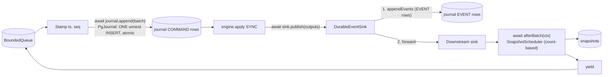

# Week 5: Durable Journal, Snapshots, Crash Recovery and the Chaos Harness

One-week working document. Put it in `docs/WEEK-5.md`. It covers the blueprint block "Weeks 5 to 6: Event sourcing, snapshots, recovery" (compressed into one week, see the split point in section 5). Week 6 (blueprint Week 7: risk stage, reservations, ledger) is previewed at the end.

**The theme of this week:** until now the journal was an in-memory array, so a crash lost everything. This week the journal becomes PostgreSQL, the engine learns to snapshot and restore itself, and you prove the headline claim of the whole project: **kill the shard at any point, restart it, and it recovers to exactly the state of an uninterrupted run.**

Rule for this week: you hand-write **`OrderBook.snapshot()` / restore** (engine-core) and **`recoverStream()`** (journal). Those are the two pieces you will explain in every "what if the process crashes?" question. AI tools may help with schema, codecs, the Postgres journal, tests, the chaos harness, benchmarks and docs (section 9).

---

## 0. Status and carry-over

| # | Carry-over | Done when |
|---|-----------|-----------|
| V1 | Week 4 audit blockers fixed; gate green (`npm ci`, build, lint, check:boundaries, test); `npm run test:flake` 20/20 | Audit report has no BLOCKER open |
| V2 | Postgres 18 runs from `docker compose` at the pinned tag; Spikes 3 and 7 pass against it (Testcontainers or compose, whichever you chose) | Recorded in `docs/versions.md` |
| V3 | **Spike 4** (Kafka transactions and fencing) with the real Confluent API names (the earlier version guessed `rebalance_cb` and `sendOffsets`) | Time-box 2 hours. Optional Prompt 0 in the prompt pack. If you skip it, write the date you will do it; Week 10 depends on it |
| V4 | You can explain `ShardRunner.run()`, `NaiveRisk` and `SerializedRisk` aloud and whiteboard the race | Done |

---

## 1. Goal and scope

**Goal:** a durable, replayable journal and a recovery procedure whose correctness is *tested*, not asserted: snapshot plus tail replay equals the live run, regenerated events equal stored events, and every crash window has a defined outcome.

| In scope this week | Deferred |
|--------------------|----------|
| Postgres schema and a tiny SQL migration runner | Fencing enforcement (conditional insert on `shard_leases`), Week 10. `writer_epoch` is *recorded* now |
| Pool-scoped `int8 -> bigint` parsing; Spike 7 as real tests; P10 over Postgres | Kafka as the journal or transport (Week 10) |
| Explicit, versioned, strict JSON codecs for commands, events and snapshots (in `common`) | Tick records (breaker, Week 8). The codec is built as a union so they fit |
| `PgJournal`: batched, atomic, contiguity-checked command append; event append; chunked readers | Risk-stage dedupe (needs durable reservation state, Week 7). Only the **gateway-side** store is built now |
| `DurableEventSink` (journals events, then forwards downstream) | The HTTP gateway itself (Week 9) |
| Engine `snapshot()` / `restore()` (additive, pure) and canonical snapshot ordering | Projections, ledger (Weeks 7 to 9) |
| Snapshot store with checksum, fallback and pruning; count-based `SnapshotScheduler` | Time-based snapshots |
| `recoverStream()`: snapshot + tail replay, verify stored events, regenerate missing events, detect gaps | Multi-instance failover (Week 10) |
| Runner integration: recovered state, `afterBatch` hook | Optimizing the journal path (Week 11) |
| `SeqDeduper` for duplicate delivery (R3) | |
| In-process crash-point tests and an OS-process `SIGKILL` chaos script | |
| Recovery-time benchmark (R6) with hypotheses first | |

---

## 2. Deliverables and definition of done

- [ ] V1 to V4 handled (section 0)
- [ ] Migrations 001 to 003, runner, MG1 to MG3
- [ ] `common`: strict versioned codecs (commands, events, book snapshot), upcaster registry, `SeqDeduper`, `SnapshotStore` and `RecoveredState` types; CD1 to CD9
- [ ] `journal`: pool factory with bigint parsing, `PgJournal`, snapshot store, `OrderRequestStore`, `recoverStream`; PG1 to PG4, J1 to J14, SS1 to SS7, OR1 to OR6, RC1 to RC12
- [ ] `engine-core`: `snapshot()` / `restore()` with SN1 to SN10 and property P15; purity rules unchanged and green
- [ ] `shard`: `DurableEventSink` usage, `recovered` option, `afterBatch` hook, `Stamper.restore`; SH16 to SH18
- [ ] Properties P7 (replay equals live, over Postgres), P8 (no hidden inputs), P15 (snapshot equivalence)
- [ ] Chaos: R1 (in-process crash points CP1 to CP5), R1b (OS `SIGKILL` script), R2, R3, R6
- [ ] Unit tests stay Docker-free; integration tests are a separate Vitest project and run in CI
- [ ] Mutation table (section 8.7), docs updated, decisions recorded, `PROGRESS.md` updated
- [ ] You can draw the crash-window table (section 4.4) and the recovery algorithm from memory

**Definition of done:** after random kills at every crash point, recovered state equals the uninterrupted run (events and book), and you can show the recovery-time table.

---

## 3. Technologies and tech stack (this week only)

| Tool | Version | Used for |
|------|---------|----------|
| PostgreSQL | 18.x (`postgres:18` pinned in compose) | Journal, snapshots, order requests |
| `pg` (node-postgres) | latest 8.x, `npm view pg version`, pin exact | Pool, `unnest` batch inserts, pool-scoped type parsers |
| `@types/pg` | matching, pin exact | Types |
| Testcontainers (+ `@testcontainers/postgresql`) | as used in Spike 3, pin exact | Integration tests (fallback: compose service in CI) |
| SQL migrations | plain numbered `.sql` files + a ~60-line runner | Fewer dependencies than `node-pg-migrate` |
| `node:crypto` (journal only) | built in | SHA-256 for snapshot checksums and payload hashes |
| Vitest 4.1 projects | as pinned | Separate `unit` and `integration` projects |
| fast-check 4.x | as pinned | P7, P8, P15, codec round trips |
| tinybench / perf hooks | as pinned | R6 recovery benchmark |

Not used: Kafka (except optional Spike 4), Redis, Fastify, zod. Only `pg`, `@types/pg` and Testcontainers pieces are new. Record every pin in `docs/versions.md`.

Where impure APIs may appear: `journal` (pg, `node:crypto`), `shard` (clock, timers, child process for chaos), `benchmarks`. `engine-core` stays pure; `common` stays browser-safe (no `node:*`, no timers, no crypto; hashing lives in `journal`).

---

## 4. Architecture

### 4.1 Packages and files

```
packages/engine-core/src/book/
  snapshot.ts           // BookSnapshot types, InvalidSnapshotError (types only)
  order-book.ts         // + snapshot(), static restore(spec, snapshot)   [hand-write]
packages/common/src/
  codec/commands.ts     // serializeCommand / deserializeCommand (strict, versioned, exhaustive)
  codec/events.ts       // serializeEvent / deserializeEvent
  codec/book-snapshot.ts// serializeBookSnapshot / deserializeBookSnapshot (canonical order)
  codec/versioning.ts   // CURRENT_VERSION, Upcaster registry, UnknownSchemaVersionError
  seq-deduper.ts        // SeqDeduper (idempotent consumption by (symbol, seq))
  recovery-types.ts     // RecoveredState, SnapshotRecord, SnapshotStore port
packages/journal/
  migrations/001_journal.sql, 002_snapshots.sql, 003_order_requests.sql
  src/migrate.ts        // runner with checksums
  src/pool.ts           // createPool({ connectionString }) with pool-scoped int8 -> bigint parser
  src/pg-journal.ts     // PgJournal implements JournalAppender (+ events, readers)
  src/durable-event-sink.ts
  src/snapshot-store.ts // PgSnapshotStore implements SnapshotStore
  src/snapshot-scheduler.ts
  src/order-request-store.ts
  src/recovery.ts       // recoverStream()                              [hand-write]
packages/shard/src/
  shard-runner.ts       // + recovered option, afterBatch hook
  stamper.ts            // + restore(seqBySymbol, lastTs)
  chaos-child.ts        // child process for the SIGKILL chaos script
packages/benchmarks/src/recovery.bench.ts
scripts/chaos-kill.mjs
vitest.config / projects // unit vs integration (*.int.test.ts)
```

### 4.2 Schema (migrations)

```sql
-- 001_journal.sql  (one table, keeps the blueprint name; record_type + idx deviate from 5.5, see decisions)
CREATE TABLE journal (
  stream_id      text        NOT NULL,                  -- symbol
  seq            bigint      NOT NULL CHECK (seq >= 1), -- per-stream command sequence from the Stamper
  record_type    text        NOT NULL CHECK (record_type IN ('COMMAND','EVENT')),
  idx            integer     NOT NULL CHECK (idx >= 0), -- COMMAND: always 0. EVENT: position within the command's events
  schema_version smallint    NOT NULL CHECK (schema_version >= 1),
  ts             bigint      NOT NULL CHECK (ts >= 0),
  writer_epoch   bigint      NOT NULL,                  -- recorded now, enforced in Week 10
  payload_json   jsonb       NOT NULL,                  -- bigint fields are decimal STRINGS
  created_at     timestamptz NOT NULL DEFAULT now(),
  PRIMARY KEY (stream_id, seq, record_type, idx),
  CHECK (record_type <> 'COMMAND' OR idx = 0)
);

-- 002_snapshots.sql
CREATE TABLE snapshots (
  stream_id text NOT NULL, last_seq bigint NOT NULL CHECK (last_seq >= 0),
  last_ts bigint NOT NULL, schema_version smallint NOT NULL,
  state_json jsonb NOT NULL, checksum text NOT NULL,
  created_at timestamptz NOT NULL DEFAULT now(),
  PRIMARY KEY (stream_id, last_seq));

-- 003_order_requests.sql  (gateway idempotency, blueprint 5.5)
CREATE TABLE order_requests (
  account_id text NOT NULL, client_order_id text NOT NULL,
  order_id text NOT NULL UNIQUE, payload_hash text NOT NULL,
  created_at timestamptz NOT NULL DEFAULT now(),
  PRIMARY KEY (account_id, client_order_id));
```

Notes: `jsonb` normalizes key order and whitespace, so **checksums and equality never use stored text**; they use the canonical serializer's output (fixed key order). `seq` and `ts` are `number` in code and `BIGINT` in the database; the reader converts with a safe-integer check and throws on an unsafe value. Money, price and quantity are `bigint` everywhere.

### 4.3 The write path and the read path



Order matters: **commands are durable before the engine sees them; events are durable before they are forwarded; a snapshot is taken only between batches** by the single writer, so it always matches the last applied `seq`.

### 4.4 Crash windows (the table to memorize)

| # | Crash point | Durable state | Recovery does | Visible effect |
|---|-------------|---------------|---------------|----------------|
| CP1 | After command journal, before `apply` | Commands, no events | Replays the commands, regenerates events, appends them, caller republishes | None: the engine never showed anything |
| CP2 | After `apply`, before events journaled | Commands, no events | Same as CP1 (the apply was in memory only) | None |
| CP3 | After events journaled, before downstream publish | Commands and events | Verifies regenerated events equal stored; caller republishes from the journal | Downstream may see duplicates; consumers dedupe by `(symbol, seq)` (`SeqDeduper`) |
| CP4 | During a snapshot write | Possibly no snapshot, or an invalid one | Falls back to the previous valid snapshot, else full replay | Slower recovery only |
| CP5 | Before the command journal (batch dequeued, not durable) | Nothing for that batch | Nothing; the producer was never acknowledged and retries (idempotent by `clientOrderId`) | A retry, not a loss |

### 4.5 Recovery algorithm (pseudocode; write the real code yourself)

```
recoverStream(pool, symbol, spec, opts):
    maxSeq = journal.lastCommandSeq(symbol)                        // 0 if none
    candidates = snapshots.listNewestFirst(symbol)
    for snap of candidates:                                        // first VALID one wins
        if snap.lastSeq > maxSeq:                invalid("ahead of journal")      ; continue
        if checksum mismatch / unknown version:  invalid(reason)                  ; continue
        try book = OrderBook.restore(spec, snap.state); assert book.checkInvariants() == []
        catch:                                   invalid("restore failed")        ; continue
        chosen = snap ; break
    book    = chosen ? restored : new OrderBook(spec)
    lastSeq = chosen ? chosen.lastSeq : 0 ; lastTs = chosen ? chosen.lastTs : 0

    for chunk of journal.readCommands(symbol, afterSeq = lastSeq, chunkSize):   // streamed, bounded memory
        for cmd of chunk:
            if cmd.seq != lastSeq + 1: throw JournalGapError(expected, got)
            events   = book.apply(cmd.command)                                  // command carries its journaled ts
            stored   = journal.readEvents(symbol, cmd.seq)                      // chunked alongside
            if stored is non-empty and not equal(stored, events): throw ReplayMismatchError(seq, diff)
            if stored is empty: regenerated.push(output(cmd, events))           // crash window CP1/CP2
            lastSeq = cmd.seq ; lastTs = max(lastTs, cmd.ts)
    return { book, lastSeq, lastTs, replayed, verified, regenerated, snapshotUsed, invalidSnapshots }
```

Rules: a `ReplayMismatchError` means non-determinism or tampering and is **fatal** (the caller must not start the runner). A missing event set is not an error; it is the CP1 to CP2 window and is filled in. The caller appends `regenerated` through the event journal (idempotent), republishes it, and then starts the runner from the `RecoveredState` (books, `seqBySymbol`, `lastTs`).

### 4.6 Engine snapshot contract (engine-core, additive)

```ts
export type RestingOrderSnapshot = {
  readonly orderId: string; readonly accountId: string;
  readonly side: 'BUY' | 'SELL'; readonly price: bigint;
  readonly remaining: bigint; readonly arrivalSeq: number;
};
export type LevelSnapshot = { readonly price: bigint; readonly orders: readonly RestingOrderSnapshot[] }; // FIFO, head first
export type BookSnapshot = {
  readonly version: 1; readonly symbol: string;
  readonly spec: { /* the InstrumentSpec fields: tick, lot, max price, max quantity, ... */ };
  readonly nextArrivalSeq: number; readonly nextTradeSeq: number;
  readonly bids: readonly LevelSnapshot[];   // CANONICAL ORDER: best price first
  readonly asks: readonly LevelSnapshot[];   // CANONICAL ORDER: best price first
};
class OrderBook { snapshot(): BookSnapshot; static restore(spec: InstrumentSpec, s: BookSnapshot): OrderBook }
```

Properties of the contract: pure data only (no node references, safe to mutate the book afterwards); canonical ordering so equal books give equal snapshots and stable checksums; `restore` validates everything and throws `InvalidSnapshotError` **before** returning a book (all-or-nothing); `restore(snapshot())` followed by the same commands yields the same events including `tradeId` continuity and FIFO order. Engine purity rules do not change.

### 4.7 Dependency map changes (update blueprint 4.4 and `check-boundaries.mjs`)

| Package | Change |
|---------|--------|
| `journal` | May depend on `engine-core`, `common`, `pg`; may use `node:crypto`. Must not depend on `shard`, Kafka, `web` |
| `shard` | Adds `journal` (now allowed by the blueprint map). Still no Kafka import |
| `common` | Adds codecs, `SeqDeduper`, recovery types. No `node:*`, timers or crypto |
| `benchmarks` | **Deviation:** adds `journal` (recovery benchmark). Still no direct `pg`, Fastify or Kafka dependency |

---

## 5. How to build it (day by day) and the split point

Write the failing test first each day. Integration tests use Postgres and live in the separate project; unit tests never need Docker.

| Day | Hours | Do | Done when |
|-----|-------|----|-----------|
| 1 | 2 to 3 | V1 to V4. Dependencies, integration project, migrations, pool, bigint boundary, codecs and versioning (Prompt 1) | CD, MG, PG tests green |
| 2 | 2 to 3 | Engine snapshot tests first; **you hand-write** `snapshot()` / `restore()` (Prompt 2) | SN1 to SN10, P15 green |
| 3 | 2 to 3 | `PgJournal`, snapshot store, scheduler, order-request store, `SeqDeduper` (Prompt 3) | J, SS, OR tests green |
| **split point** | | If time is short, stop here and treat Days 4 to 7 as "Week 6". Everything above is useful alone | |
| 4 | 3 | Runner integration; **you hand-write** `recoverStream()`; RC tests, P7, P8 (Prompt 4) | RC, SH16 to SH18, P7, P8 green |
| 5 | 2 to 3 | Crash-point chaos R1 (in-process), R2, R3 (Prompt 4 continued) | 20 of 20 flake gate |
| 6 | 2 to 3 | `SIGKILL` chaos script, recovery benchmark with hypotheses first, mutations (Prompt 5) | Tables committed |
| 7 | 1 to 1.5 | Docs, decisions, whiteboard, cleanup | Everything green, CI green |

**Stuck protocol:** if a recovery bug costs more than 90 minutes, shrink it to one stream, three commands, one crash point. Print the journal rows and the recovered book snapshot side by side. Debug the diff, not the 300-command run.

---

## 6. Worked scenarios (use as fixtures)

### Scenario 1: snapshot then tail (SN2, RC3)
Example 1 from Week 2, steps 1 to 3 (three resting asks), then snapshot. Restore into a fresh book and run steps 4 to 8: events identical to the uninterrupted run, including `tradeId` values, and the book after each step is identical.

### Scenario 2: crash window CP2
Stream `ACME`, commands 1 to 5 stamped and journaled; the process dies during `apply` of command 3. Journal has COMMAND rows 1 to 5 and EVENT rows for none (the batch's events were never journaled). Recovery: no snapshot, replays 1 to 5, finds no stored events, returns 5 `regenerated` outputs. After the caller appends them, a second recovery verifies 5 of 5 and regenerates nothing.

### Scenario 3: tampered event (RC5)
Same journal, but EVENT row `(ACME, 3, EVENT, 0)` payload has `quantity` changed. Recovery replays to seq 3 and throws `ReplayMismatchError { symbol: 'ACME', seq: 3 }` with a readable diff. The runner must not start.

### Scenario 4: torn snapshot (RC7)
Snapshots at `last_seq` 1000 (valid) and 2000 (checksum wrong). Journal has 2,350 commands. Recovery ignores the 2000 snapshot (reported in `invalidSnapshots`), restores 1000, replays 1,350 commands. Result equals the full-replay result.

### Scenario 5: restart continues the sequence (RC11)
After recovery with `lastSeq` ACME 40, BETA 7, `lastTs` 5000, and a clock reading 4000: the next ACME command is stamped `seq 41, ts 5000`; the next BETA `seq 8, ts 5000`.

### Scenario 6: concurrent duplicate request (OR)
50 concurrent `register` calls, same `(account, clientOrderId)`, same payload: exactly one `CREATED`, 49 `DUPLICATE`, all with the same `orderId`. Same key with a different payload: `CONFLICT` and no row change.

---

## 7. Edge cases to handle

**Codec**
- Bigint values beyond 2^53 and at the int8 bounds (2^63 - 1, and 2^63 rejected before the database is touched)
- Non-canonical decimal strings ("007", "1e3", "+5", "-0", "") rejected on decode; numbers where strings are required rejected
- Unknown command or event `type`, missing fields, unexpected extra fields: strict rejection with a typed error naming the field
- Unknown `schema_version`: `UnknownSchemaVersionError` unless an upcaster is registered
- Serializer output is deterministic (fixed key order), so hashes and checksums are stable
- Exhaustive handling: adding a new command or event type must fail to compile until the codec is updated

**Journal**
- A batch with a duplicate or gapped `seq`, within one stream or across several: rejected before any write; nothing persisted
- A database-level conflict mid-batch: the entire batch is rolled back (single statement), `JournalConflictError`
- 10,000-row batch in one round trip (no parameter-count limit: use `unnest`)
- `seq` or `ts` above the safe-integer range in the database: the reader throws instead of rounding
- Event append: identical re-append is idempotent; different content for the same key is an error
- Connection failure during append: rejects, nothing recorded, the runner fail-stops
- Readers are chunked: never load an unbounded tail into memory

**Snapshots**
- Snapshot of an empty book; of a book with partially filled makers; after cancels at head, middle and tail
- Restore rejects: duplicate order ids, non-positive remaining, wrong side for the side array, level price mismatch, unordered levels, crossed book, spec mismatch (tick, lot or limits differ), negative counters
- A snapshot whose `last_seq` is beyond the journal's last command: invalid (it claims state that was never durable)
- Snapshot write failure is **non-fatal** (the journal is the source of truth); it is counted and surfaced through a callback

**Recovery**
- Empty journal and no snapshot; snapshot only and no tail; tail only
- Gap in command `seq`; stored events that disagree; stored events missing for the last few commands
- Multi-symbol journals recovered independently; `lastTs` is the maximum across streams
- Recovered runner never stamps a `ts` below the recovered `lastTs`, even if the clock steps back
- Recovery must not call the clock or generate ids: it uses journaled `ts` only

**Idempotency and duplicates**
- Same key, same payload (duplicate); same key, different payload (conflict); concurrent registers (exactly one created)
- Duplicate delivery of every output, shuffled duplicates, and a gap in `seq` at the consumer (`SeqDeduper` reports a gap rather than skipping)

**Process-level**
- `SIGKILL` at a random moment in the OS-process chaos run, including during a snapshot write and between batches
- Postgres unavailable at startup: recovery fails fast with a clear error; the runner never starts on unknown state

---

## 8. Test cases to pass

IDs R1, R2, R3, R6, P7, P8 come from the blueprint. Everything else is new this week; add them to the blueprint tables.

### 8.1 Codec, migrations and the Postgres boundary

| # | Test | Expected |
|---|------|----------|
| CD1 | Property: random commands (all types) serialize, `JSON.stringify`, `JSON.parse`, deserialize | Deep-equal, bigint above 2^53 preserved |
| CD2 | Same for every event type | Deep-equal |
| CD3 | Serialized payloads | No JSON number for any bigint field (all decimal strings); `JSON.stringify` never throws |
| CD4 | Decode strictness | Unknown type, missing field, extra field, number-for-string, non-canonical decimal each throw a typed error naming the field |
| CD5 | Determinism | Same value serializes to the identical string every time; key order fixed |
| CD6 | Versioning | Every payload carries `v: 1`; unknown version throws `UnknownSchemaVersionError`; a registered synthetic v0 to v1 upcaster is applied |
| CD7 | Book snapshot codec | Round trip deep-equal; canonical order preserved |
| CD8 | Bounds | Bigint outside int8 range rejected at serialize for DB-bound fields |
| CD9 | Exhaustiveness | A type-level check (or compile test) that every command and event `type` is handled |
| MG1 | Migrations apply in order; running again is a no-op | `schema_migrations` has one row per file |
| MG2 | A failing migration | Rolled back; nothing recorded |
| MG3 | An applied migration file is edited | Checksum mismatch error |
| PG1 | Round trip bigint through an `int8` column | 0, 1, 2^53 - 1, 2^53, 2^53 + 1, 2^63 - 1, -2^63 exact |
| PG2 | 2^63 | Rejected by the codec before the database; the database itself would also reject |
| PG3 | P10 over Postgres (fast-check, batched with `unnest`) | Identity for random bigints within bounds |
| PG4 | Pool-scoped parser | A second pool without the parser still returns strings (no global side effect); `seq`/`ts` convert to number with a safe check |

### 8.2 Engine snapshot (engine-core)

| # | Test | Expected |
|---|------|----------|
| SN1 | Empty book snapshot and restore | Empty book; the next trade id continues |
| SN2 | Scenario 1 | Events and book identical to the uninterrupted run, including `tradeId` |
| SN3 | Cancel at head, middle, tail after restore | FIFO and pointers correct; `checkInvariants()` empty |
| SN4 | Isolation | Mutating the book after `snapshot()` does not change the snapshot; mutating the snapshot does not affect a restored book (deep-frozen snapshot is acceptable) |
| SN5 | Malformed snapshots (each listed in section 7) | `InvalidSnapshotError`; no book returned |
| SN6 | Spec mismatch | `InvalidSnapshotError` |
| SN7 | Canonical order | Two equal books give deep-equal snapshots; `snapshot()` twice is identical |
| SN8 | Partially filled makers and arrival order | `arrivalSeq` and remaining preserved |
| SN9 | Counters | `nextArrivalSeq` and `nextTradeSeq` continue exactly |
| SN10 | No IOC remnants | A book after IOC activity snapshots only resting orders |
| **P15** | Property: random commands, random cut point `k`; book A runs everything; book B runs `k` commands, snapshot, restore into C, runs the rest | Events after `k` identical; final snapshot identical |

### 8.3 Journal, snapshot store, idempotency (Postgres)

| # | Test | Expected |
|---|------|----------|
| J1 | Append a batch of commands | Rows correct: `COMMAND`, `idx` 0, `schema_version`, `ts`, `writer_epoch`, payload |
| J2 | Bigint above 2^53 in `price` and `quantity` | Read back deep-equal |
| J3 | Batch whose middle row conflicts | Whole batch rolled back; `JournalConflictError` |
| J4 | Gap or duplicate `seq` in a batch | `JournalSequenceError` before any write; nothing persisted |
| J5 | Interleaved streams | Contiguity enforced per stream independently |
| J6 | 10,000-row batch | One statement (assert via a query spy) |
| J7 | `appendEvents` | `idx` 0..n-1 in order; identical re-append idempotent; different content errors |
| J8 | `readCommands(stream, afterSeq, limit)` | Ordered by `seq`, chunked, typed with bigint |
| J9 | `lastCommandSeq` | 0 when empty; max after appends |
| J10 | Unsafe `seq` in the database | Reader throws |
| J11 | Unknown `schema_version` row | `UnknownSchemaVersionError` unless upcaster registered |
| J12 | `writer_epoch` | Equals the configured value |
| J13 | Connection failure mid-append | Rejects; nothing recorded |
| J14 | Reading 100,000 commands | No query returns more than the chunk size |
| SS1 | Save and load a snapshot | Exact round trip |
| SS2 | Several snapshots | Newest valid returned |
| SS3 | Corrupt checksum on the newest | Ignored, reported, previous valid one returned |
| SS4 | Unknown snapshot version | Ignored and reported |
| SS5 | `last_seq` beyond the journal | Ignored and reported |
| SS6 | Pruning keeps the newest K and never deletes the newest valid | Verified |
| SS7 | Idempotent save of an identical snapshot; different content for the same `(stream, last_seq)` | OK; error |
| OR1 | `register` new key | `CREATED` with the supplied `orderId` |
| OR2 | Same key and payload | `DUPLICATE` with the original `orderId` |
| OR3 | Same key, different payload | `CONFLICT`; no row change |
| OR4 | 50 concurrent registers (blueprint C4) | Exactly one `CREATED`, rest `DUPLICATE`, one row |
| OR5 | Payload hash independent of key order | Same hash |
| OR6 | `orderId` uniqueness | Reusing an `orderId` under a different key errors |

### 8.4 Recovery and runner integration

| # | Test | Expected |
|---|------|----------|
| RC1 | Empty journal, no snapshot | Fresh book, `lastSeq` 0 |
| RC2 | No snapshot, N commands | Recovered book equals the live book |
| RC3 | Snapshot at `k` plus tail | Same result as RC2; only `N - k` commands applied (spy) |
| RC4 | Events missing for the tail (Scenario 2) | Returned as `regenerated`; after appending, a second recovery regenerates none |
| RC5 | Tampered stored event (Scenario 3) | `ReplayMismatchError` with seq and diff |
| RC6 | Deleted command row | `JournalGapError` |
| RC7 | Torn snapshot (Scenario 4) | Fallback, identical result |
| RC8 | Snapshot ahead of the journal | Ignored |
| RC9 | Snapshot that fails restore invariants | Ignored and reported |
| RC10 | Multi-symbol | Each stream recovered; `lastTs` is the max |
| RC11 | Scenario 5 | `seq` and `ts` continue; `ts` never below recovered `lastTs` |
| RC12 | Large tail | Read in chunks of at most the configured size |
| SH16 | `afterBatch` hook | Called once per batch, after publish and before yield, with last seq per symbol |
| SH17 | `afterBatch` throws | Runner fail-stops |
| SH18 | Runner started with `recovered` state | Books and stamper continue from it |
| **P7** | Property over Postgres: random commands through the runner with `PgJournal` and `DurableEventSink` | Stored events equal events regenerated by replaying the journaled stamped commands on an empty engine; live book snapshot equals replay snapshot (numRuns about 50; the in-memory version is SP1) |
| **P8** | Replay the same journal twice with the system clock set to different dates, and once with `Date.now` replaced by a function that throws | Identical output; the throwing variant still succeeds |

### 8.5 Chaos and duplicates

| # | Test | Expected |
|---|------|----------|
| R1 | In-process crash points CP1 to CP5 at random batch indices (fast-check), with `SimulatedCrash` injected through journal, sink and snapshot-store wrappers. After the crash recover from Postgres, resend only commands that were not journaled, and run to completion | Final journal events and book snapshot equal an uninterrupted run; downstream outputs, deduped by `(symbol, seq)`, equal the uninterrupted outputs |
| R1b | `scripts/chaos-kill.mjs`: a child process runs a shard on Postgres; the driver sends `SIGKILL` at random moments, restarts, repeats; at the end compare to an uninterrupted run by seed | Equal; not part of `npm test` (own script, optional nightly CI) |
| R2 | Torn snapshot (also CP4 inside R1, RC7, SS3) | Fallback to the previous snapshot, then replay |
| R3 | Feed every output to a consumer twice, and with shuffled duplicates, through `SeqDeduper`; also re-append every event to the journal | Consumer state unchanged versus single delivery; a gap is reported; journal unchanged |
| R6 | Recovery time versus tail length (benchmark) | Documented table and curve |

### 8.6 Benchmark (R6, hypotheses first)

`npm run bench:recovery`: populate a journal with N commands (and their events) for N in {1k, 10k, 50k, 100k}; measure `recoverStream` wall time (3 runs, median) for: no snapshot; snapshot every 10k; snapshot every 1k. Also record snapshot save and load time, rows read, replayed count.

**Hypotheses (commit them to `docs/experiments.md` BEFORE running; only add "Result:" lines afterwards):**
- H1: without snapshots, recovery time grows roughly linearly with N (10x N gives roughly 10x time, within about 50%).
- H2: with snapshots, recovery time is bounded by the snapshot interval and is roughly independent of total N.
- H3: verifying stored events (read, deserialize, compare) costs at least as much as re-applying the commands, so event verification dominates replay time.
- H4: snapshot save time depends on the number of resting orders, not on N.

State what this does **not** prove: one machine, local Postgres, no network latency, a synthetic book shape, warm caches.

### 8.7 Mutation checks (prove the tests have teeth)

Apply separately in a scratch branch, record which tests fail, revert:
1. Recovery replays from `seq > lastSeq + 1` (skips one command): RC2, RC3, P7.
2. `restore` forgets `nextTradeSeq`: SN2, SN9, P15.
3. `restore` reverses FIFO inside a level: SN3, P15.
4. `PgJournal.append` inserts row by row without one statement: J3.
5. Recovery ignores a stored/regenerated event mismatch: RC5.
6. Snapshot checksum not verified: SS3, RC7.
7. Recovery does not return `regenerated` events: RC4.
8. Codec serializes bigint through `Number`: CD1, J2, PG3.
9. `Stamper.restore` forgets `lastTs`: RC11.
10. `SeqDeduper` accepts duplicates: R3.
11. `OrderRequestStore` uses `ON CONFLICT DO UPDATE`: OR2, OR4.
12. Snapshot taken before the last command of a batch is applied: P15 via R1 or RC3 (report what catches it).

A surviving mutation is a test gap: strengthen the test, not the code.

### 8.8 Flake gate

Integration and chaos tests must be deterministic: fast-check generated schedules and crash points, no sleeps, unique Postgres schema per test file. `npm run test:flake` (extended to the integration project) passes 20 of 20.

---

## 9. Rules for this week

- `engine-core` changes are **additive and pure**: `snapshot.ts` and two methods. No new imports, no dependency, purity lint untouched and green. `git diff` on `engine-core/src` must show only that.
- No Kafka, no fencing enforcement, no Tick records, no risk-stage dedupe, no HTTP in this week. If you feel the need, write it in `PROGRESS.md` as a Week 6+ item.
- The journal write is **atomic or absent**: one statement per batch. No loops of single inserts.
- Never decode with a permissive parser. Strict codecs only.
- Integration tests never run in the default `npm test`; unit tests never require Docker.
- Commit after each green test; leave `PROGRESS.md` stating what is done and the next failing test.
- **AI tools this week.** Allowed: migrations, runner, pool, codecs, `PgJournal`, snapshot store, scheduler, `OrderRequestStore`, `SeqDeduper`, tests, chaos script, benchmarks, docs, reviews. **Not allowed:** `OrderBook.snapshot()` / `restore()` and `recoverStream()`.
- Every number in the docs comes from a run you can point to.

---

## 10. Decisions to record in `docs/decisions.md`

Format: context, options, choice, trade-offs, how tested.

1. Journal in PostgreSQL as the source of truth (blueprint decision #9) vs Kafka: what you chose and why.
2. One `journal` table with `record_type` and `idx` (deviation from the blueprint's `(stream_id, seq)` PK): why, and what the primary key still guards.
3. `jsonb` payloads with bigint as decimal strings; explicit per-type strict serializers instead of a generic reviver.
4. One `unnest` insert per batch, atomic, no `ON CONFLICT` for commands (a conflict means two writers or a bug).
5. `seq` and `ts` as numbers with a safe-integer check; money as bigint.
6. Pool-scoped type parsers, not global.
7. `writer_epoch` recorded now, enforced in Week 10.
8. Snapshots: count-based, canonical order, checksum over canonical text, taken between batches by the single writer, failure non-fatal.
9. Recovery: snapshot plus tail replay, verify stored events (fatal on mismatch), regenerate missing events, detect gaps.
10. Events journaled by `DurableEventSink` after `apply`; they are derivable, so recovery can regenerate them.
11. Schema versioning and upcasters.
12. Idempotency: gateway store now; risk-stage dedupe deferred to Week 7 (needs durable reservation state).
13. Consumer-side dedupe by `(symbol, seq)`.
14. Plain SQL migrations vs `node-pg-migrate`.
15. Integration tests in a separate Vitest project.
16. Engine-core gained a snapshot API: why it stays pure.

---

## 11. Interview prep for this week

Be able to answer from memory:

- What happens if the process dies right after the journal write but before the engine applied the command? After applying but before events were journaled? After events were journaled but before they were forwarded? (Draw the crash-window table.)
- Why journal commands and not only events? What does replay need? (Determinism: the engine is a function of the stamped command stream.)
- Why does recovery verify stored events against regenerated ones, and what does a mismatch mean?
- How do snapshots bound recovery time, and what can go wrong with a snapshot? (Torn, stale, ahead of the journal, spec changed.)
- Why is a snapshot taken between batches by the single writer, never concurrently?
- What is `writer_epoch` for, and why is it recorded but not enforced yet?
- Why is `seq` ordering, not `ts`?
- How does a duplicate delivery get neutralized at each hop? (Journal PK, idempotent event insert, `SeqDeduper`, `order_requests`.)
- Why `unnest` instead of a multi-row `VALUES` insert?
- How would you change an event's shape in a running system? (Version field, upcasters, replay through the upcast pipeline.)

**Whiteboard exercise (no notes):** draw the journal timeline for five commands with a crash inside command 3's apply, mark what is durable, run recovery step by step (no snapshot), and show what `regenerated` contains. Then repeat with a valid snapshot at seq 2 and a torn snapshot at seq 4.

---

## 12. Common mistakes to avoid

- Inserting commands one row at a time in a loop (not atomic)
- Letting `jsonb` key order leak into checksums or equality
- Using `JSON.stringify` on a bigint-bearing object anywhere
- A global `pg.types.setTypeParser(20, ...)` that silently changes every query in the process
- Snapshotting mid-batch, or from a different tick than `lastSeq`
- Restoring a snapshot without validating it (a corrupt snapshot silently becomes live state)
- Treating a stored-event mismatch as a warning
- Calling the clock or generating an id during recovery
- Not restoring `lastTs` and the per-symbol `seq` counters into the stamper
- Swallowing snapshot errors without surfacing them
- Letting a test depend on a leftover database state from another test file
- Resending commands that were already journaled after a crash (the journal is the truth, not the producer)
- Touching `engine-core` beyond the snapshot API
- Reporting recovery times from a different machine than the one written in the table

---

## 13. Progress log (copy into `PROGRESS.md` each day)

```
Day N:
- Done:
- Failing / blocked:
- Next failing test to write:
- Flaky tests seen (and root cause):
- Property-test seeds worth keeping:
- Decisions made:
- Benchmark notes (hardware, Node, Postgres version):
```

---

## 14. Week 6 preview (blueprint Week 7: risk stage, reservations, ledger)

Next is the account-partitioned **risk stage** for real: the reservation lifecycle (place, convert on fill, release on cancel and IOC remainder), market orders converted to capped IOC with the reference-price fallback chain (U13, U14, P9), rejections that carry the account snapshot, the double-entry ledger with invariants (P5, P6), the leaked-reservation sweeper (R4), and **C1** (the full overspend test across three symbols) next to the preserved naive version (C2). The risk-stage dedupe deferred from this week lands there, on top of durable state.

What Week 5 must hand over: a journal and recovery you trust, versioned codecs ready for new record types (reservations, breaker transitions), the `RecoveredState` contract, and the crash-window table you can defend.