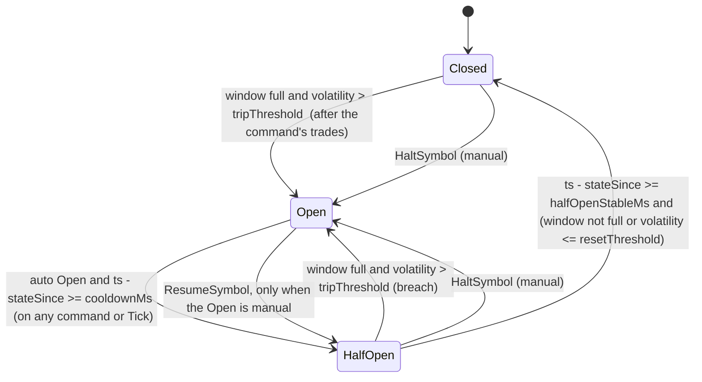

# Week 7: The Circuit Breaker, the Halt Policy and Reconciliation

One-week working document. Put it in `docs/WEEK-7.md`. It covers blueprint "Week 8: Circuit breaker and reconciliation", the two features the blueprint calls the ones that "show domain awareness". Week 8 (blueprint Week 9: API, WebSocket, read side, plus the persistence item) is previewed at the end.

**The theme of this week:** two ideas, both about *time and disagreement*. The **circuit breaker** is a state machine inside the matching engine, driven by stamped time (never the wall clock), that stops matching when prices move too fast, and a **halt policy** that decides what happens to the money reserved against resting orders while a symbol is halted. **Reconciliation** is the back-office twin: your books and an external broker's statement will disagree, and you need a deterministic way to find every break, work it through a workflow with an audit trail, and, when needed, post a ledger adjustment.

Rule for this week: you hand-write **the `Breaker` state machine** (`engine-core/src/breaker/breaker.ts`) and **one line in `RiskCore.onSubmitOrder`** (the early `SYMBOL_HALTED` rejection). The state machine is what you will whiteboard. AI tools may help with the engine integration, snapshot changes, tick injector, risk plumbing, the whole reconciliation package, tests and docs (section 9).

---

## 0. Status and carry-over

| # | Check | Done when |
|---|-------|-----------|
| V1 | The full audit (`FULL-AUDIT-PROMPT.md`) has run and its BLOCKERs for Weeks 1 to 6 are fixed or consciously deferred | You know what is proven and what is not |
| V2 | Gate green: `npm ci`, build, lint, `check:boundaries`, `npm test`; `npm run test:flake` 20/20 | Green |
| V3 | Week 6 state known. Week 7 needs the risk stage, router and wiring from Week 6 (`system-tests`) for the end-to-end halt tests. If Week 6 is not done, do the engine part (Prompts 1 and 2) and the recon core (Prompt 4), and postpone Prompts 3 and 5 | Noted in `PROGRESS.md` |
| V4 | Week 5 snapshot exists (`OrderBook.snapshot()` / `restore()`), because breaker state must survive a snapshot. If the snapshot codec, journal or recovery from Week 5 exist, this week extends them; if not, it extends only what exists and records the gap | Noted |
| V5 | You can draw the Week 6 reservation lifecycle and explain why the risk core takes time as an input | Done |

---

## 1. Goal and scope

**Goal:** a breaker that is fully deterministic and replayable, a halt policy that never strands customer funds indefinitely, and a reconciliation workflow whose every state change is justified and audited.

| In scope this week | Deferred |
|--------------------|----------|
| `Breaker` state machine (Closed, Open, Half-open), count-based rolling volatility with hysteresis, manual halt and resume, incident clock, `maxHaltDuration` force-cancel | Operator UI and API endpoints for halt, resume and breaker config (API week) |
| Engine commands `Tick`, `HaltSymbol`, `ResumeSymbol`; breaker events; `BREAKER_OPEN`, `HALF_OPEN_RATE_CAP` rejections; `HALT_TIMEOUT` cancel reason | `ConfigureBreaker` as a journaled command (config is constructor input this week) |
| Half-open price band and per-second order cap measured in stamped time | Heartbeat ticks (ticks are injected only while a time-based condition is pending) |
| Snapshot v2 (breaker config and state) with v1 restore | Time-based snapshots, journaling `ConfigureBreaker` |
| `TickInjector` in `shard` (no change to `ShardRunner.run()`) | Kafka transport, multi-instance failover |
| Risk halt policy: `SymbolStatusChanged`, early `SYMBOL_HALTED` rejection, force-cancel release through the router, held funds per symbol | WebSocket notifications (API week) |
| Reconciliation: streamed CSV parser, statement matcher with six break types plus settlement mismatch, workflow with mandatory reasons and an audit trail, idempotent runs by file hash, simulated broker statement generator | Postgres tables `recon_runs` and `recon_breaks`, upload endpoint, role checks (API week) |
| Adjustments: `ApplyAdjustment` risk command, `@SUSPENSE` ledger legs, single-account atomic adjustment | Multi-account atomic adjustments, quantity-mismatch adjustments |
| Tests K4 to K12, X1 to X6 and the series in section 8 | Performance tuning |

---

## 2. Deliverables and definition of done

- [ ] V1 to V5 handled (section 0)
- [ ] `engine-core`: `Breaker`, new commands and events, gating and force-cancel in `OrderBook`, snapshot v2; **purity lint unchanged and green**; with no breaker config, behavior is identical to Week 6 (regression)
- [ ] `common`: codec and type updates (exhaustive switches force them), `RiskCommand` additions
- [ ] `shard`: `TickInjector`, `symbolsNeedingTicks()`; `ShardRunner.run()` untouched
- [ ] `risk`: `SymbolStatusChanged`, `SYMBOL_HALTED`, `ApplyAdjustment`, router mappings, held-by-symbol view
- [ ] `ledger`: `@SUSPENSE` adjustment postings
- [ ] `recon`: parser, date math, matcher, workflow, adjustments, simulator, `InMemoryReconStore`
- [ ] All tests in section 8 pass; flake gate 20/20
- [ ] Mutation table (section 8.9), decisions recorded, docs and `PROGRESS.md` updated, README limitations updated
- [ ] You can draw the breaker state machine with every transition label, and the halt-timeline, from memory

**Definition of done:** a price series trips the breaker at the expected trade, the symbol recovers Open to Half-open to Closed under replay, a long halt force-cancels and releases every reservation (balances and ledger still reconcile), and a statement with seeded faults produces exactly the expected breaks which you can resolve with an audit trail.

---

## 3. Technologies and tech stack (this week only)

**No new dependencies.** Plain TypeScript (strict), Vitest 4.1, fast-check 4.x as pinned.

| Zone | Rule |
|------|------|
| `engine-core/src/breaker/**` | Same purity as the engine: no clock, `Math.random`, I/O, `await`, `Promise`, `node:*`. Time enters only through the `ts` on commands. Already covered by the existing engine-core lint block (the breaker is a folder, not a package) |
| `recon/src/core/**` | **Pure** (new lint block, same ban list as the other pure zones): CSV record state machine, matcher, workflow, date math, break classification. Time and actors are inputs |
| `recon/src` outside `core` | May use `node:stream` and `node:crypto` (parser stream wrapper, file hash); no timers |
| `common` | Browser-safe as before |

Money and prices stay `bigint` in minor units. External prices arrive as decimal strings and are converted exactly with a configured number of decimals; there is no floating point anywhere.

---

## 4. Architecture

### 4.1 Where the code goes

```
packages/engine-core/src/
  breaker/types.ts         // BreakerConfig, BreakerState, BreakerView, BreakerSnapshotState
  breaker/volatility.ts    // volatilityBps(window), bandBounds(anchor, bps)  (pure helpers)
  breaker/breaker.ts       // Breaker: advance(), onTrades(), halt(), resume()             [hand-write]
  book/order-book.ts       // constructor(spec, breakerConfig?), gating, band, force-cancel, needsTick(), snapshot v2
packages/common/src/       // codec + type updates; RiskCommand/RiskEvent additions
packages/shard/src/
  tick-injector.ts         // TickInjector(runner, ...): tickOnce(), start(intervalMs), stop()
  shard-runner.ts          // + symbolsNeedingTicks(), + breakerConfigs option (NOT run())
packages/risk/src/core/risk-core.ts   // + SymbolStatusChanged, ApplyAdjustment; SYMBOL_HALTED line in onSubmitOrder [one line: you]
packages/risk/src/router.ts           // + Breaker events -> symbol status, HALT_TIMEOUT mapping
packages/ledger/src/ledger.ts         // + SUSPENSE, postAdjustment()
packages/recon/src/
  core/csv.ts              // RecordParser: chunk in, rows and errors out (pure)
  core/dates.ts            // civilFromDays(), settlementDate()
  core/matcher.ts          // classify(): internal trades x statement rows -> breaks
  core/workflow.ts         // ReconStore transitions, audit trail
  statement-stream.ts      // Readable -> rows (node:stream, node:crypto file hash)
  service.ts               // runReconciliation(), resolveBreak() with AdjustmentExecutor
  simulate-statement.ts    // simulated broker: CSV with injected faults
  in-memory-store.ts
packages/system-tests/test/   // halt end-to-end, recon end-to-end
```

### 4.2 The breaker state machine



**State**: `state`, `manual` (was this Open caused by a manual halt?), `window` (last N trade prices, count-based), `anchorPrice`, `incidentStartTs` (set at the first trip or manual halt, cleared only when Closed), `stateSinceTs`, a per-second order bucket for Half-open, and `forceCancelled` (once per incident).

**Metric**: with a full window of `N` prices, `volatilityBps = floor((max - min) * 10_000 / min)`. The window must be **full** before the breaker can trip ("too few trades: stay closed"). **Trip is strictly greater than** `tripThresholdBps`; reaching it exactly does not trip. `resetThresholdBps < tripThresholdBps` gives **hysteresis**.

**Anchor** ("last valid price") is the oldest price in the window at the moment of the trip, that is, the price before the volatile stretch. The Half-open band is `[ceilDiv(anchor x (10_000 - b), 10_000), floorDiv(anchor x (10_000 + b), 10_000)]`.

**Time**: `advance(ts)` runs at the start of **every** command and Tick. It performs, in this order: (1) the halt-timeout check, (2) at most **one** state transition (Open to Half-open, or Half-open to Closed). One transition per command is deliberate and tested; the tick injector keeps ticking while the state is not Closed, so a long gap resolves over consecutive ticks.

**Window clearing**: the window is cleared on entering Half-open and on closing, so old trades cannot cause an immediate re-trip (second hysteresis).

**Flapping**: the incident clock keeps running across Open, Half-open, Open cycles; it does not restart on re-trip.

### 4.3 Engine integration rules

| Situation | Behavior |
|-----------|----------|
| Breaker not configured | The book behaves **exactly** as in Week 6. Tick produces no events; Halt and Resume produce `BreakerCommandIgnored(BREAKER_DISABLED)` |
| `PlaceOrder` while **Open** | `OrderRejected(BREAKER_OPEN)`; nothing rests, nothing matches. The risk stage releases the reservation through the normal matcher-rejection path |
| `CancelOrder` while Open or Half-open | Always allowed; `OrderCancelled(USER_REQUEST)`; the reservation is released immediately by the existing path |
| Resting orders when the breaker trips | **Stay resting** (the default policy), unless the incident exceeds `maxHaltDurationMs` |
| `PlaceOrder` while **Half-open** | At most `halfOpenMaxOrdersPerSec` orders per stamped second, else `OrderRejected(HALF_OPEN_RATE_CAP)`; matching only against resting prices inside the band; the remainder rests (GTC) or is cancelled (IOC) as usual |
| Evaluation point | The trip check runs **after** the current command's matching has finished. An order already matching is never aborted mid-sweep; the next command sees the new state. Event order for a command: trades, then `BreakerTripped` |
| `maxHaltDurationMs` exceeded (state not Closed, `ts - incidentStartTs > max`, not yet fired in this incident) | Force-cancel **all** resting orders on the symbol: one `OrderCancelled(HALT_TIMEOUT)` per order in canonical order (bids best first, then asks best first, FIFO within a level), then `HaltTimeoutCancelled { count, incidentStartTs }`. Fires once per incident |
| `needsTick()` | True when the breaker is enabled and not Closed (time-based conditions are pending) |

### 4.4 New commands, events and enums

```ts
// commands (ts is stamped by the shard's input stage, as always)
{ type: 'Tick'; ts: number }
{ type: 'HaltSymbol'; reason: string; ts: number }
{ type: 'ResumeSymbol'; ts: number }

// events
{ type: 'BreakerTripped'; reason: 'VOLATILITY' | 'HALF_OPEN_BREACH' | 'MANUAL'; volatilityBps?: bigint; thresholdBps?: bigint;
  anchorPrice?: bigint; incidentStartTs: number; detail?: string; ts: number }
{ type: 'BreakerHalfOpened'; trigger: 'COOLDOWN' | 'RESUME'; ts: number }
{ type: 'BreakerClosed'; incidentDurationMs: number; ts: number }
{ type: 'BreakerCommandIgnored'; command: 'HaltSymbol' | 'ResumeSymbol'; reason: string; ts: number }
{ type: 'HaltTimeoutCancelled'; count: number; incidentStartTs: number; ts: number }
// additions: RejectReason 'BREAKER_OPEN' | 'HALF_OPEN_RATE_CAP';  CancelReason 'HALT_TIMEOUT'
```

`BreakerConfig = { windowTrades, tripThresholdBps, resetThresholdBps, cooldownMs, halfOpenBandBps, halfOpenMaxOrdersPerSec, halfOpenStableMs, maxHaltDurationMs }` (all bigint for bps, numbers for counts and ms; validated: `0 <= reset < trip`, `windowTrades >= 2`, positive durations).

### 4.5 Snapshot v2

`BookSnapshot.version` becomes `2` and gains `breaker?: { config, state }` (state includes the window, anchor, incident start, state-since, manual flag, half-open bucket, `forceCancelled`). `restore(spec, snapshot, breakerConfig?)` accepts version 1 (the breaker restores as a fresh Closed one) and version 2; a mismatch between the snapshot's breaker config and the supplied one, or breaker presence, throws `InvalidSnapshotError('SPEC_MISMATCH')`. Where the Week 5 codec and recovery exist, they gain the v2 shape and a v1 upcaster (a real use of the versioning strategy), and the shard and `recoverStream` receive `breakerConfigs`.

### 4.6 Ticks

`TickInjector` is outside `ShardRunner.run()`. `tickOnce()` asks the runner `symbolsNeedingTicks()` (read-only, synchronous, safe because the engine apply is synchronous) and calls `runner.tryEnqueue(symbol, { type: 'Tick', ts: 0 })` for each; the existing loop stamps and journals the Tick like any command, so replay re-executes it. `start(intervalMs)` uses a real interval, `stop()` clears it; tests call `tickOnce()` directly with a fake clock. A `FULL` queue skips that tick (the next one retries). No Tick is ever sent for a symbol whose breaker is Closed.

### 4.7 Halt policy in the risk stage

| Mechanism | Behavior |
|-----------|----------|
| Status follows the engine | Router: `BreakerTripped` marks the symbol HALTED; `BreakerHalfOpened` and `BreakerClosed` mark it ACTIVE. It produces `SymbolStatusChanged { symbol, status }`, broadcast to every partition on the unbounded notice path |
| Early rejection | `RiskCore` keeps `haltedSymbols`. A `SubmitOrder` for a halted symbol is rejected `SYMBOL_HALTED` **before any reservation** (with the account snapshot). A reservation that raced past this check is released when the matcher rejects with `BREAKER_OPEN` |
| Self-service release | Cancels are allowed during a halt; each releases its reservation immediately |
| Hard bound | `maxHaltDurationMs` force-cancels everything; each `OrderCancelled(HALT_TIMEOUT)` becomes `OrderClosed` (new release reason `HALT_TIMEOUT`) |
| Visibility | `RiskCore.view(accountId)` gains `heldBySymbol` (cash held for BUY reservations and shares held for SELL, per symbol). Notifications to clients wait for the API week |

### 4.8 Reconciliation design

**Statement** (CSV, UTF-8, header required): `tradeId,symbol,quantity,price,tradeTs,settlementDate`. Prices are decimal strings converted with `priceDecimals` (default 2) to minor units: `"101.25"` becomes `10125n`; more decimals than configured is a row error. Quantities are canonical non-negative integers. `settlementDate` is `YYYY-MM-DD`.

**Internal side**: `InternalTradeRecord { tradeId, symbol, price, quantity, buyerAccountId, sellerAccountId, ts }`, collected from the ledger postings (add `ts` to the Week 6 `TradePosting`). Internal settlement date = UTC date of `ts` plus `settlementLagDays` (default 1), computed with pure integer civil-calendar arithmetic (no `Date` object).

**Run parameters**: `cutoffTs`, `priceDecimals`, `settlementLagDays`, `source`.

**Break types** (deterministic, ordered by `tradeId` then type):

| Type | Rule |
|------|------|
| `MISSING_EXTERNAL` | Internal trade with `ts <= cutoffTs` that never appears in the statement |
| `MISSING_INTERNAL` | Statement trade id that is not an internal trade |
| `QUANTITY_MISMATCH` | Same id, different quantity |
| `PRICE_MISMATCH` | Same id, different price |
| `SETTLEMENT_MISMATCH` | Same id, different settlement date |
| `DUPLICATE` | The id appears more than once in the statement (the first row is matched normally; one break per id carries the count) |
| `LATE` | Statement contains a trade whose internal `ts > cutoffTs` (it arrived after the cut-off) |

A trade can have more than one field mismatch; one break is raised per mismatching field. Malformed rows do not abort the run: they are recorded as parse errors (row number, reason) in the run summary and never produce breaks.

**Idempotency**: the run id derives from the **SHA-256 of the file** (computed while streaming, independent of chunking). Re-uploading the same file returns the existing run and creates no new breaks (a different `cutoffTs` for the same file is still the same run; documented).

**Streaming**: the statement is read as a stream; rows are matched as they arrive. Memory is bounded by internal trades plus distinct external ids seen (documented), never by file size as text.

**Workflow** (pure, with an audit trail): statuses `OPEN`, `INVESTIGATING`, `RESOLVED`, `WRITTEN_OFF`. Allowed: `OPEN -> INVESTIGATING | RESOLVED | WRITTEN_OFF`; `INVESTIGATING -> RESOLVED | WRITTEN_OFF`. `RESOLVED` and `WRITTEN_OFF` are terminal. Every change needs a non-empty trimmed `reason` and an `actor`; each writes an audit entry `{ breakId, seq, from, to, reason, actor, ts, adjustmentId? }`.

### 4.9 Adjustments

A resolution may carry **one** adjustment: `{ accountId, asset, amount (signed, non-zero) }`, booked against `@SUSPENSE`. Only `PRICE_MISMATCH` has a helper (`previewAdjustment(break, 'BUYER' | 'SELLER')`: `delta = (externalPrice - internalPrice) x quantity`; accepting the external price means the buyer pays `delta` more, so BUYER gets `-delta` CASH and SELLER gets `+delta`). Other types may be resolved or written off without an adjustment; an adjustment on them is accepted only if explicitly supplied by the operator.

Flow: the service calls an `AdjustmentExecutor` port (in the system tests, `RiskStage.adjust`), which applies a journaled `ApplyAdjustment` command in the owning partition. The core rejects it (`AdjustmentRejected`) if the account is unknown, the amount is zero, or the result would break `heldCash <= cash` (or shares); otherwise it emits `AccountAdjusted`, and the wiring posts ledger tx `adj:<adjustmentId>` (account amount, `@SUSPENSE` the opposite). **Order matters: risk first, ledger second, break status last.** If the executor rejects, the break stays in its previous status and the workflow returns `ADJUSTMENT_REJECTED`. Adjustments are idempotent by `adjustmentId`.

### 4.10 Dependency map and lint

| Package | Change |
|---------|--------|
| `engine-core` | Unchanged dependencies (none). New folder `breaker/` under the existing purity lint |
| `recon` | May depend on `common` (and `journal` later); may use `node:stream` and `node:crypto` outside `core/`. **New** pure-zone lint block for `packages/recon/src/core/**` (same ban list as risk core and ledger, with `import type` from common allowed) |
| `ledger` | Adds `@SUSPENSE` and `postAdjustment`; still pure |
| `risk` | New commands only; still depends on `common` only |
| `system-tests` | May additionally depend on `recon` |
| `benchmarks` | Unchanged |

Update `scripts/check-boundaries.mjs` and `docs/BLUEPRINT.md` 4.4 together, and prove the new lint block fires (then revert).

---

## 5. How to build it (day by day) and split points

Write the failing test first each day. Everything is in memory (no Docker) except where Week 5 integration tests are extended.

| Day | Hours | Do | Done when |
|-----|-------|----|-----------|
| 1 | 3 | V1 to V5. Engine types, breaker types and helpers, reference breaker, tests written first; **you hand-write `Breaker`** (Prompt 1) | BR tests, K4 to K8, D2 green |
| 2 | 3 | Engine integration, snapshot v2, codec, `TickInjector` (Prompt 2) | EB, SNB, TI, K9, K10 (engine level), P20, P21 green |
| **split point 1** | | The breaker is complete and proven in the engine. Strong deliverable on its own | |
| 3 | 3 | Risk halt policy, router, wiring, end-to-end K10 to K12 (Prompt 3) | HA, K10 to K12 (pipeline), P22 green |
| **split point 2** | | Halt policy proven end to end | |
| 4 | 3 | Recon core: parser, dates, matcher, workflow (Prompt 4) | PA, DT, X1 to X5, XM, XW, P23 green |
| 5 | 3 | Adjustments, service, system tests, mutations, docs, gate (Prompt 5) | X6, XA, everything green |
| 6 to 7 | 2 | Buffer, whiteboard, cleanup, flake gate | Done |

**Stuck protocol:** if a breaker bug costs more than 90 minutes, write the state, the window and the stamped `ts` after each command in a table. Almost every breaker bug is an off-by-one in a time comparison or a window that was not cleared; the table shows which.

---

## 6. Worked scenarios (use as fixtures)

### Scenario 1: trip, half-open, recover (K4, K5, Scenario table)
Config: `windowTrades 5`, `tripThresholdBps 500`, `resetThresholdBps 200`, `cooldownMs 10_000`, `halfOpenBandBps 300`, `halfOpenMaxOrdersPerSec 2`, `halfOpenStableMs 5_000`, `maxHaltDurationMs 60_000`. Tick size 1.

| Step | Input | Window after | Volatility | State after |
|------|-------|--------------|------------|-------------|
| 1 to 5 | trades at 100, 101, 100, 102, 100 | `[100,101,100,102,100]` | `floor(2 x 10000 / 100) = 200` | CLOSED (window just filled, 200 is not above 500) |
| 6 | trade at 108, ts 1,000 | `[101,100,102,100,108]` | `floor(8 x 10000 / 100) = 800` | **OPEN**: `BreakerTripped{VOLATILITY, volatilityBps 800, thresholdBps 500, anchorPrice 101, incidentStartTs 1000}`; `stateSince 1000` |
| 7 | Tick ts 10,999 | | | OPEN (9,999 ms elapsed) |
| 8 | Tick ts 11,000 | cleared | | **HALF_OPEN** `BreakerHalfOpened{COOLDOWN}`; `stateSince 11,000`; band `[ceil(101x9700/10000)=98, floor(101x10300/10000)=104]` |
| 9 | orders at ts 11,100 and 11,200 | | | allowed (bucket 11: 2 of 2) |
| 10 | order at ts 11,300 | | | `OrderRejected(HALF_OPEN_RATE_CAP)` (3rd in bucket 11) |
| 11 | order at ts 12,000 | | | allowed (new bucket 12) |
| 12 | Tick ts 15,999 | | | HALF_OPEN (4,999 ms) |
| 13 | Tick ts 16,000 | window not full | | **CLOSED** `BreakerClosed{incidentDurationMs 15_000}`; incident cleared |

### Scenario 2: hysteresis (K8)
In Half-open the window fills with prices whose volatility is 300 bps (above reset 200, below trip 500). After the stable time the breaker **stays** Half-open (no flapping to Closed or Open). A later trade lowers the window volatility to 150 bps; the next command or Tick closes it.

### Scenario 3: manual halt (K9 variant)
`HaltSymbol{reason}` at ts 2,000 while Closed: `BreakerTripped{MANUAL, incidentStartTs 2000}`; stays Open past any cooldown. Another `HaltSymbol` while Open: `BreakerCommandIgnored`. `ResumeSymbol` at ts 9,000: `BreakerHalfOpened{RESUME}`; stable at 14,000 gives Closed with `incidentDurationMs 12_000`. `ResumeSymbol` on an automatic Open: `BreakerCommandIgnored`.

### Scenario 4: halt timeout (K10)
After the trip in Scenario 1 (incident start 1,000), three resting orders exist: bids `b1` @99 and `b2` @99, ask `a1` @110. Ticks continue; at Tick ts 61,001 (more than 60,000 after the incident start, still not Closed because no stable window closed it) the engine emits `OrderCancelled(b1, HALT_TIMEOUT)`, `OrderCancelled(b2, HALT_TIMEOUT)`, `OrderCancelled(a1, HALT_TIMEOUT)` in that order, then `HaltTimeoutCancelled{count 3}`. A later Tick does not repeat it. Through the pipeline each cancel becomes `OrderClosed(HALT_TIMEOUT)`; every reservation is released; balances reconcile with the ledger.

### Scenario 5: reconciliation with seeded faults
Internal trades (`priceDecimals 2`, `settlementLagDays 1`, cutoff after all of them):

| tradeId | symbol | qty | price (minor) | ts | buyer | seller |
|---------|--------|-----|---------------|----|-------|--------|
| t1 | ACME | 10 | 10125 | 1_700_000_000_000 | B | S |
| t2 | ACME | 5 | 10100 | 1_700_000_001_000 | B | S |
| t3 | ACME | 10 | 10125 | 1_700_000_002_000 | B | S |

(1,700,000,000,000 ms is 2023-11-14T22:13:20Z, so the internal settlement date is `2023-11-15`.) The simulated statement: t1 present and **duplicated**, t2 **dropped**, t3 present with price `101.50`, plus `t9` that has no internal trade. Expected breaks, in order: `t1 DUPLICATE (count 2)`, `t2 MISSING_EXTERNAL`, `t3 PRICE_MISMATCH (internal 10125, external 10150)`, `t9 MISSING_INTERNAL`. Counts per type are 1 each. Uploading the same file again returns the same run id and no new breaks. Resolving `t3` with `ACCEPT_EXTERNAL` for the buyer: preview `{ accountId: B, asset: CASH, amount: -250n }` (`delta = (10150 - 10125) x 10 = 250`); after the adjustment B's risk cash and ledger cash both drop by 250, `@SUSPENSE` rises by 250, and the break is `RESOLVED` with an audit entry.

---

## 7. Edge cases to handle

**Breaker**
- Window not yet full: no trip, whatever the volatility (too few trades)
- Volatility exactly at the threshold does not trip (`>`), one bps above does
- A trip on a trade that also completes the window (the window fills and trips on the same trade)
- A single large order sweeping many levels trips the breaker only **after** it completes (never mid-sweep)
- Flapping: Open, Half-open breach, Open again: the incident clock is not reset; cooldown restarts; window cleared on each Half-open entry
- Half-open with volatility between the reset and trip thresholds does not close (hysteresis)
- Half-open can persist if no trades arrive to lower the volatility; `maxHaltDurationMs` then bounds the incident
- One transition per command or Tick; a long gap resolves over consecutive Ticks
- Manual halt in Closed, Half-open; ignored when already Open; manual halt keeps the existing incident start if one is running
- Resume only works on a manual Open; Resume goes to Half-open, never straight to Closed
- Half-open per-second cap uses stamped time buckets; the boundary (`ts` 11,999 vs 12,000) is tested; the cap counts every order attempt in the bucket
- Half-open band: an order priced outside the band can rest but cannot trade; boundary prices (exactly `lo` and `hi`) are inside
- Halt timeout fires once per incident, even if Ticks continue; never fires when Closed; never fires when `maxHaltDurationMs` is not exceeded (strictly greater)
- Force-cancel order is canonical and deterministic; empty book: `HaltTimeoutCancelled{count 0}` or no cancel events (decide, document, test)
- Timestamps equal across commands (clamped clock): no extra transition
- No breaker configured: identical to Week 6 behavior, byte for byte (all earlier tests pass unmodified)
- Replay at a different wall-clock time (and with `Date.now` throwing) gives identical transitions at identical journal sequence numbers

**Snapshots**
- Snapshot while Open, Half-open, and mid-incident restores to identical future behavior (P15 extended)
- v1 snapshot restores as Closed; breaker config or presence mismatch is rejected

**Ticks**
- No Tick for a Closed symbol; Ticks stop once Closed; `FULL` skips a tick; Ticks are journaled and replayed

**Risk and halt**
- Order for a halted symbol rejected before any reservation; order that raced past is released by the matcher rejection
- Half-open and Closed symbols accept orders
- `SymbolStatusChanged` is idempotent and broadcast to every partition; replay reproduces `haltedSymbols`
- Cancel during a halt releases immediately; force-cancel releases everything; balances and ledger reconcile afterwards

**Reconciliation**
- Statement: empty file, header only, missing or extra columns, BOM, CRLF and LF, quoted fields with commas and escaped quotes, blank lines, malformed rows (reported with a row number), invalid UTF-8, more price decimals than configured, negative or non-canonical quantity, bad dates
- Chunk boundaries inside a field, inside a quote, and between CR and LF produce the same rows and the same hash
- Duplicates (identical and conflicting), same trade with different price, quantity, settlement date
- Cut-off boundary: `ts == cutoffTs` is expected; `ts == cutoffTs + 1` is not expected and is `LATE` if present
- Re-upload of the same file: no new run, no new breaks; different file: new run
- Workflow: illegal transitions, terminal immutability, empty or whitespace reason, missing actor, resolving twice
- Adjustment: unknown account, zero amount, would violate holds, duplicate `adjustmentId`; a rejected adjustment leaves the break unchanged

---

## 8. Test cases to pass

IDs K4 to K12, X1 to X6 come from the blueprint. The rest are new this week; add them to the blueprint tables.

### 8.1 Breaker unit tests (pure `Breaker`, `engine-core/test/breaker.test.ts`)

| # | Test | Expected |
|---|------|----------|
| K4 | Scenario 1 steps 1 to 6 | CLOSED until trade 6; trips on trade 6 with the exact event fields |
| BR1 | Window not full | No trip even at huge volatility |
| BR2 | Threshold boundary | Exactly `tripThresholdBps` does not trip; one bps above does |
| BR3 | Volatility vectors | `(max - min) x 10_000 / min` with floor division on several windows |
| BR4 | Anchor | Oldest window price at the trip; band bounds with ceil and floor |
| K5 | Scenario 1 steps 7 to 13 | Exact transitions at exact timestamps (9,999 vs 10,000; 4,999 vs 5,000) |
| K6 | Instability in Half-open | A full window with volatility above trip re-opens (`HALF_OPEN_BREACH`) |
| K8 | Scenario 2 hysteresis and flapping | No oscillation; incident clock not reset across Open, Half-open, Open |
| BR5 | Manual halt and resume (Scenario 3) | Exact events; ignored cases; Resume to Half-open |
| BR6 | One transition per advance | A Tick after cooldown plus stable time performs only Open to Half-open |
| BR7 | Window clearing | Cleared on Half-open entry and on close |
| BR8 | Incident clock | Starts once, runs across flapping, clears at Closed |
| BR9 | Half-open bucket | Cap counts attempts per stamped second; boundary 11,999 / 12,000 |
| BR10 | Halt timeout | Fires once per incident; strictly greater than the max; never when Closed |
| BR11 | Config validation | `reset >= trip`, `windowTrades < 2`, non-positive durations throw |
| BR12 | `needsTick()` | True only when not Closed |
| **D2** | Differential: random sequences of (trade batches, Ticks, Halts, Resumes) through the real `Breaker` and an independent **reference breaker** (plain variables, recomputes volatility over the full trade list; written differently) | Identical states and events |

### 8.2 Engine integration (`EB`, `SNB`)

| # | Test | Expected |
|---|------|----------|
| EB1 | No breaker config | All Week 2 to 6 engine tests pass unmodified; Tick no events; Halt and Resume ignored with `BREAKER_DISABLED` |
| EB2 | Open rejects `PlaceOrder` | `OrderRejected(BREAKER_OPEN)`; book unchanged |
| K7 | Cancel while Open and Half-open | `OrderCancelled(USER_REQUEST)` works; resting orders remain after the trip |
| EB3 | Trip after the command | A sweeping order completes all its trades, then `BreakerTripped`; event order trades first |
| EB4 | Half-open band | Resting levels outside the band are skipped; orders at exactly the bounds trade; remainder rests or cancels by TIF |
| EB5 | Half-open rate cap | The third order in a bucket rejected `HALF_OPEN_RATE_CAP`; new bucket allowed |
| K10 (engine) | Scenario 4 | Exact force-cancel events in canonical order, then `HaltTimeoutCancelled`; not repeated |
| EB6 | Empty book at timeout | Documented behavior |
| EB7 | `checkInvariants()` | Includes breaker invariants (legal state, window length at most N, incident fields consistent); empty after every command |
| EB8 | Tick advances time without orders | Cooldown and stable transitions happen on Ticks |
| SNB1 | Snapshot v2 round trip in each state | Restore then continue equals uninterrupted |
| SNB2 | v1 snapshot | Restores as Closed |
| SNB3 | Config or presence mismatch | `InvalidSnapshotError` |
| **P15x** | Extended property: random commands including Tick, Halt, Resume with the breaker enabled; random cut point | Events after the cut and final snapshot identical |
| **K9** | Replay a stamped log containing transitions at a different wall-clock time and with `Date.now` throwing | Identical transitions at identical sequence numbers |
| **P20** | Property: determinism, two fresh books, random sequences with Ticks, Halts, Resumes | Identical events and snapshots |
| **P21** | Property: legality | Only legal transitions; Open never trades; resting orders untouched except by cancel or force-cancel; conservation (`filled + cancelled + resting == quantity`) with force-cancel counted as cancelled |

### 8.3 Codec and shard

| # | Test | Expected |
|---|------|----------|
| CDB1 | Codec round trip (if the Week 5 codec exists) for `Tick`, `HaltSymbol`, `ResumeSymbol` and every breaker event; exhaustive switches compile | Deep-equal; strict decode |
| CDB2 | v1 to v2 snapshot upcaster (if the snapshot codec exists) | Applied correctly |
| TI1 | `tickOnce()` | Enqueues a Tick only for symbols whose book `needsTick()` |
| TI2 | Closed symbol | No Tick |
| TI3 | Ticks are stamped and journaled | Appear in the journal with contiguous `seq`; replay reproduces transitions |
| TI4 | `FULL` queue | Tick skipped, no error, retried next call |
| TI5 | `ShardRunner.run()` unchanged | `git diff` shows no change in the loop |
| SP1x | Runner equals synchronous replay with Ticks and a breaker config | Equal events |

### 8.4 Risk halt policy and pipeline (`HA`, `K10`, `K11`, `K12`, `P22`)

| # | Test | Expected |
|---|------|----------|
| HA1 | `SymbolStatusChanged` | Idempotent; halts and re-activates; replay reproduces `haltedSymbols` |
| HA2 | Early rejection | `SubmitOrder` for a halted symbol: `OrderRejected(SYMBOL_HALTED)` with snapshot, **no reservation**, order id remembered |
| HA3 | Half-open and Closed | Orders accepted |
| HA4 | Router mapping | `BreakerTripped` to HALTED; `BreakerHalfOpened` and `BreakerClosed` to ACTIVE; broadcast to all partitions |
| HA5 | `HALT_TIMEOUT` mapping | `OrderClosed(HALT_TIMEOUT)` releases exactly the remaining reservation |
| HA6 | Held by symbol (`HV1`) | `view(accountId).heldBySymbol` correct for BUY cash and SELL shares |
| **K10** | Pipeline: Scenario 4 with real trades | All reservations released; risk and ledger balances reconcile |
| **K11** | Pipeline: halted symbol | Early `SYMBOL_HALTED` before a reservation; a raced order is rejected by the matcher (`BREAKER_OPEN`) and its reservation released |
| **K12** | Pipeline: trader cancels during a halt | Allowed; reservation released immediately |
| **P22** | Property: random full flows with random halts, resumes and time advances | Risk invariants at every observation; P19 reconciliation; every reservation closed or live at quiescence |

### 8.5 Statement parser and dates (`PA`, `DT`)

| # | Test | Expected |
|---|------|----------|
| PA1 | Simple file | Correct rows |
| PA2 | CRLF, LF, BOM, blank lines | Same rows |
| PA3 | Quoted fields with commas and escaped quotes | Correct |
| PA4 | Chunk boundaries (fast-check splits the same content at random positions, including inside quotes and between CR and LF) | Same rows, same errors, same file hash |
| PA5 | Empty file, header only, missing or extra columns | Defined outcome (run with zero rows, or a header error) |
| PA6 | Malformed rows | Reported with row number and reason; never abort; never produce breaks |
| PA7 | Invalid UTF-8 | Row error, not a crash |
| PA8 | Price decimals | `"101.25"` is `10125n` at 2 decimals; `"101.255"` is a row error; `"101"` is `10100n`; no float |
| PA9 | Streaming | Rows are delivered while the stream is still being written (a generator-driven stream proves incremental processing) |
| PA10 | File hash | SHA-256 equal to an independent hash of the whole content, independent of chunking |
| DT1 | `civilFromDays` vectors | `0` is 1970-01-01; `19_675` is 2023-11-14; `19_723` is 2024-01-01; `11_017` is 2000-03-01; negative days work |
| DT2 | `settlementDate(ts, lag)` | `1_700_000_000_000` with lag 1 is `2023-11-15`; month and year rollover |
| DT3 | Property against a reference using `Date.UTC` (test code may use `Date`) | Equal for random timestamps |

### 8.6 Matcher and workflow (`X`, `XM`, `XW`)

| # | Test | Expected |
|---|------|----------|
| X1 | Statement matches internal exactly | Zero breaks |
| X2 | Missing external trade | `MISSING_EXTERNAL` |
| X3 | Price mismatch | `PRICE_MISMATCH` carrying both values |
| X4 | Duplicate external row | `DUPLICATE` with the count |
| X5 | Same file uploaded twice | Same run id; no duplicate breaks |
| XM1 | Missing internal | `MISSING_INTERNAL` |
| XM2 | Quantity mismatch | `QUANTITY_MISMATCH` with both values |
| XM3 | Settlement mismatch | `SETTLEMENT_MISMATCH` |
| XM4 | Late | `LATE` |
| XM5 | Cut-off boundary | `ts == cutoff` expected; `cutoff + 1` not expected |
| XM6 | Scenario 5 | Exactly the four breaks in order; counts per type |
| XM7 | Several mismatching fields on one trade | One break per field |
| XM8 | Determinism | Same inputs produce the same ordered breaks and ids |
| **P23** | Property: random internal trades; a statement built by randomly dropping, duplicating and altering rows | Breaks equal an independent naive classification, and counts equal the injected faults |
| XW1 | Allowed transitions | As in 4.8 |
| XW2 | Terminal states | `RESOLVED` and `WRITTEN_OFF` immutable |
| XW3 | Mandatory reason | Empty or whitespace rejected |
| XW4 | Actor required | Missing actor rejected |
| XW5 | Audit trail | One entry per change with `from`, `to`, `reason`, `actor`, `ts`, ascending `seq` |
| XW6 | Age | Computed from injected time |
| XW7 | Resolve twice | Second attempt fails; trail unchanged |

### 8.7 Adjustments (`XA`) and the end-to-end resolve (`X6`)

| # | Test | Expected |
|---|------|----------|
| XA1 | `previewAdjustment` for `PRICE_MISMATCH` | Scenario 5: BUYER `-250n`, SELLER `+250n` |
| XA2 | `ApplyAdjustment` in the risk core | Credits or debits cash or shares; idempotent by `adjustmentId`; rejected for unknown account, zero amount, or if it would break holds |
| XA3 | Ledger posting | `adj:<id>` balanced with `@SUSPENSE`; per-asset zero-sum holds; P6 includes `@SUSPENSE` |
| XA4 | Order: risk, ledger, break | A rejected adjustment leaves the break and balances unchanged |
| XA5 | Duplicate `adjustmentId` | No double effect |
| XA6 | Ledger and risk reconcile after adjustments (P19 extended) | Equal |
| **X6** | Resolve a break end to end (Scenario 5, `t3`) | Status `RESOLVED`, audit entry, risk and ledger adjusted, `@SUSPENSE` +250 |

### 8.8 Determinism and flake gate

No sleeps, no `setTimeout`, no `Math.random`; fast-check generates sequences and chunk splits; time comes from `ts` and the fake clock. `npm run test:flake` covers `engine-core`, `shard`, `risk`, `ledger`, `recon`, `common`, `system-tests`: 20 of 20.

### 8.9 Mutation checks (prove the tests have teeth)

Apply each separately **in a temporary copy of the repo** (never with git), record which tests fail, restore:
1. Trip uses `>=` instead of `>`: BR2.
2. Window not required to be full: BR1.
3. Open allows `PlaceOrder`: EB2.
4. Cancel rejected while Open: K7.
5. Window not cleared on Half-open entry: K5, K8, BR7.
6. Hysteresis removed (reset equals trip): K8.
7. Incident start reset on re-trip: BR8, K10.
8. Force-cancel with the wrong reason or wrong order: K10.
9. Force-cancel fires on every Tick: BR10, K10.
10. `Date.now()` inside the breaker: lint, P20, K9.
11. Snapshot omits breaker state: SNB1, P15x.
12. `TickInjector` ticks Closed symbols: TI2.
13. Risk core ignores `SymbolStatusChanged`: HA1, K11.
14. `SYMBOL_HALTED` checked after the reservation: HA2, K11.
15. Router maps `HALT_TIMEOUT` to the wrong release: HA5, K10.
16. Matcher ignores settlement date: XM3.
17. Idempotency removed (always a new run): X5.
18. Workflow allows `RESOLVED` to `OPEN`: XW2.
19. Workflow accepts an empty reason: XW3.
20. Adjustment applied in risk but not posted to the ledger: XA3, XA6.
21. Adjustment not idempotent: XA5.
22. CSV parser ignores quoted commas: PA3.
23. File hash computed per chunk: PA4, PA10.
24. Cut-off off by one: XM5.

A surviving mutation is a test gap: strengthen the test, not the code.

---

## 9. Rules for this week

- The breaker lives in `engine-core/src/breaker` under the existing purity lint. `Date`, `Math.random`, `await` and `node:*` are forbidden there; time is the `ts` on commands.
- With no breaker configured, **every earlier engine test passes unmodified**. If a Week 2 to 6 test needs editing, stop and explain.
- `ShardRunner.run()` is not touched. Ticks are ordinary queued commands.
- `recon/src/core` is pure (new lint block, proven). Time, actors and ids are inputs.
- Never swallow `RiskInvariantError` or a replay mismatch.
- Your own git identity commits everything; the agent never runs git write commands (`GIT OVERRIDE` in the prompts).
- Every number in the docs comes from a run you can point to.
- **AI tools this week.** Allowed: types, helpers, reference breaker, engine integration, snapshot, codec, tick injector, risk plumbing, the whole recon package, tests, docs, reviews. **Not allowed:** `Breaker` (`advance`, `onTrades`, `halt`, `resume`) and the one-line `SYMBOL_HALTED` check in `onSubmitOrder`.

---

## 10. Decisions to record in `docs/decisions.md`

Format: context, options, choice, trade-offs, how tested.

1. What happens to resting orders when the breaker trips (blueprint decision #7): leave them resting, block matching, allow cancels; the alternatives (cancel all, re-price) and why not.
2. Breaker is a folder inside `engine-core`, driven by stamped time and journaled Ticks (blueprint 5.8); why not a separate package.
3. Count-based, range-based volatility; strictly-greater trip; full window required; hysteresis with two thresholds; window cleared on Half-open.
4. Anchor definition (oldest price in the window) and the Half-open band; alternatives considered.
5. Trip evaluated after the command's matching, never mid-sweep: the cost (one order can sweep a lot before the trip) and the benefit (a defined, replayable evaluation point).
6. One transition per command or Tick; Ticks only while a condition is pending; no heartbeat.
7. Manual halt keeps the incident clock; Resume goes to Half-open; Resume only for manual halts.
8. `maxHaltDuration` force-cancel once per incident, canonical order, `HALT_TIMEOUT` reason; the bounded-limitation policy (blueprint 5.3).
9. Breaker config is constructor input this week; `ConfigureBreaker` as a journaled command is deferred (and what that means for replay: config must be fixed).
10. Snapshot v2 with a v1 upcaster; why breaker state must be snapshotted.
11. Risk follows breaker status through the router; `SYMBOL_HALTED` before any reservation; the raced-order path.
12. Reconciliation: break types, one break per mismatching field, idempotency by file hash, cut-off and `LATE` semantics, streaming memory bound.
13. Workflow states, terminal immutability, mandatory reason and actor, audit trail.
14. Adjustments: single-account, against `@SUSPENSE`, risk first then ledger then status; why multi-account atomic adjustments are deferred.
15. Pure core and impure shell in `recon` (parser stream wrapper outside `core`).
16. Persistence for recon, risk and ledger is still deferred; what that means for the recovery claim.

---

## 11. Interview prep for this week

Be able to answer from memory:

- Draw the breaker state machine with every transition and its label. What is evaluated when, and in what order inside `advance`?
- Why is the breaker deterministic on replay? Where does time come from? Why can it not call `Date.now()`?
- What happens to resting orders when it trips, and why? What happens to their reserved funds, and what bounds that? (Four mechanisms: early rejection, self-service cancel, `maxHaltDuration` force-cancel, visibility.)
- Why a window that must be full before it can trip, strictly greater thresholds, and two thresholds? What does each prevent?
- Why evaluate the trip after the command rather than mid-match? What is the downside?
- How does a halt in the engine become a `SYMBOL_HALTED` rejection in the risk stage? What about an order already in flight?
- What is a reconciliation break? Name the types and the rule for each. Why one break per mismatching field?
- Why is the file hash the idempotency key? What breaks if you hash per chunk?
- Why can resolving a break post an adjustment against a suspense account, and why must risk be updated before the ledger?
- What would you do differently in a real exchange? (Honest limits: simulated broker, in-memory recon, no persistence yet.)

**Whiteboard exercise (no notes):** Scenario 1 as a table of window, volatility, state and timestamp for each step, ending with the force-cancel timeline from Scenario 4. Then draw the three queues involved when a halt starts: engine event, router, risk partitions.

---

## 12. Common mistakes to avoid

- Reading the clock inside the breaker, or comparing against `Date.now()` instead of `ts`
- `>=` instead of `>` at the threshold; letting a partly filled window trip
- Forgetting to clear the window on Half-open entry (an immediate re-trip)
- Restarting the incident clock on every re-trip (the halt timeout then never fires)
- More than one transition per command, or a halt timeout that fires every Tick
- Force-cancelling in map-iteration order instead of the canonical order
- Evaluating the trip mid-sweep
- Sending Ticks for Closed symbols, or never stopping them
- Marking a symbol halted in the risk core but forgetting to broadcast to every partition
- Checking `SYMBOL_HALTED` after the reservation
- Comparing a statement's decimal price as a float
- Splitting CSV lines on commas without handling quotes, or loading the whole file as one string
- Hashing the file per chunk, or after normalization
- Letting a break leave a terminal state, or accepting an empty reason
- Posting the ledger adjustment before the risk core accepted it
- Modifying a Week 2 to 6 test to make the breaker fit

---

## 13. Progress log (copy into `PROGRESS.md` each day)

```
Day N:
- Done:
- Failing / blocked:
- Next failing test to write:
- Flaky tests seen (and root cause):
- Property-test seeds worth keeping:
- Decisions made:
```

---

## 14. Week 8 preview (blueprint Week 9: API, WebSocket, read side)

Next is the **Fastify API** (REST and WebSocket, JWT roles, zod schemas shared with the UI, RFC 9457 errors, the async 202 contract, idempotent `POST /orders` using the order-request store), the **projections** (orders, positions, top of book, reconciliation views) and the WebSocket fan-out with slow-client policy, plus the halt, resume, breaker-config and reconciliation endpoints that this week's engine and workflow support.

**Do the persistence item first or alongside, not last:** Postgres journal records for risk commands and events (the Week 5 codec generalized), ledger entries, `recon_runs`, `recon_breaks` and the audit trail, recovery for the risk core, and an end-to-end kill test across both stages. Until then the recovery claim covers the matching engine only; the risk core, ledger and reconciliation are proven deterministic and replayable but not durable. Keep that sentence in the README.

What Week 7 must hand over: a breaker you can draw from memory, a halt policy proven end to end, a reconciliation workflow with an audit trail, and a clear list of what is still in memory.