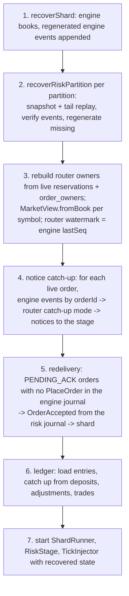

# Week 8: Durability Across the Whole Pipeline (Risk, Ledger, Reconciliation) and End-to-End Recovery

One-week working document. Put it in `docs/WEEK-8.md`. It covers the persistence item that Weeks 6 and 7 deliberately deferred. **Schedule note:** the earlier plan put the API in Week 8. This week is the durability work *first*, and the API, WebSocket and read side move to Week 9, for two reasons: the API's claims ("durably received", "every decision is an event") are only honest once risk and ledger survive a crash, and persistence plus the API is more than one week. Week 9 is previewed at the end.

**The theme of this week:** after Week 5, killing the *matching engine* and restarting it recovers exactly. But the risk stage, the ledger and the reconciliation workflow still live in memory, so a crash loses reservations, balances and break history, and the two stages can disagree afterwards. This week every stateful component gets a Postgres-backed journal or store, and you prove the headline claim across **both stages**: kill the system at any point, restart, and the final state (books, reservations, balances, ledger) equals the uninterrupted run, with no lost order, no duplicate order, and no stranded reservation.

Rule for this week: you hand-write **`RiskCore.restore()`** (validate first, build second, return last: the risk twin of `OrderBook.restore()`). That is the piece you must be able to explain when asked "how does the risk stage recover?" AI tools may help with the codecs, journals, stores, recovery orchestration, the runtime package, tests, the chaos script and docs (section 9).

---

## 0. Status and carry-over

| # | Check | Done when |
|---|-------|-----------|
| V1 | **Week 5 is proven**: `PgJournal`, strict versioned codecs, snapshot store, `recoverStream`, RC1 to RC12, P7, R1 all pass against Postgres (run the full audit, `FULL-AUDIT-PROMPT.md`). Week 8 reuses all of it. If Week 5 is not green, finish it first | Audit says DONE |
| V2 | Weeks 6 and 7 are green (risk core, router, stage, ledger, breaker, recon core) | Audit says DONE |
| V3 | Gate green and `npm run test:flake` 20/20 for unit and integration | Green |
| V4 | Docker and Postgres 18 run locally (integration project) | `npm run test:integration` runs |
| V5 | Spike 4 (Kafka transactions and fencing with the real Confluent API) is still owed before Week 10; note whether it is done | Noted in `PROGRESS.md` |

---

## 1. Goal and scope

**Goal:** a durable, recoverable pipeline whose recovery is proven by tests, including crashes between the stages.

| In scope this week | Deferred |
|--------------------|----------|
| Strict versioned codecs for risk commands, events and state (in `common`) | Fencing enforcement (`writer_epoch` is recorded, not enforced; Week 10) |
| `PgRiskJournal`, `DurableRiskOutbox`, risk snapshots, `RiskCore.exportState()` / `restore()`, `recoverRiskPartition` | Kafka transport, multi-instance failover |
| Durable ledger (`ledger_entries`), `Ledger` restore, ledger catch-up from the journals | HTTP API, WebSocket, projections (Week 9) |
| `order_owners` table written atomically with `OrderAccepted` | Bounding the growth of dedupe sets (snapshot plus sequence window, Week 10) |
| Durable reconciliation store (`recon_runs`, `recon_breaks`, `recon_audit`) with optimistic transitions | `ConfigureBreaker` as a journaled command |
| Router and `MarketView` recovery; notice catch-up for live orders; safe redelivery of orders that never reached the matcher | Performance tuning of recovery (a recovery-time table for risk is optional) |
| New `runtime` workspace: the in-process composition root and `recoverPipeline` | |
| Crash tests across both stages (RCP1 to RCP7), properties P24 to P26, and a `SIGKILL` script across the pipeline | |

---

## 2. Deliverables and definition of done

- [ ] V1 to V5 handled (section 0)
- [ ] Migrations 004 to 007 and tests; `SqlExecutor` abstraction exported by `journal`
- [ ] `common`: risk codecs and state codec with RCD tests
- [ ] `journal` / `risk`: `PgRiskJournal`, `DurableRiskOutbox`, risk snapshot store and scheduler, `RiskCore.exportState()` and `restore()` (**hand-written**), `recoverRiskPartition`
- [ ] `ledger`: `PgLedgerStore`, `Ledger.restore`, catch-up
- [ ] `recon`: `PgReconStore` with optimistic transitions
- [ ] `runtime` (new workspace): production wiring, `recoverPipeline`; `system-tests` import from it
- [ ] All tests in section 8 pass; flake gate 20/20 for unit and integration
- [ ] Mutation table (section 8.9), decisions, docs, README limitations updated
- [ ] You can draw the risk crash-window table and the `recoverPipeline` sequence from memory

**Definition of done:** across random crash points in either stage, after recovery the final books, risk state, ledger and event streams equal an uninterrupted run (sequential flows), and concurrent flows still satisfy every invariant with every order having exactly one terminal fate.

---

## 3. Technologies and tech stack (this week only)

No new npm dependencies (`pg` and Testcontainers came in Week 5). PostgreSQL 18.

| Zone | Rule |
|------|------|
| `common` | Browser-safe: codecs only, no `node:*`, no timers, no crypto |
| `journal` | Owns the Postgres primitives: `createPool`, `SqlExecutor` (`query`, `transaction`), stream and snapshot helpers. Other packages use the `SqlExecutor` **type**; none imports `pg` directly |
| `risk`, `ledger`, `recon` | May depend on `journal` now (as the blueprint allows). Their **cores stay pure** (existing lint zones); persistence adapters live outside the cores |
| `runtime` (new, thirteenth workspace) | Composition root: may depend on every backend package; only `system-tests` (and later `api`) may depend on it |

---

## 4. Architecture

### 4.1 Where the code goes

```
packages/journal/
  migrations/004_order_owners.sql, 005_ledger_entries.sql, 006_recon.sql, 007_journal_indexes.sql
  src/sql-executor.ts      // SqlExecutor interface, toExecutor(pool)
  src/stream-sql.ts        // shared unnest-insert / keyset-read helpers extracted from PgJournal
  src/pg-journal.ts        // + hasCommandForOrder(), readEventsForOrder(), readEventsByType()
  src/state-snapshot-store.ts  // generic snapshot store with a codec; PgSnapshotStore becomes an instance
packages/common/src/codec/
  risk-commands.ts, risk-events.ts, risk-state.ts     // strict, versioned, exhaustive
packages/risk/src/
  core/risk-core.ts        // + exportState(), static restore(config, state)         [restore: hand-write]
  persistence/pg-risk-journal.ts, durable-risk-outbox.ts, risk-snapshot-scheduler.ts, recovery.ts
  stage.ts                 // + afterBatch option (snapshot scheduling); stamper restore
  router.ts                // + restoreOwners(), catch-up mode, setWatermark()
  market-view.ts           // + static fromBook()
packages/ledger/src/       // pg-ledger-store.ts, Ledger.restore(entries), catch-up.ts
packages/recon/src/        // pg-recon-store.ts (implements the existing ReconStore port)
packages/runtime/src/      // wire.ts (moved from system-tests), recover-pipeline.ts, index.ts
packages/system-tests/     // imports runtime; crash-point tests; chaos child
scripts/chaos-pipeline.mjs
```

### 4.2 Schema (migrations)

```sql
-- 004_order_owners.sql: who owns an order; written atomically with the OrderAccepted event
CREATE TABLE order_owners (
  order_id text PRIMARY KEY, account_id text NOT NULL, symbol text NOT NULL,
  side text NOT NULL CHECK (side IN ('BUY','SELL')), created_at timestamptz NOT NULL DEFAULT now());
CREATE INDEX order_owners_account ON order_owners (account_id);

-- 005_ledger_entries.sql
CREATE TABLE ledger_entries (
  seq bigint GENERATED ALWAYS AS IDENTITY PRIMARY KEY,
  tx_id text NOT NULL, leg_idx integer NOT NULL CHECK (leg_idx >= 0),
  account_id text NOT NULL, asset text NOT NULL,
  amount bigint NOT NULL CHECK (amount <> 0),
  direction text NOT NULL CHECK (direction IN ('DEBIT','CREDIT')),
  ref_event_id text NOT NULL, created_at timestamptz NOT NULL DEFAULT now(),
  UNIQUE (tx_id, leg_idx),
  CHECK ((direction = 'DEBIT' AND amount < 0) OR (direction = 'CREDIT' AND amount > 0)));
CREATE INDEX ledger_entries_account_asset ON ledger_entries (account_id, asset);

-- 006_recon.sql
CREATE TABLE recon_runs (run_id text PRIMARY KEY, source text NOT NULL, file_hash text NOT NULL UNIQUE,
  cutoff_ts bigint NOT NULL, price_decimals integer NOT NULL, settlement_lag_days integer NOT NULL,
  rows_read bigint NOT NULL, parse_errors_json jsonb NOT NULL, counts_json jsonb NOT NULL,
  started_at timestamptz NOT NULL, finished_at timestamptz NOT NULL);
CREATE TABLE recon_breaks (break_id text PRIMARY KEY, run_id text NOT NULL REFERENCES recon_runs(run_id),
  type text NOT NULL, trade_id text NOT NULL, internal_json jsonb, external_json jsonb,
  status text NOT NULL CHECK (status IN ('OPEN','INVESTIGATING','RESOLVED','WRITTEN_OFF')),
  reason text, resolved_by text, created_at timestamptz NOT NULL DEFAULT now(), updated_at timestamptz NOT NULL DEFAULT now());
CREATE INDEX recon_breaks_run ON recon_breaks (run_id, type, status);
CREATE TABLE recon_audit (seq bigint GENERATED ALWAYS AS IDENTITY PRIMARY KEY,
  break_id text NOT NULL REFERENCES recon_breaks(break_id),
  from_status text NOT NULL, to_status text NOT NULL,
  reason text NOT NULL CHECK (btrim(reason) <> ''), actor text NOT NULL CHECK (btrim(actor) <> ''),
  ts bigint NOT NULL, adjustment_id text);

-- 007_journal_indexes.sql: lookups used by recovery (adapt the JSON paths to the real codec output)
CREATE INDEX journal_cmd_order ON journal ((payload_json->>'orderId')) WHERE record_type = 'COMMAND';
CREATE INDEX journal_evt_order ON journal ((payload_json->>'orderId')) WHERE record_type = 'EVENT';
CREATE INDEX journal_evt_taker ON journal ((payload_json->>'takerOrderId')) WHERE record_type = 'EVENT';
CREATE INDEX journal_evt_maker ON journal ((payload_json->>'makerOrderId')) WHERE record_type = 'EVENT';
CREATE INDEX journal_evt_type ON journal (stream_id, (payload_json->>'type'), seq) WHERE record_type = 'EVENT';
```

The risk partitions reuse the **same `journal` table** with `stream_id = 'risk-<partition>'` (commands as `COMMAND` rows, events as `EVENT` rows with `idx`), and the **same `snapshots` table** with the risk state codec. The in-memory `Ledger` keeps its own `seq`, renumbered on restore (the database identity may have gaps after rollbacks).

### 4.3 Risk state, export and restore

```ts
type RiskState = {
  version: 1; partition: number;
  instruments: { symbol: string; /* every InstrumentRiskConfig field as strings/numbers */ }[];   // copy of the config, for mismatch detection
  accounts: { accountId: string; cash: bigint; heldCash: bigint;
              positions: { symbol: string; quantity: bigint; heldShares: bigint }[] }[];      // sorted by id, then symbol
  reservations: { orderId; accountId; symbol; side; priceCap: bigint; qtyRemaining: bigint; amountRemaining: bigint;
                  state: 'PENDING_ACK' | 'LIVE'; placedTs: number; placedSeq: number; appliedTradeIds: string[] }[];   // by placedSeq
  decidedOrders: string[]; seenRequestIds: string[]; seenAdjustmentIds: string[]; haltedSymbols: string[];   // all sorted
};
```
`exportState()` is pure, canonical (equal cores give equal states) and returns plain data with no references into the live core. **`snapshot()` from Week 6 is unchanged** (it keeps set *sizes* for cheap comparisons). `RiskCore.restore(config, state)` **validates everything first** (version, config match, no duplicate order ids, reservation account exists, amounts consistent: BUY `amountRemaining == priceCap x qtyRemaining`, SELL `amountRemaining == qtyRemaining`, each account's `heldCash` equals the sum of its BUY reservations and each position's `heldShares` equals the sum of its SELL reservations, `heldCash <= cash`, `heldShares <= quantity`, non-negative values, every reservation order id is in `decidedOrders`), throws `InvalidRiskStateError` with a reason **before building anything**, then builds a new core, then runs `checkInvariants()` and returns it only if clean (all-or-nothing).

### 4.4 Risk crash windows (the second table to memorize)

| # | Crash point | Durable state | Recovery does | Visible effect |
|---|-------------|---------------|---------------|----------------|
| RCP1 | After a risk batch is journaled, before `apply` | Commands, no events | Replays, regenerates events, appends them | None |
| RCP2 | During risk `apply` | Same as RCP1 | Same | None |
| RCP3 | After risk events (and `order_owners`) are journaled, **before `OrderAccepted` reaches the shard** | `OrderAccepted` durable, engine journal has no `PlaceOrder` | **Redelivery**: order is `PENDING_ACK` and the engine journal has no command for it, so it is enqueued to the shard exactly once | Order proceeds as if nothing happened |
| RCP4 | After the order was enqueued to the shard but before the shard journaled it | Same as RCP3 (the shard queue was in memory) | Same redelivery | Same |
| RCP5 | After the shard journaled and applied it, before the notices reached risk | Engine events durable, risk has not applied the fills or closes | **Notice catch-up**: for every live order, engine events that mention it are re-routed; duplicates are ignored by the core (`appliedTradeIds`, unknown-order ignore, idempotent acks) | Reservations converge to the engine's truth |
| RCP6 | After risk journaled a deposit, adjustment or the notices, before the ledger posted | Risk events durable, ledger entries missing | **Ledger catch-up**: replay deposits, adjustments and trades through idempotent posts | Ledger equals risk again |
| RCP7 | During a risk snapshot write | No snapshot or a torn one | Fall back to the previous valid snapshot, else full replay | Slower recovery only |

Redelivery uses the engine journal as the truth, so it can never place an order twice and never loses one. The runtime leak sweeper (Week 6) still covers messages dropped while the process is alive.

### 4.5 `recoverPipeline` sequence



Failure policy: a `ReplayMismatchError`, `JournalGapError`, `InvalidRiskStateError`, `OwnerMissingError` (a trade whose order has no owner row) or a ledger invariant failure is **fatal**: `recoverPipeline` throws and nothing starts.

### 4.6 Ledger durability

`PgLedgerStore.appendTx(tx)`: one statement (or one transaction) inserting all legs with `ON CONFLICT (tx_id, leg_idx) DO NOTHING`; a duplicate `txId` inserts nothing and returns `posted: false`. The pure `Ledger` validates balance **before** the database is touched. `loadAll()` returns entries in `seq` order; `Ledger.restore(entries)` rebuilds and runs `checkInvariants()`. A SQL invariant query (`SELECT asset, SUM(amount) ... GROUP BY asset`) is available for audits. Normal operation posts live (idempotent); catch-up covers any gap.

### 4.7 Reconciliation durability

`PgReconStore` implements the existing store port. `createRun` is idempotent by `file_hash` (unique), returning the existing run. Breaks are inserted in one transaction with the run. A status change runs in one transaction: `UPDATE recon_breaks SET status = $to ... WHERE break_id = $id AND status = $from` (optimistic check); zero rows updated means someone else changed it, and the transition fails with `CONCURRENT_MODIFICATION`; the audit row is inserted in the same transaction. Terminal states are enforced by the same `WHERE`. The audit table is append-only (no update or delete in the store API).

### 4.8 Dependency map and workspaces

| Package | Change |
|---------|--------|
| `journal` | Adds `SqlExecutor`; still depends on `engine-core`, `common`, `pg` |
| `risk`, `ledger`, `recon` | May now depend on `journal` (blueprint 4.4). They use `SqlExecutor`, never `pg` |
| `runtime` | **New** thirteenth workspace (decision): depends on all backend packages |
| `system-tests` | May depend on `runtime` |
| `shard`, `engine-core` | Dependencies unchanged; `engine-core` source unchanged except nothing this week |

Update `scripts/check-boundaries.mjs` and `docs/BLUEPRINT.md` 4.4 together and prove the checker fires.

---

## 5. How to build it (day by day) and split points

| Day | Hours | Do | Done when |
|-----|-------|----|-----------|
| 1 | 3 | V1 to V5. Migrations, `SqlExecutor`, shared stream helpers, risk codecs, `PgRiskJournal`, `DurableRiskOutbox` (Prompt 1) | RCD, MG, RJ, DO green |
| 2 | 3 | Risk state export tests first; **you hand-write `RiskCore.restore()`**; snapshots; `recoverRiskPartition` (Prompt 2) | RX, RSS, RR, P24 green |
| **split point 1** | | Risk is durable on its own. Strong deliverable | |
| 3 | 3 | Durable ledger, order owners, durable recon, catch-up (Prompt 3) | LP, OW, LC, RDB green |
| 4 | 3 to 4 | `runtime` package, `recoverPipeline`, router and market-view recovery, crash-point tests (Prompt 4) | RM, PR, RCP1 to RCP7 green |
| **split point 2** | | Pipeline recovery proven | |
| 5 | 3 | `SIGKILL` pipeline chaos, mutations, docs, gate (Prompt 5) | P25, P26, R1c, everything green |
| 6 to 7 | 2 | Buffer, whiteboard, flake gate | Done |

**Stuck protocol:** if a recovery divergence costs more than 90 minutes, shrink it to one account, one symbol, one crash point, three commands. Print the risk state before and after recovery side by side; the first differing field names the missing piece (usually a dedupe set, a halted symbol, or an unpersisted owner).

---

## 6. Worked scenarios (use as fixtures)

### Scenario 1: risk recovery with a snapshot (RR3)
Partition 0: `OpenAccount acc1`, `Deposit CASH 10_000`, then 30 commands (orders, fills, closes). Snapshot at risk `seq` 20. Crash. Recovery restores the snapshot, replays seq 21 to 32, verifies the stored events for those commands, and the recovered `exportState()` equals the state of a fresh core fed all 32 commands.

### Scenario 2: the unsent order (RCP3, RCP4)
`acc1` cash 1,000; `BUY o1 q5 @100` is accepted (reserve 500) and journaled (`OrderAccepted` and the `order_owners` row durable), then the process dies before the shard sees it. Recovery: `o1` is `PENDING_ACK`; the engine journal has no command for `o1`; the `OrderAccepted` is read from the risk journal and enqueued; the order rests exactly once; reservation intact. Variant: the shard had journaled `o1` before the crash: no redelivery; notice catch-up applies any missed ack.

### Scenario 3: missed fills (RCP5)
`o1` (BUY q10 @105) rests; a counterparty SELL fills 4 @ 101 and the shard journals and applies it, then the process dies before risk saw `FillApplied`. Recovery: `o1` is live in risk with qtyRemaining 10; catch-up re-routes the engine `TradeExecuted` (and any `OrderRested`) for `o1` through the router in catch-up mode; the core converts: cash 10,000 - 404, held 630, position 4, improvement 16 released (Week 6 Scenario 1). Re-running the catch-up a second time changes nothing.

### Scenario 4: ledger behind risk (RCP6)
Deposit 1,000 and one trade were journaled; the ledger has only the deposit. Catch-up posts the trade from the engine journal using `order_owners` for buyer and seller; ledger balances equal risk balances; running it again posts nothing.

### Scenario 5: concurrent resolves (RDB)
Two operators resolve the same `OPEN` break at the same time: exactly one transition succeeds; the other fails with `CONCURRENT_MODIFICATION`; the audit table has exactly one entry for that change.

---

## 7. Edge cases to handle

**Codecs and journals**
- Risk command and event codecs are strict (unknown type, missing or extra field, wrong JS type, non-canonical decimal each throw a typed error naming the field) and exhaustive (adding a command or event type fails to compile)
- `SubmitOrder` carries `MarketInput` with optional fields; absent fields round-trip as absent
- Per-partition contiguity; two partitions interleaved in one batch; a duplicate or gap rejected before any write
- Idempotent event re-append; different content for the same key is an error (as in Week 5)
- Events and the `order_owners` row for an `OrderAccepted` are written in **one transaction**; if either fails neither persists
- Connection failure during append: rejects, nothing recorded, fail-stop

**Risk state and recovery**
- Restore rejects every inconsistency in 4.3 before building anything, and the configuration must match
- The dedupe sets survive restore: a duplicate `SubmitOrder` after a restart is still `DuplicateIgnored`; a duplicate fill still ignored; halted symbols still halted
- Snapshot ahead of the journal, corrupt checksum, unknown version, restore failure: fall back (as in Week 5)
- Stamper state (`seq` per partition, `lastTs`) continues after recovery; a clock stepping back is clamped
- A multi-partition recovery restores each partition independently

**Pipeline recovery**
- Redelivery only when the order is `PENDING_ACK` **and** the engine journal has no command for it; never twice, never lost
- Notice catch-up uses indexed lookups by order id and a catch-up mode that skips sequence-gap detection, then sets the router watermark to the engine's last seq
- Catch-up is idempotent: running it twice leaves state unchanged
- `OwnerMissingError` is fatal
- The sweep set is volatile by design: a stale `PENDING_ACK` is simply swept again later
- MarketView after recovery equals the live view (resting orders from the book, last trade from the last trade event)
- Ledger catch-up covers deposits, adjustments and trades; an adjustment posted twice is a no-op

**Reconciliation store**
- Same file hash re-uploaded after a restart: same run, no new breaks
- Concurrent transitions: exactly one wins
- Empty reason or actor rejected by the database constraint as well as the workflow

**Process-level**
- `SIGKILL` at random moments across both stages, including during snapshots and between the two stages
- Postgres unavailable at startup: `recoverPipeline` fails fast; nothing starts on unknown state

---

## 8. Test cases to pass

All new this week; add the IDs to the blueprint tables. Integration tests run in the integration project (`*.int.test.ts`); pure tests run in the unit project.

### 8.1 Codecs, migrations, journal

| # | Test | Expected |
|---|------|----------|
| RCD1 | Property: random risk commands (all types, bigint above 2^53) serialize, `JSON.stringify`, `JSON.parse`, deserialize | Deep-equal |
| RCD2 | Same for every risk event | Deep-equal |
| RCD3 | Strictness | Each malformation throws a typed error naming the field |
| RCD4 | Optional `MarketInput` fields | Absent stays absent |
| RCD5 | Versioning and determinism | `v: 1`; unknown version throws; same value gives the same canonical string |
| RCD6 | Exhaustiveness | Compile-time check |
| RCD7 | `RiskState` codec round trip | Deep-equal; canonical order preserved |
| MG4 | Migrations 004 to 007 | Apply in order, idempotent, checksummed (extends MG1 to MG3) |
| RJ1 | Append risk commands for two partitions | Rows correct (`risk-0`, `risk-1`), payloads decode |
| RJ2 | Gap, duplicate, wrong start | `JournalSequenceError`, nothing persisted |
| RJ3 | Batch with a conflicting row | Entire batch rolled back |
| RJ4 | 10,000-command batch | One statement |
| RJ5 | Events: idempotent re-append; different content errors | As in Week 5 |
| RJ6 | `readCommands` chunking and ordering | Correct |
| RJ7 | Connection failure | Nothing recorded |
| RJ8 | Journal indexes used | Lookups by order id use the expression indexes (assert with `EXPLAIN` on a seeded table) |
| DO1 | `DurableRiskOutbox` | Events journaled **before** forwarding |
| DO2 | `OrderAccepted` | `order_owners` row inserted in the same transaction; if the events insert fails, no owner row |
| DO3 | Idempotent re-publish | No duplicate owner or event rows |

### 8.2 Risk state, snapshots, recovery

| # | Test | Expected |
|---|------|----------|
| RX1 | `exportState()` canonical | Equal cores give equal states; twice is identical |
| RX2 | Isolation | Mutating the core after export does not change the state; mutating the state does not affect a restored core |
| RX3 | Restore of an empty core | Empty, healthy |
| RX4 | Restore after a scripted flow (Week 6 Scenario 1) | Identical behavior afterwards |
| RX5 | Dedupe sets and halted symbols survive restore | Duplicate order, fill, deposit, adjustment all still ignored; halted symbol still rejects |
| RX6 | Malformed states (each rule in 4.3: duplicate reservation, orphan reservation, held mismatch, negative, over-held, config mismatch, version, reservation not in `decidedOrders`) | `InvalidRiskStateError` with the right reason; nothing built |
| RX7 | `checkInvariants()` gate | A state that passes validation but fails invariants is rejected |
| **P24** | Property: random flows through a core, random cut point `k`; core A runs all, core B runs `k`, exports, restores into C, runs the rest | Events after `k` and final `exportState()` identical (numRuns >= 1000) |
| RSS1 to RSS5 | Risk snapshot store: round trip, newest valid first, corrupt checksum skipped, unknown version skipped, ahead-of-journal skipped | As SS1 to SS5 |
| RSC1 | Snapshot scheduler (count-based) | Snapshots when due, failure non-fatal, retried |
| RR1 | Empty journal | Fresh core |
| RR2 | No snapshot, N commands | Equals the live core |
| RR3 | Scenario 1 | Snapshot plus tail equals full replay; only the tail applied |
| RR4 | Events missing for the tail | `regenerated` returned and appended; second recovery regenerates none |
| RR5 | Tampered stored event | `ReplayMismatchError` |
| RR6 | Deleted command row | `JournalGapError` |
| RR7 | Torn snapshot | Fallback, identical result |
| RR8 | Snapshot ahead of the journal | Ignored |
| RR9 | Snapshot that fails restore | Ignored, reported |
| RR10 | Two partitions | Independent; `lastTs` max |
| RR11 | Stamper continues | `seq` and `ts` continue; clamped clock |
| RR12 | Large tail | Chunked reads |

### 8.3 Ledger, owners, recon store

| # | Test | Expected |
|---|------|----------|
| LP1 | `appendTx` atomic | Legs all or nothing |
| LP2 | Duplicate `txId` | `posted: false`, no rows |
| LP3 | Unbalanced tx | Rejected by the pure ledger before any SQL |
| LP4 | `loadAll` and `Ledger.restore` | Same balances; invariants clean; entries in order |
| LP5 | Reversal persisted | Original rows untouched; new rows `rev:...` |
| LP6 | Concurrent append of the same tx | One set of rows |
| LP7 | Bigint exactness near 2^63 - 1 | Exact |
| LP8 | Database constraints | Zero amount, sign/direction mismatch rejected by SQL |
| LP9 | SQL invariant query | Per-asset sums are 0 after a scripted run |
| OW1 | Owner insert and lookup | Correct |
| OW2 | Idempotent re-insert | One row |
| OW3 | Conflicting owner for the same order id | Error |
| OW4 | Batch lookup for catch-up | One query for many order ids |
| LC1 | Catch-up from deposits, adjustments, trades | Ledger equals the live ledger |
| LC2 | Partial ledger (rows deleted) | Catch-up fills the gap |
| LC3 | Idempotent | Second run posts nothing |
| LC4 | Missing owner | `OwnerMissingError`, fatal |
| LC5 | Scenario 4 | Exact balances |
| LC6 | Ledger equals risk balances after catch-up | P19 holds |
| RDB1 | Run idempotent by file hash across a store restart | Same run, no new breaks |
| RDB2 | Breaks and counts persisted | Read back equal |
| RDB3 | Allowed transition with audit row | One transaction |
| RDB4 | Concurrent resolves (Scenario 5) | Exactly one wins; one audit row |
| RDB5 | Terminal immutability | Enforced under concurrency |
| RDB6 | Empty reason or actor | Rejected by the database constraint too |
| RDB7 | Audit append-only and ordered | Ascending `seq`, no update path |
| RDB8 | Filters by run, type, status | Correct |

### 8.4 Router, market view, pipeline recovery

| # | Test | Expected |
|---|------|----------|
| RM1 | `router.restoreOwners` from live reservations and `order_owners` | Owner map equal to the live router's |
| RM2 | `MarketView.fromBook` | `snapshotFor` equals the live view for random books |
| RM3 | Catch-up mode | Skips sequence-gap detection; the watermark is then set so live outputs continue |
| RM4 | Notice catch-up for live orders (Scenario 3) | Reservation converges; second run changes nothing |
| PR1 | Redelivery decision | `PENDING_ACK` and no engine command: redeliver; engine command present: do not |
| PR2 | Scenario 2 | Order rests exactly once; no duplicate command in the engine journal |
| PR3 | Redelivery of an IOC that already completed | Not redelivered (engine journal has the command) |
| PR4 | `recoverPipeline` ordering | Steps 1 to 7 in order; a fatal error in any step starts nothing |
| PR5 | Fatal conditions | `ReplayMismatchError`, `JournalGapError`, `InvalidRiskStateError`, `OwnerMissingError` each prevent start |
| PR6 | Recovered pipeline accepts new orders | `seq`, `ts` continue; reservations consistent |
| **RCP1 to RCP7** | Crash-point tests per section 4.4 (deterministic wrappers, fixed example plans) | Recovery per the table; final state equals the uninterrupted run |

### 8.5 End-to-end properties

| # | Test | Expected |
|---|------|----------|
| **P25** | Sequential flows (one command at a time, quiesce between), random crash point in **either** stage (engine CP1 to CP5 and RCP1 to RCP7), recovery, resend of only non-durable submissions, run to completion, fake clock constant, one partition | Final books, `exportState()`, ledger and event streams equal the uninterrupted run (numRuns about 40) |
| **P26** | Concurrent flows (several accounts, symbols, partitions 1 and 4), random crash point and delays | After recovery: all invariants hold, ledger equals risk (P19), every order has exactly one terminal fate (filled, cancelled, rejected, released), no order placed twice (engine journal has at most one `PlaceOrder` per order id), no reservation without a live or `PENDING_ACK` order |
| **P19x** | Ledger equals risk after every recovery in P25 and P26 | Equal |
| **R1c** | `scripts/chaos-pipeline.mjs`: a child process runs the full pipeline on Postgres, the driver sends `SIGKILL` at random moments, restarts, repeats; compare with an uninterrupted sequential run by seed | Equal; not part of `npm test` |

### 8.6 Determinism and flake gate

No sleeps, no `setTimeout`, no `Math.random` in tests (the chaos script excepted); fast-check generates flows and crash plans; unique Postgres schema per test file. `npm run test:flake` for unit and integration: 20 of 20.

### 8.7 Optional

A recovery-time table for the risk partition (tail length versus snapshot interval), with hypotheses committed before the run, like R6. Not required for the definition of done.

### 8.8 Regression

Every earlier test passes unmodified, including C2 (the naive bug proof), C1, C1b, K10 to K12, R4, P7, P8, R1 to R3.

### 8.9 Mutation checks (prove the tests have teeth)

Apply each separately **in a temporary copy of the repo** (never with git), record failing tests, restore:
1. Risk recovery skips one command: RR2, RR3, P25.
2. `restore` forgets `decidedOrders`: RX5, P24.
3. `restore` forgets `haltedSymbols`: RX5.
4. `restore` forgets `appliedTradeIds`: RX5, RM4.
5. `DurableRiskOutbox` forwards before journaling events: DO1.
6. Owner row not inserted atomically with the events: DO2.
7. Redelivery ignores the engine-journal check (double placement): PR1 to PR3, P26.
8. Redelivery skipped (lost order): PR2, RCP3, P25.
9. Notice catch-up skipped: RM4, RCP5, P26.
10. Ledger catch-up not idempotent: LC3.
11. Ledger append not atomic: LP1.
12. Recon transition without the optimistic `WHERE`: RDB4, RDB5.
13. Risk codec drops `MarketInput`: RCD4, RR2.
14. Snapshot taken before the last command of a batch is applied: P24, RR3.
15. Risk stamper restore forgets `lastTs`: RR11.
16. `recoverPipeline` runs ledger catch-up before shard recovery: PR4, LC.
17. Router catch-up applies sequence-gap detection: RM3.
18. `Ledger.restore` skips the invariant check: LP4.

A surviving mutation is a test gap: strengthen the test, not the code.

---

## 9. Rules for this week

- `engine-core` is unchanged this week (`git diff` must be empty). `ShardRunner.run()` is untouched.
- The cores (`risk/src/core`, `ledger/src` pure parts, `recon/src/core`) stay pure; persistence adapters live outside them.
- Journal writes are atomic or absent: one statement or one transaction per batch.
- Decoding is strict; never a permissive parser.
- Never swallow `ReplayMismatchError`, `JournalGapError`, `InvalidRiskStateError` or `OwnerMissingError`.
- Integration tests only in the integration project; unit tests never need Docker.
- Your own git identity commits everything; the agent never runs git write commands.
- Every number in the docs comes from a run you can point to.
- **AI tools this week.** Allowed: migrations, codecs, journals, stores, scheduler, recovery orchestration, runtime package, tests, chaos script, docs, reviews. **Not allowed:** `RiskCore.restore()`.

---

## 10. Decisions to record in `docs/decisions.md`

Format: context, options, choice, trade-offs, how tested.

1. Durability of the whole pipeline before the API: why this ordering; what changes in the schedule.
2. Reuse of the `journal` and `snapshots` tables for risk partitions (`risk-<p>` streams) versus separate tables.
3. `exportState()` separate from `snapshot()`; why state includes the dedupe sets and halted symbols.
4. `RiskCore.restore` validates first, builds second, checks invariants last (all-or-nothing), mirroring the book.
5. Events journaled by an outbox before they are forwarded; `order_owners` written in the same transaction.
6. Redelivery of unsent orders decided by the engine journal (exactly once) versus relying on the sweeper only.
7. Notice catch-up by order id with idempotent core handlers, versus a durable router checkpoint.
8. Ledger durability: entries table plus idempotent catch-up from the journals; why not a derived-only ledger.
9. Reconciliation store with optimistic transitions and database constraints.
10. `SqlExecutor` abstraction so non-journal packages never import `pg`.
11. New `runtime` workspace as the composition root; wiring moved out of `system-tests`.
12. Fatal versus recoverable conditions during `recoverPipeline`.
13. Known limits: dedupe sets grow without bound (bounded in Week 10), no fencing yet (Week 10), recovery time grows with the tail.
14. What the recovery claim now covers, and what it does not.

---

## 11. Interview prep for this week

Be able to answer from memory:

- Walk through a crash between the two stages: after the risk stage journaled an accepted order but before the shard saw it. How does the system avoid losing it, and how does it avoid placing it twice?
- Why is it safe to re-route engine events to risk after a crash? (Idempotent handlers: fills by trade id, unknown-order ignore, idempotent acks.) Why filter by live orders?
- Why does `order_owners` have to be written in the same transaction as the `OrderAccepted` event?
- Why does the ledger need both live posting and catch-up?
- Why does `restore` validate before building? What breaks if a corrupt state silently becomes live?
- What is in the risk state that a "balances only" snapshot would miss? (Dedupe sets, halted symbols, reservations with applied trade ids.)
- What does the recovery claim cover now, and what remains? (No fencing yet; unbounded dedupe sets; recovery time grows with the tail.)
- How would two instances of the risk stage break this, and what does Week 10 add?

**Whiteboard exercise (no notes):** draw the seven crash windows of the two stages (engine CP1 to CP5 from Week 5, RCP1 to RCP7 here) on one timeline of a single order's life, and for each say what is durable and what recovery does. Then draw the `recoverPipeline` sequence and say why step 4 comes before step 5.

---

## 12. Common mistakes to avoid

- Persisting events and the owner row in separate transactions
- Redelivering every `PENDING_ACK` order without checking the engine journal (double placement of an IOC that already completed)
- Applying sequence-gap detection to catch-up outputs (it throws on the intentional gaps)
- Forgetting to set the router watermark after catch-up (the first live output looks like a gap or a duplicate)
- Restoring balances but not the dedupe sets (a duplicate order after restart is accepted)
- Snapshotting mid-batch
- Letting a ledger post happen before the validation of balance
- Deriving idempotency from `seq` (identity gaps) instead of `tx_id` and `leg_idx`
- Treating a mismatch, gap or missing owner as a warning
- Running the ledger catch-up before the engine and risk are recovered
- Hashing or comparing `jsonb` text instead of canonical serializations
- Touching `engine-core` or `ShardRunner.run()` to make recovery fit

---

## 13. Progress log (copy into `PROGRESS.md` each day)

```
Day N:
- Done:
- Failing / blocked:
- Next failing test to write:
- Flaky tests seen (and root cause):
- Property-test seeds worth keeping:
- Decisions made:
```

---

## 14. Week 9 preview (blueprint Week 9: API, WebSocket, read side)

Now the **Fastify API** on top of `runtime`: JWT auth with roles (`jose`), zod schemas in `common` shared with the UI, RFC 9457 errors, the asynchronous `202` contract (durably received means journaled), idempotent `POST /orders` through the order-request store, rate limiting, order, market data, account, risk and reconciliation endpoints, then **projections** (order status, positions, top of book, reconciliation views, the audit timeline for P4), the WebSocket protocol with snapshot plus deltas, `seq` resync and slow-client conflation. The UI tiers come after.

What Week 8 must hand over: a runtime that recovers across both stages, durable ledger and reconciliation, the `runtime` facade the API will call, and a README that states honestly what the recovery claim covers.