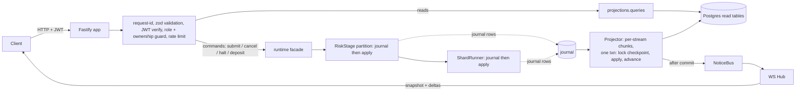
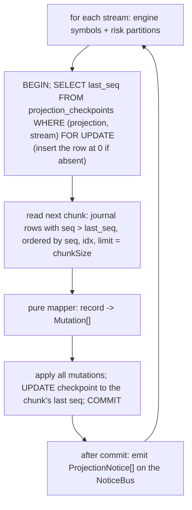
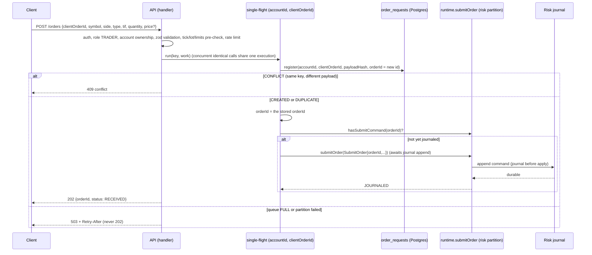

# Week 9: The API Layer, Projections (CQRS Read Side) and the WebSocket Gateway (v2, corrected)


One-week working document. Put it in `docs/WEEK-9.md`. It covers blueprint "Week 9: API, WebSocket and read side". Week 10 (React UI, tier 1 and 2 pages) is previewed at the end.


**Changes from v1 (read once):**
1. Projector exactly-once is now enforced by a **locked checkpoint comparison inside the transaction** (section 4.4), not by "idempotent upserts", because balance counters are incremental. Absolute values are used wherever an event carries them.
2. `POST /orders` uses an **in-process single-flight per `(accountId, clientOrderId)`** so concurrent identical requests journal exactly one `SubmitOrder` (section 4.6).
3. `cancel_requested` is written **by the projector** from the journaled engine `CancelOrder` command, never by the HTTP handler (the projector is the only writer).
4. Open decisions are resolved: cancel of a terminal order is `409`; resume on an automatic Open is `202` plus a visible `BreakerCommandIgnored` fact.
5. The audit timeline order is **display-only** (not a correctness claim) and tie-broken causally.
6. `/auth/refresh` has a maximum session age.
7. Scope is split into **9a (days 1 to 4)** and **9b (days 5 to 7)**. Budget about 18 to 22 hours of agent-assisted work plus your two hand-written functions and review; if that exceeds your 10 to 15 hours per week, run 9a and 9b as two calendar weeks.
8. New rule: **no `it.todo`, `it.skip`, placeholders or invented test names**; a CI script enforces it (section 9).


**The theme of this week:** until now the system had no front door. After Week 8 it is durable across both stages, and `recoverPipeline` hands you a running pipeline. This week you put the **Fastify API** in front of it and build the **read side**: projections that turn the journals into queryable tables, and a **WebSocket gateway** that pushes changes to clients. Three claims have to become visible and testable:


1. **`202` means durably received, and nothing more.** An order is acknowledged only after its `SubmitOrder` command is journaled. Risk failures are never synchronous errors; they arrive as events.
2. **Reads never touch the engine.** Every GET reads a projection. The projections are rebuildable from the journals and must equal the live risk state.
3. **Every action is authorized by the server.** Roles and ownership are enforced in the API, not hidden in a menu.


Rule for this week: you hand-write **`deriveOrderStatus()`** (projections) and **`submitOrderDurably()`** (api). AI tools may help with everything else (section 9).


---


## 0. Status and carry-over


| # | Check | Done when |
|---|-------|-----------|
| V1 | **Week 8 is proven, not reported.** `recoverPipeline` has all seven steps implemented; `grep -rniE "it\.todo|it\.skip|placeholder|NOT IMPLEMENTED|TODO" packages --include=*.ts` returns nothing in Week 5 to 8 code; RR, LP, OW, LC, RDB, RM, PR, RCP1 to RCP7, P25, P26, P19x all exist as real tests and pass; flake 20/20 | **If this fails, STOP. Week 9 does not start.** Finish Week 8 first |
| V2 | Gate green: `npm ci`, build, lint, `check:boundaries`, `npm test`, `npm run test:integration`; `npm run test:flake` 20/20 | Green |
| V3 | **Runtime facade inventory.** Write `docs/RUNTIME-API.md`: the exact methods `runtime` exposes today with real signatures, and what the API needs that is missing (section 4.2) | File exists; gaps listed. **Never invent a facade method; add the smallest one and record it** |
| V4 | Build hygiene: no compiled `.js` or `.d.ts` next to sources, `dist` and `dist-test` excluded from Vitest, `check:no-placeholders` script exists and runs in CI | `git ls-files` shows no emitted JS under `src` or `test` |
| V5 | Spike 4 (Kafka transactions and fencing) still owed before the Kafka week; note whether done | Noted in `PROGRESS.md` |


---


## 1. Goal and scope


**Goal:** a secure, honest HTTP and WebSocket surface over the durable pipeline, with read models that are rebuildable, exactly-once and provably consistent with the risk core.


| In scope this week | Deferred |
|--------------------|----------|
| Shared contracts in `common`: zod schemas, `ApiRole`, endpoint-role table, problem codes, money formatting | React UI (Week 10) |
| Fastify app factory, request ids, RFC 9457 errors, JWT (jose) auth, role and ownership guards, login/refresh/me | OAuth, external identity, password reset, token revocation |
| Orders: submit (202), get, list, cancel (202), audit timeline | Amend / `PATCH /orders` (engine amend is not built; not in the OpenAPI) |
| Market data: instruments, book, trades, status | Redis cache (in-process only if needed, behind a port) |
| Accounts: balances, positions, pnl, reservations, ledger lines | Fees, margin |
| Risk endpoints: halt, resume, breakers, rejections feed | `PUT /risk/accounts/{id}/limits` and `PUT .../breaker-config` (no limits model; `ConfigureBreaker` is not a journaled command yet) |
| Reconciliation endpoints over the durable store, multipart upload | Break-detail UI actions beyond status and resolve |
| Admin: users, accounts, deposit | `/admin/instruments`, `/admin/demo/reset`, `/system/chaos/*`, `/system/simulator/*` |
| System: `/system/invariants`, `/system/health` | Shard ownership, fencing epochs, throughput dashboards (Kafka and metrics weeks) |
| Projections in Postgres, a checkpointed projector (exactly-once, order-independent), rebuild from journals | Redis hot cache |
| WebSocket gateway: auth message, subscribe, snapshot plus deltas, `seq` and `epoch`, slow-client policy | Multi-instance fan-out (needs shared pub/sub; documented) |
| Per-account rate limiting (in-memory token bucket behind a port) | Redis-backed limiter |
| `prom-client` metrics and health on a separate port | Grafana dashboards |
| Hand-written `openapi.yaml` plus a contract test that it matches the registered routes | Swagger UI |


---


## 2. Deliverables and definition of done


- [ ] V1 to V5 handled (section 0), `docs/RUNTIME-API.md` written
- [ ] Dependencies added and pinned with `npm view` peer checks; boundary map, checker and lint updated with proofs (section 4.12)
- [ ] `common`: zod request and response schemas, error codes, money formatting; ZS tests
- [ ] Migrations 008 to 011 and tests
- [ ] `projections`: tables, projector, `deriveOrderStatus` (**hand-written**), rebuild, notices; OS, MP, PJ, PX, P27, P28
- [ ] `api`: app factory, auth, guards, errors, orders (with hand-written `submitOrderDurably`), market data, accounts, audit, risk, recon, admin, system, WebSocket gateway, hub, rate limiter
- [ ] `packages/api/openapi.yaml` and contract test OC1, OC2
- [ ] `main.ts` composition (migrate, recover, start projector, listen), separate metrics and health port, `.env.example`
- [ ] All tests in section 8 exist with their IDs in the test titles and pass; **a test-ID table (ID, file, status) is in `PROGRESS.md`**; flake gate 20/20 for unit and integration
- [ ] `check:no-placeholders` is green and runs in CI
- [ ] Mutation table (section 8.11), decisions, README limitations, `PROGRESS.md` updated
- [ ] You can draw the `POST /orders` durability sequence and the projector transaction from memory


**Definition of done:** a client can log in, submit an order, receive `202`, watch its status through WebSocket and GET until a terminal fate, read the audit timeline including the account snapshot of a rejection; killing and restarting the process loses none of this; dropping and rebuilding the projections reproduces identical tables; and the role matrix test proves every endpoint refuses the wrong role.


---


## 3. Technologies and tech stack (this week only)


First new runtime dependencies since Week 5. For each, run `npm view <pkg> version peerDependencies`, pin exact, and record in `docs/versions.md`. Do not install anything else.


| Package | Used by | Why | Check |
|---------|---------|-----|-------|
| `fastify` 5.x (your pin) | api | HTTP edge | Already pinned (5.10.x) |
| `@fastify/websocket` | api | WebSocket on Fastify (wraps `ws`) | Peer range must include Fastify 5 |
| `@fastify/multipart` | api | Reconciliation upload, streamed | Peer range must include Fastify 5 |
| `jose` | api | JWT sign and verify (HS256) | none |
| `zod` 4.x | common | Shared request and response schemas | Browser-safe |
| `prom-client` | api | Metrics, event-loop lag | none |
| `ws` and `@types/ws` (dev) | api tests | Real WebSocket client in tests | Same major as `@fastify/websocket` uses |


Not used: Redis, Kafka, a rate-limit plugin, an auth plugin, an ORM, Swagger UI. Password hashing uses `node:crypto` `scrypt`.


Where impure APIs may appear: `api` (http, timers for auth timeout and drain checks, `node:crypto`), `projections` (timers only in the optional poller outside the pure functions; `deriveOrderStatus` and the event-to-row mapping are pure), `runtime`. `common` stays browser-safe.


---


## 4. Architecture


### 4.1 Where the code goes


```
packages/common/src/api/
 roles.ts            // ApiRole; ENDPOINT_ROLES keyed "METHOD /path" (single source for server guards and UI route guards)
 schemas.ts          // zod: PlaceOrderBody, ListOrdersQuery, Pagination, Login, Deposit, HaltBody, ResolveBody, ... + response DTO types
 problem.ts          // ProblemCode union, Problem type (RFC 9457 shape)
 money-format.ts     // formatMinor(bigint, decimals), parseDecimalToMinor(string, decimals)  (reuses the Week 1 codec)
packages/projections/
 (migrations live in journal/migrations, 008 to 011)
 src/order-facts.ts      // OrderFacts type, deriveOrderStatus(facts)                [hand-write]
 src/mappers.ts          // pure: journal record -> Mutation[] (typed row operations)
 src/projector.ts        // Projector: runOnce(), start(), stop(), wake(), rebuild()
 src/checkpoints.ts      // projection_checkpoints access (SELECT ... FOR UPDATE)
 src/queries.ts          // getOrder, listOrders, orderTimeline, book, trades, balances, positions, pnl, reservations, rejections, breakers
 src/notices.ts          // ProjectionNotice union + NoticeBus (in-process, after commit)
packages/api/src/
 config.ts, app.ts (buildApp(deps), no listen), main.ts (composition root)
 plugins/request-id.ts, errors.ts, auth.ts, rbac.ts, rate-limit.ts, metrics.ts
 auth/passwords.ts (scrypt), auth/tokens.ts (jose), auth/users.ts (SqlExecutor store)
 orders/submit.ts        // submitOrderDurably()                                      [hand-write]
 orders/single-flight.ts // keyed in-flight promise map
 routes/auth.ts, orders.ts, market.ts, accounts.ts, risk.ts, recon.ts, admin.ts, system.ts
 ws/hub.ts, ws/gateway.ts
 openapi.yaml
packages/runtime/src/    // + smallest facade additions recorded in docs/RUNTIME-API.md
packages/system-tests/test/api-*.int.test.ts
scripts/rebuild-projections.mjs, scripts/seed-demo.mjs, scripts/check-no-placeholders.mjs
.env.example
```


### 4.2 Request pipeline and what talks to what





Rules baked into the picture:
1. **Commands go through the runtime facade only**; the API never touches a core, a stage queue or the shard directly.
2. **Reads go through projections only.** The one allowed exception is `GET /system/invariants`, which compares projections with the risk core and the ledger on purpose.
3. **The projector is the only writer of projection tables**, and it reads the same journals recovery reads. HTTP handlers never write a projection table (including `cancel_requested`).
4. **Notices are emitted only after commit.**
5. **Reads are eventually consistent** with writes. After a `202`, a GET may briefly see no projection row; `GET /orders/{id}` synthesizes `RECEIVED` from `order_requests` when the command is journaled and no view row exists (4.6).


**Facade methods the API needs (verify against `docs/RUNTIME-API.md`; add only what is missing):**


| Need | Contract |
|------|----------|
| `submitOrder(cmd)` | Resolves `{ kind: 'JOURNALED', riskSeq }` **after the risk journal append for that command resolved**, or `{ kind: 'FULL' }`, or rejects when the partition has failed |
| `hasSubmitCommand(orderId)` | True if a `SubmitOrder` for that order id is already in a risk journal (migration 007 index) |
| `cancelOrder(symbol, orderId)` | Enqueues `CancelOrder` to the shard; `ACCEPTED`, `FULL`, `UNKNOWN_SYMBOL`, `CLOSED` |
| `haltSymbol` / `resumeSymbol` | Enqueue `HaltSymbol` / `ResumeSymbol` to the shard |
| `openAccount`, `deposit` | Risk commands with `requestId` idempotency, resolved after journaling |
| `riskView(accountId)` | Synchronous copy of the core view (only for `/system/invariants` and tests) |
| `internalTrades(fromTs, toTs)` | Reconciliation source: engine `TradeExecuted` joined with `order_owners` |
| `ledgerSnapshot()` | Balances for invariants |


### 4.3 Schema (migrations 008 to 011; adapt names to your codec, keep the semantics)


```sql
-- 008_users.sql
CREATE TABLE users (
 user_id text PRIMARY KEY, username text NOT NULL UNIQUE,
 password_hash text NOT NULL,                      -- 'scrypt$N$r$p$saltB64$hashB64'
 role text NOT NULL CHECK (role IN ('TRADER','RISK','OPS','ADMIN')),
 active boolean NOT NULL DEFAULT true, created_at timestamptz NOT NULL DEFAULT now());
CREATE TABLE user_accounts (
 user_id text NOT NULL REFERENCES users(user_id), account_id text NOT NULL,
 PRIMARY KEY (user_id, account_id), UNIQUE (account_id));


-- 009_projection_core.sql
CREATE TABLE projection_checkpoints (
 projection text NOT NULL, stream_id text NOT NULL, last_seq bigint NOT NULL CHECK (last_seq >= 0),
 updated_at timestamptz NOT NULL DEFAULT now(), PRIMARY KEY (projection, stream_id));
CREATE TABLE orders_view (
 order_id text PRIMARY KEY, account_id text NOT NULL, client_order_id text, symbol text NOT NULL,
 side text NOT NULL, order_type text NOT NULL, time_in_force text NOT NULL,
 quantity bigint NOT NULL, price bigint, effective_price bigint,
 received_ts bigint, accepted boolean NOT NULL DEFAULT false, rested boolean NOT NULL DEFAULT false,
 filled_qty bigint NOT NULL DEFAULT 0, filled_notional bigint NOT NULL DEFAULT 0,
 terminal text CHECK (terminal IN ('CANCELLED','REJECTED')), terminal_reason text,
 cancel_requested boolean NOT NULL DEFAULT false,
 created_at timestamptz NOT NULL DEFAULT now(), updated_at timestamptz NOT NULL DEFAULT now());
CREATE INDEX orders_view_account ON orders_view (account_id, created_at DESC, order_id);
CREATE INDEX orders_view_symbol_status ON orders_view (symbol, terminal);
CREATE TABLE order_fills (
 order_id text NOT NULL, trade_id text NOT NULL, price bigint NOT NULL, quantity bigint NOT NULL,
 role text NOT NULL CHECK (role IN ('TAKER','MAKER')), ts bigint NOT NULL,
 PRIMARY KEY (order_id, trade_id));
CREATE TABLE resting_orders (
 symbol text NOT NULL, order_id text NOT NULL, side text NOT NULL, price bigint NOT NULL,
 remaining bigint NOT NULL CHECK (remaining > 0), PRIMARY KEY (symbol, order_id));
CREATE INDEX resting_orders_level ON resting_orders (symbol, side, price);
CREATE TABLE trades_view (
 symbol text NOT NULL, engine_seq bigint NOT NULL, idx integer NOT NULL, trade_id text NOT NULL,
 price bigint NOT NULL, quantity bigint NOT NULL, taker_side text NOT NULL, ts bigint NOT NULL,
 PRIMARY KEY (symbol, engine_seq, idx));


-- 010_account_views.sql
CREATE TABLE balances_view (account_id text PRIMARY KEY, cash bigint NOT NULL DEFAULT 0, held_cash bigint NOT NULL DEFAULT 0);
CREATE TABLE positions_view (
 account_id text NOT NULL, symbol text NOT NULL,
 quantity bigint NOT NULL DEFAULT 0, held_shares bigint NOT NULL DEFAULT 0,
 cost_basis bigint NOT NULL DEFAULT 0, realized_pnl bigint NOT NULL DEFAULT 0,
 PRIMARY KEY (account_id, symbol));
CREATE TABLE reservations_view (
 order_id text PRIMARY KEY, account_id text NOT NULL, symbol text NOT NULL, side text NOT NULL,
 asset text NOT NULL, amount_total bigint NOT NULL, amount_remaining bigint NOT NULL,
 status text NOT NULL CHECK (status IN ('PLACED','PARTIALLY_CONVERTED','CONVERTED','RELEASED')),
 released_reason text, converted_amount bigint NOT NULL DEFAULT 0, improvement_released bigint NOT NULL DEFAULT 0,
 updated_at timestamptz NOT NULL DEFAULT now());
CREATE INDEX reservations_view_account ON reservations_view (account_id, status);
CREATE TABLE rejections_view (
 id bigint GENERATED ALWAYS AS IDENTITY PRIMARY KEY, source text NOT NULL CHECK (source IN ('RISK','MATCHER')),
 order_id text NOT NULL, account_id text NOT NULL, symbol text, reason text NOT NULL,
 required bigint, snapshot_json jsonb, ts bigint NOT NULL, UNIQUE (source, order_id));
CREATE TABLE breaker_view (
 symbol text PRIMARY KEY, state text NOT NULL CHECK (state IN ('CLOSED','OPEN','HALF_OPEN')),
 trip_reason text, incident_start_ts bigint, state_since_ts bigint, detail_json jsonb);
 -- detail_json carries { lastIgnored: { command, reason, ts } } for BreakerCommandIgnored


-- 011_api_support.sql
ALTER TABLE order_requests ADD COLUMN symbol text, ADD COLUMN account_owner_user text;
```


### 4.4 The projector (exactly-once by locked checkpoint comparison)





**Why this is exactly-once.** The checkpoint row is locked (`FOR UPDATE`) at the start of the transaction, the chunk is read **after** the lock using the locked value, and mutations plus the checkpoint advance commit together. Two projector instances serialize on the lock; the second re-reads from the new checkpoint and finds nothing to do. A crash before `COMMIT` applies nothing. A chunk can therefore never be applied twice, so **incremental counters (`cash -= cost`, `held_cash += amount`) are safe**. Where an event carries an absolute value (`makerRemaining`, `filledQty`), the mapper uses the absolute value rather than a delta. Tables keyed by an event identity (`order_fills`, `trades_view`, `rejections_view`) additionally use `ON CONFLICT DO NOTHING` as defense in depth, not as the main guarantee. Also take `pg_try_advisory_lock` for a projector singleton at `start()`; refuse to start a second poller.


- **Streams are independent** (risk partitions and engine symbols are read in separate transactions), so **every mutation must be order-independent across streams**: it stores *facts* (`accepted`, `rested`, `filled_qty`, `terminal`, `cancel_requested`) and never computes a status in SQL. Status is derived at read time by `deriveOrderStatus(facts)`.
- **Account tables** (`balances_view`, `positions_view`, `reservations_view`) are fed **only from risk-stream records**, so their counters have a single, ordered source (one stream per account partition).
- **Events for an order with no view row** create a minimal row from `order_owners`; later records fill in the rest.
- **Wake-up**: `wake()` is called after any journal append; an optional poller (default 200 ms) covers missed wakes. Tests call `runOnce()` and never use timers.
- **Rebuild**: `rebuild()` runs in one transaction that truncates every projection table and the checkpoints, then replays all streams from seq 1. The API returns `503 projection_rebuilding` while it runs (script and test only; no endpoint).
- **Lag metric**: `max(journal seq) - checkpoint` per stream.


Mutation sources (the mapper is pure):


| Source record | Updates |
|---------------|---------|
| Risk `COMMAND SubmitOrder` | `orders_view` insert with `received_ts`, client fields, quantity, type, TIF, limit price |
| Risk `ReservationPlaced` | `reservations_view` PLACED; `held_cash` or `held_shares` += amount |
| Risk `OrderAccepted` | `orders_view.accepted = true`, `effective_price` |
| Risk `OrderRejected` | `terminal = REJECTED`, reason; `rejections_view` (RISK, snapshot, required) |
| Risk `ReservationConverted` | `reservations_view` amounts; BUY: `cash -= cost`, `held_cash -= consumed`, position += qty, `cost_basis += cost`; SELL: held_shares, position, `cash += proceeds`, realized pnl (rule below) |
| Risk `ReservationReleased` | `reservations_view` RELEASED with reason; held amount decreased |
| Risk `FundsDeposited`, `AccountAdjusted` | balances or positions |
| Engine `COMMAND CancelOrder` | `orders_view.cancel_requested = true` (the fact is the journaled command, not the HTTP call) |
| Engine `OrderRested` | `orders_view.rested = true`; `resting_orders` upsert |
| Engine `TradeExecuted` | `trades_view`; `order_fills` for taker and maker; `filled_qty`, `filled_notional` recomputed from `order_fills`; maker `resting_orders.remaining` set to the event's absolute `makerRemaining`, deleted at 0 (no-op if the row is absent) |
| Engine `OrderCancelled` | `terminal = CANCELLED` with reason; delete from `resting_orders` |
| Engine `OrderRejected` | `terminal = REJECTED` (source MATCHER), `rejections_view` |
| Engine breaker events | `breaker_view` |
| Engine `BreakerCommandIgnored` | `breaker_view.detail_json.lastIgnored` |


Account projections must produce the **same numbers as the risk core**; P27 proves it. Realized P&L rule (documented, tested): on a SELL fill of `f` shares from a position of `q` with basis `B`: `removed = q == f ? B : floor(B * f / q)`; `realized += proceeds - removed`; `basis -= removed`. Share deposits enter with zero basis. Unrealized P&L is computed at read time: `quantity * mark - cost_basis`, where `mark` is the last trade price of the symbol (absent mark yields `null`, never zero).


### 4.5 Order status derivation (you hand-write this)


```ts
type OrderFacts = {
 quantity: bigint; accepted: boolean; rested: boolean; filledQty: bigint;
 terminal: 'CANCELLED' | 'REJECTED' | null; cancelRequested: boolean; hasCommand: boolean;
};
type OrderStatus = 'RECEIVED' | 'ACCEPTED' | 'RESTING' | 'PARTIALLY_FILLED' | 'FILLED'
                 | 'CANCEL_REQUESTED' | 'CANCELLED' | 'REJECTED';
function deriveOrderStatus(f: OrderFacts): OrderStatus
```


Precedence: `terminal === 'REJECTED'` gives `REJECTED`; `filledQty === quantity` gives `FILLED` (a fill beats a recorded cancel); `terminal === 'CANCELLED'` gives `CANCELLED` (including an IOC remainder after partial fills; `filledQty` tells the story); `cancelRequested` gives `CANCEL_REQUESTED`; `filledQty > 0` gives `PARTIALLY_FILLED`; `rested` gives `RESTING`; `accepted` gives `ACCEPTED`; else `RECEIVED`. Pure, total, **independent of the order in which facts were learned** (P28). Impossible fact sets (`filledQty > quantity`) throw: they mean a projection bug.


### 4.6 `POST /orders`: the durability sequence (you hand-write `submitOrderDurably`)





Properties (each is a test):
- `202` is sent **only after** the risk journal append resolved, or after `hasSubmitCommand` proved it was already durable.
- The `orderId` is generated **once**, inside `register`, and stored with the key. A crash between `register` and `submitOrder` leaves a row with no journaled command; the next retry (same key) sees `DUPLICATE`, finds no command, and submits.
- **Single-flight** guarantees that concurrent identical requests in one process journal exactly **one** `SubmitOrder` (OA10 asserts one journal row, not just one effect). The risk core's `orderId` dedupe remains the safety net across processes and restarts (a duplicate command would be journaled but ignored). The single-flight map is per process; with several API instances the safety net is the core's dedupe (documented in decisions).
- A single-flight entry is removed on settle (success or failure) so a failed attempt can be retried.
- `FULL` or a failed partition returns `503` with `Retry-After`. The `order_requests` row stays but is invisible: `GET /orders/{id}` returns `404` for an order with no journaled command.
- No synchronous `422` for insufficient balance; the decision arrives as `OrderRejected`.
- Edge validation covers shape, tick, lot, quantity parsing (`parseQuantity`, strings allowed), price decimals (more decimals than configured is `400`), and the configured maximums. Engine and risk core validate again.
- `type: MARKET` requires `timeInForce: IOC` and no price, otherwise `400`.


`DELETE /orders/{id}`: owner only, `404` for anyone else; if the projection shows a terminal status, `409 order_not_cancellable`; otherwise it calls `cancelOrder(symbol, orderId)` and returns `202`. **The handler writes nothing to projection tables.** The `cancel_requested` fact appears when the projector reads the engine's journaled `CancelOrder` command. A cancel is enqueued to the shard queue (in memory until the shard journals it), so a crash can lose an unjournaled cancel; the client sees the order still live and retries. Documented, not hidden.


### 4.7 Endpoint and role matrix (single source of truth: `ENDPOINT_ROLES` in `common`)


`R` read, `W` write, `own` only for accounts the user owns (other accounts return `404`, wrong role returns `403`). ADMIN is read-only on trading data.


| Endpoint | TRADER | RISK | OPS | ADMIN | Notes |
|----------|--------|------|-----|-------|-------|
| `POST /auth/login` | public | public | public | public | rate limited by IP and username |
| `POST /auth/refresh`, `GET /me` | any authenticated | | | | refresh limited by session age (4.11) |
| `POST /orders` | W own | 403 | 403 | 403 | `202`, `400`, `409`, `429`, `503` |
| `DELETE /orders/{id}` | W own | 403 | 403 | 403 | `202`, `404`, `409` |
| `GET /orders/{id}`, `GET /orders/{id}/events` | R own | R | R | R | |
| `GET /orders` | R own (accountId optional) | R (accountId required) | R (required) | R (required) | cursor pagination, newest first |
| `GET /instruments`, `/instruments/{s}`, `/symbols/{s}/book`, `/trades`, `/status` | R | R | R | R | any authenticated user |
| `GET /accounts/{id}/balances`, `/positions`, `/pnl`, `/reservations`, `/ledger` | R own | R | R | R | |
| `GET /risk/rejections`, `/risk/breakers` | 403 | R | 403 | R | |
| `POST /risk/symbols/{s}/halt`, `/resume` | 403 | W | 403 | 403 | halt reason mandatory; `202` |
| `POST /recon/runs` | 403 | 403 | W | 403 | multipart, `202`, idempotent by file hash |
| `GET /recon/runs`, `/runs/{id}`, `/breaks`, `/breaks/{id}`, `/breaks/{id}/audit` | 403 | 403 | R | R | |
| `POST /recon/breaks/{id}/status`, `/resolve` | 403 | 403 | W | 403 | reason mandatory |
| `GET/POST /admin/users`, `/admin/accounts`, `POST /admin/accounts/{id}/deposit` | 403 | 403 | 403 | W | deposit idempotent by `requestId` |
| `GET /system/invariants`, `/system/health` | 403 | 403 | 403 | R | |


Metrics and health for orchestration live on a separate port with no auth (network-restricted), not on the public API.


### 4.8 Error model (RFC 9457)


`Content-Type: application/problem+json`, body `{ type, title, status, code, detail, instance, requestId, errors? }`. Never a stack trace; 5xx has a generic detail plus the request id.


| Code | Status | When |
|------|--------|------|
| `validation_failed` | 400 | zod error, tick, lot, bound, decimals, unsafe integer (with `errors: [{ path, message }]`) |
| `unauthenticated` | 401 | missing, malformed, expired, bad-signature token, or session too old to refresh |
| `forbidden` | 403 | role mismatch |
| `not_found` | 404 | unknown resource **or** another trader's resource |
| `conflict` | 409 | same `clientOrderId`, different payload; illegal break transition; `order_not_cancellable` |
| `payload_too_large` | 413 | upload over the limit |
| `rate_limited` | 429 | with `Retry-After` |
| `service_unavailable` | 503 | queue full, partition failed, projection rebuilding; `Retry-After` |
| `internal_error` | 500 | anything unexpected |


Every response carries `X-Request-Id` (accepted from the client if a safe string of at most 64 characters, else generated).


### 4.9 WebSocket protocol (`/ws`, plain JSON)


Server envelope: `{ type, topic?, epoch, seq, ts, payload }`. `epoch` is a random id generated at process start (deviation from the blueprint, recorded): a client that sees a new epoch must resync.


| Step | Message |
|------|---------|
| Connect | Server starts a 5 second auth timer. No token in the URL |
| Auth | Client: `{ "op": "auth", "token": "<jwt>" }`. Server: `{ "type": "auth.ok" }` or closes with 4401. Any other op before auth closes with 4401 |
| Subscribe | `{ "op": "subscribe", "topic": "book.ACME" }`. Role is checked per topic (error message, connection stays). Reply is a **snapshot** message (with the `seq` it corresponds to), then deltas |
| Unsubscribe | `{ "op": "unsubscribe", "topic": ... }` |
| Keep-alive | Server pings every 20 s; two missed pongs close the connection |
| Limits | At most 50 subscriptions per connection; client messages over 8 KiB close the connection |


| Topic | Audience | Snapshot | Delta |
|-------|----------|----------|-------|
| `book.{symbol}` | any authenticated | top 10 levels per side + `seq` (engine seq of the last applied command) | `{ levels: [{ side, price, quantity }] }` absolute quantities, `0` removes the level; `seq` = engine seq |
| `trades.{symbol}` | any | last 20 trades | one trade |
| `breaker` | any | all symbols' state | one state change |
| `user.orders` | TRADER (own accounts) | open orders of the user | order status change |
| `user.account` | TRADER (own accounts) | balances | balance or reservation change, halt notifications |
| `risk.rejections` | RISK, ADMIN | last 50 | one rejection |
| `system` | ADMIN | health | invariant failure or recovery event (minimal) |


**Resync rule (client side, enforced by tests):** keep the last `epoch` and `seq` per topic. Refetch the REST snapshot on epoch change, on reconnect, on a `conflated: true` snapshot, or (for `user.*`, `breaker`, `risk.rejections`, `system`) when `seq > last + 1`. For `book.*`, `seq` is the durable engine sequence: monotonic but **not necessarily contiguous** (the gateway emits a delta only for commands that changed the book), so a gap alone does not force a resync. Apply only deltas with a higher `seq` than the snapshot.


### 4.10 Hub and slow-client policy


`Hub` is independent of Fastify and sockets: it uses `SocketLike { send(data: string): void; readonly bufferedAmount: number; close(code: number, reason: string): void }`. Per connection:
- `HIGH` (default 1 MiB), `LOW` (256 KiB) and `HARD` (4 MiB) watermarks on `bufferedAmount`.
- **Book topics are conflatable.** Above `HIGH` the hub stops sending deltas for that connection and marks each book topic `stale`. A drain check (injected scheduler, every 50 ms while any connection is stale) sends a fresh `snapshot` with `conflated: true` once `bufferedAmount < LOW`. At most one pending snapshot per topic: memory per slow connection is bounded by topics, not event rate.
- **Non-conflatable topics** (`user.*`, `risk.rejections`, `breaker`) are queued per connection up to 1,000 messages while above `HIGH`; beyond that, or above `HARD`, the connection is closed with 1013 and the client resyncs through REST.
- `publish` only enqueues and sends synchronously; it never awaits a socket.
- `user.*` routing uses the account ids resolved at subscription time.


### 4.11 Auth, config, rate limiting


- **Passwords**: `scrypt`, per-user random salt, parameters inside the hash string, `timingSafeEqual`. Unknown user and wrong password give the same `401` and comparable time (hash a dummy for unknown users).
- **JWT**: HS256 via `jose`, claims `sub`, `role`, `iat`, `exp`, `jti`, **`auth_time`** (time of the original password login); default TTL 900 s. The server secret must be at least 32 bytes or the process refuses to start. `alg: none`, wrong algorithm, wrong signature, expired and not-yet-valid tokens are rejected. Ownership is looked up per request (`user_accounts`).
- **Refresh**: `POST /auth/refresh` issues a new token carrying the **original** `auth_time`. It is refused with `401` when `now - auth_time > SESSION_MAX_SECONDS` (default 28,800 = 8 hours). There is no token revocation in this version (an inactive user is refused on every request because the user row is read; a leaked token stays valid until `exp`). Recorded as a limit.
- **Config** (zod-parsed env, fail fast with a readable list): `PORT`, `METRICS_PORT`, `DATABASE_URL`, `JWT_SECRET`, `JWT_TTL_SECONDS`, `SESSION_MAX_SECONDS`, `PROFILE` (`demo` | `prod`), `PRICE_DECIMALS` (default 2), `RATE_LIMIT_ORDERS_PER_SEC`, `RATE_LIMIT_BURST`, `PROJECTOR_POLL_MS`, `PROJECTOR_CHUNK`.
- **Rate limiting**: token bucket per account on `POST /orders` and `DELETE /orders/{id}` behind a `RateLimiter` port (in-memory; Redis later). Time is injected. `429` carries `Retry-After` in whole seconds, rounded up. Login has its own buckets per IP and per username.
- **Demo profile**: `scripts/seed-demo.mjs` creates four users with documented demo passwords, a funded trader account, and instruments from the runtime configuration. Gated by `PROFILE=demo`, refused in `prod`.


### 4.12 Dependency map and lint


| Package | May depend on | Must not |
|---------|---------------|----------|
| `common` | engine-core types, zod | `node:*`, timers |
| `projections` | common, journal (`SqlExecutor`, readers) | `pg` directly, Fastify, Kafka, Redis |
| `api` | common, journal, projections, runtime, fastify, @fastify/websocket, @fastify/multipart, jose, prom-client | shard internals, risk cores, engine-core runtime imports |
| `runtime` | all backend packages (unchanged) | |
| `system-tests` | may additionally depend on `api` | |
| `web` | common only (unchanged) | |


`deriveOrderStatus` and `mappers.ts` live in pure files (relative imports and `import type` only); add a pure-zone lint block (same ban list as the risk core) and prove it fires. Update `scripts/check-boundaries.mjs` and `docs/BLUEPRINT.md` 4.4 in the same commit.


---


## 5. How to build it (day by day) and split points


Write the failing test first each day. Unit tests never need Docker; integration tests use Postgres in the integration project. **9a = days 1 to 4, 9b = days 5 to 7.** If you cannot do both in one week, finish 9a (a complete, honest tier 1 API) and treat 9b as the next week.


| Day | Hours | Do | Done when |
|-----|-------|----|-----------|
| 0 | 1 to 2 | V1 to V5; `check:no-placeholders`; `docs/RUNTIME-API.md` | Week 8 proven; gate green |
| 1 | 3 | Deps, boundaries, lint block, shared contracts in `common` | ZS, ER1, boundary proofs green |
| 2 | 3 to 4 | Migrations 008 to 011, mappers, **you hand-write `deriveOrderStatus`**, projector, rebuild, queries | OS, MP, PJ, PX, P27, P28 green |
| **split point 1** | | Read side complete and proven without HTTP | |
| 3 | 3 to 4 | App factory, errors, auth, rbac, rate limiter; **you hand-write `submitOrderDurably`**; orders routes | AU, ER, RLM, OA green |
| 4 | 3 | Market data, accounts, audit timeline routes; OpenAPI start; role matrix on implemented routes | MA, AA, AE, RBM green |
| **split point 2 (end of 9a)** | | Tier 1 API complete | |
| 5 | 3 | Hub, WebSocket gateway, notices, slow-client tests | HB, WS, P29 green |
| 6 | 3 | Risk and recon routes | RA, CA green |
| 6b | 3 | Admin, system routes, `main.ts`, metrics, seed script, OpenAPI contract test, E2E | SA, OC, MT, E2E green |
| 7 | 2 to 3 | Mutations, P30, docs, whiteboard, flake gate | Everything green, CI green |


**Stuck protocol:** if a projection mismatch costs more than 90 minutes, shrink it to one account, one symbol and three commands. Compare projected rows with `riskView(accountId)` field by field; the first differing field names the event the mapper handles wrongly (nearly always a conversion, a release reason, or a duplicate).


---


## 6. Worked scenarios (use as fixtures)


### Scenario 1: the happy path through the API (OA1, E2E1)
Trader `alice` owns `acc1` with cash 10,000.00 (1,000,000 minor units at 2 decimals). `POST /orders { clientOrderId: "c1", symbol: "ACME", side: "BUY", type: "LIMIT", timeInForce: "GTC", quantity: 10, price: "105.00" }` returns `202 { orderId, status: "RECEIVED" }`. After the projector runs: `ACCEPTED`, then (after the shard applies it) `RESTING`. `GET /accounts/acc1/balances` shows total 10,000.00, held 1,050.00, available 8,950.00. A counterparty fills 4 at 101.00: `PARTIALLY_FILLED`, held 630.00, total 9,596.00 (Week 6 Scenario 1 numbers).


### Scenario 2: rejection is asynchronous (OA3, AE2)
Available 98.00; `BUY q1 @ 101.25` needs 101.25. Response `202` (not `422`). Then `user.orders` receives `REJECTED`; `GET /orders/{id}` is `REJECTED` with reason `INSUFFICIENT_BALANCE`; `GET /orders/{id}/events` contains the `OrderRejected` event whose snapshot shows `availableCash 98.00`, `required 101.25`, and the sentence `"Rejected: needed 101.25, available 98.00"`.


### Scenario 3: idempotent retry, conflict, concurrency (OA4, OA5, OA7, OA10)
Same `clientOrderId` and payload twice: both `202` with the **same** `orderId`; exactly one `SubmitOrder` in the risk journal. Same `clientOrderId` with `quantity` 11: `409`, nothing changes. 50 concurrent identical requests: one execution, **one journal row**, all `202`, one `orderId`. Crash variant: the process dies after `register` and before `submitOrder`; the retry after restart returns `202` with the original `orderId` and one command is journaled.


### Scenario 4: the 503 path (OA6)
The risk partition's queue is full (or its journal fails). `POST /orders` returns `503` with `Retry-After`, never `202`. The same retry later succeeds with the same `orderId`. In between, `GET /orders/{id}` returns `404`.


### Scenario 5: ownership (RBM)
`alice` owns `acc1`; `bob` owns `acc2`. `bob` calling `GET /orders/{aliceOrder}` gets `404`. `alice` calling `POST /risk/symbols/ACME/halt` gets `403`. `admin` calling `POST /orders` gets `403` and `GET /orders?accountId=acc1` gets `200`.


### Scenario 6: slow WebSocket client (HB3)
A fast and a slow client both subscribe to `book.ACME`. The slow socket's `bufferedAmount` rises above HIGH; 500 book deltas are published. The fast client receives every delta. The slow client receives none, then one `snapshot` with `conflated: true` after its buffer drains. The hub's memory for the slow client does not grow with the 500 deltas.


### Scenario 7: projections rebuilt from the journals (PJ6)
After a flow with fills, cancels, rejections and a halt, dump every projection table in canonical order. `rebuild()`. Dump again. Identical.


### Scenario 8: reconciliation upload (CA)
OPS uploads the Week 7 Scenario 5 statement (multipart). `202 { runId }`. Uploading the same bytes again returns the same `runId` with no new breaks. `GET /recon/breaks?runId=...` lists the four breaks in order; resolving `t3` with the buyer adjustment returns `202`, and afterwards `GET /accounts/B/balances` shows 2.50 less cash after the projector runs.


### Scenario 9: cancel fact comes from the journal (OA11b)
Trader calls `DELETE` on a resting order. The response is `202`. Before the shard journals the cancel, `GET /orders/{id}` still shows `RESTING`. After the shard journals the `CancelOrder` command and the projector runs, the status is `CANCEL_REQUESTED`, then `CANCELLED` after the engine's `OrderCancelled`.


---


## 7. Edge cases to handle


**Auth and guards**
- Missing header, `Bearer` with nothing, `alg: none`, a token signed with another secret, an expired token (by one second), an inactive user: all `401`
- Refresh after `SESSION_MAX_SECONDS` from `auth_time`: `401`; refresh before: new token with the same `auth_time`
- Wrong role: `403`; another trader's resource: `404` (never `403`); an unknown id: `404` (indistinguishable)
- `GET /orders` for non-trader roles without `accountId`: `400`
- Login with unknown user and wrong password: identical response; both rate limited
- A trader with zero accounts: account ids return `404`


**Orders**
- Quantity as number, as string, above the safe integer as a number (`400`), above the maximum (`400`), zero, negative, fractional, `"1e3"`
- Price with too many decimals, negative, zero, off-tick, present for `MARKET`, missing for `LIMIT`
- `MARKET` with `GTC`: `400`
- Unknown symbol: `400`. Symbol halted: still `202`; the risk stage rejects asynchronously with `SYMBOL_HALTED`
- Same `clientOrderId` from two accounts is two orders (key is per account)
- 50 concurrent identical requests: one execution, one journal row (single-flight); a failed execution frees the key so the retry runs
- `clientOrderId` empty, over 64 characters, or with control characters: `400`
- Cancel of a terminal order (per the projection): `409 order_not_cancellable`; cancel of a non-terminal order: `202` (the engine decides races); cancel of another trader's order: `404`


**Reads and pagination**
- Opaque base64 cursor of `(created_at, order_id)`; stable under inserts; invalid cursor `400`; `limit` clamps to 1..200
- Empty account: balances `0.00`, positions empty arrays, never `null` money
- Missing `mark`: unrealized P&L `null`, not `0`
- Money and quantities are decimal strings, never JSON numbers
- A read racing the projector sees the old or the new state, never a torn row
- `GET /orders/{id}` between `202` and the first projection: synthesized `RECEIVED` (command journaled) or `404` (not journaled)
- Audit timeline order is **display-only**: `(ts, stage rank, seq, idx)` where stage rank is RISK_COMMAND < RISK_ACCEPT < ENGINE < RISK_NOTICE. It makes no cross-stream correctness claim (there is no shared sequence); the statement is in the README


**WebSocket**
- No auth in 5 s: closed 4401; bad token: closed 4401; second auth after success: error message, ignored
- Subscribe to a forbidden topic: error message, connection stays, nothing delivered
- Subscribe twice: idempotent; 51st subscription refused; oversized client message closes the connection
- Reconnect after missed deltas: the subscribe snapshot is authoritative
- Shutdown closes every socket with 1001; malformed JSON gets an error message, not a crash


**Projector**
- A rolled-back checkpoint is a **no-op replay** only if the transaction never committed; a manually lowered checkpoint is outside the contract (rebuild is the tool for that, PJ6)
- Two projector instances at once: serialized by the checkpoint lock, advisory singleton refuses a second poller (PJ11)
- An engine event for an order with no view row: row created from `order_owners`
- A maker order in `TradeExecuted` that was never seen resting (snapshot-recovered stream): absolute-remaining update is a no-op for a missing row, never negative
- `rebuild()` while serving: requests get `503 projection_rebuilding`
- Postgres failure mid-chunk: rollback, checkpoint unchanged, retry with backoff, lag surfaced
- Lag makes reads stale, never wrong; `projectorLagSeq` is in `/system/health`


**Recon and admin**
- Upload with no file, two files, non-CSV type: `400`; over the body limit (default 20 MiB): `413`
- Statement streamed (no buffering); `file_hash` is the idempotency key through the API
- Resolve with empty reason: `400`; illegal transition: `409`; concurrent resolves: one `202`, one `409`
- **Resume on an automatic Open:** the API returns `202`; the engine ignores it and journals `BreakerCommandIgnored`; the fact is visible in `GET /risk/breakers` (`lastIgnored`). Halt on an already-Open symbol behaves the same
- Deposit twice with the same `requestId`: credited once, both `202`
- Username conflict: `409`; weak password: `400`


**Process-level**
- Startup order: config, pool, migrations, `recoverPipeline` (fatal errors abort), projector catch-up, then `listen`
- SIGTERM: stop accepting, close sockets (1001), drain the projector, stop the pipeline, close the pool, exit; a second SIGTERM forces exit
- Unhandled rejection or uncaught exception: log, then exit (fail-stop)


---


## 8. Test cases to pass


All new; add the IDs to the blueprint tables. **Every ID below must appear in a real test title.** Pure tests run in the unit project; Postgres tests in the integration project. HTTP tests use `app.inject()`; WebSocket tests listen on port 0 with a `ws` client; time is injected (no sleeps).


### 8.1 Shared contracts (`common`)


| # | Test | Expected |
|---|------|----------|
| ZS1 | `PlaceOrderBody` accepts valid LIMIT and MARKET, quantity as number or string | Parsed with bigint quantity |
| ZS2 | Rejections: `MARKET` with price, `LIMIT` without price, `MARKET` with GTC, zero or negative quantity, bad decimals, over-length ids | Each fails with the right path |
| ZS3 | `formatMinor` and `parseDecimalToMinor` round trip (fast-check) | Identity; no float |
| ZS4 | `ENDPOINT_ROLES` | Every route key has a role set; no duplicate keys |
| ZS5 | Schemas are browser-safe | Boundary check |
| ER1 | Problem builder | Correct shape, `code`, `requestId`; 5xx has no internal detail |


### 8.2 Projections (integration unless noted)


| # | Test | Expected |
|---|------|----------|
| OS1 | `deriveOrderStatus` truth table (unit) | Matches the precedence in 4.5, including fill beating cancel |
| OS2 | Property (unit): any permutation of the same fact-learning steps | Same final status |
| OS3 | Impossible facts (`filled > quantity`) | Throws |
| MP1 | Mapper (unit): every record type maps to expected mutations (golden vectors) | Equal |
| MP2 | Mapper exhaustiveness | Compile-time: a new event type fails the build |
| PJ1 | Scenario 1 flow projected | Orders, fills, balances, positions, reservations match Week 6 numbers |
| PJ2 | Re-running `runOnce()` with no new journal rows | No change in any table; checkpoint unchanged |
| PJ3 | Fault injected after mutations applied, before COMMIT | Nothing applied, checkpoint unchanged; retry applies exactly once (counters correct) |
| PJ4 | Engine records processed before risk records for the same order | Final rows equal the in-order run |
| PJ5 | Checkpoints per stream | Independent; resume from each |
| PJ6 | Scenario 7 rebuild | Canonical dumps equal |
| PJ7 | Rejections feed | Risk and matcher rejections stored once, with the snapshot |
| PJ8 | Breaker view | Follows Tripped, HalfOpened, Closed; records `lastIgnored` |
| PJ9 | Chunking | Chunk size 1, 7 and 10,000 give identical tables |
| PJ10 | Lag metric | `max(seq) - checkpoint` correct |
| PJ11 | Two projector instances run concurrently on the same journal | Counters correct (no double apply); second instance finds nothing to do; advisory singleton refuses a second poller |
| PJ12 | Cancel fact | `cancel_requested` set only from the engine `CancelOrder` command record, never from an HTTP call |
| **P27** | Property: random full-pipeline flows (Week 8 generators), after quiescence and `runOnce()` | `balances_view`, `positions_view` (quantity, held) and `reservations_view` equal `riskView` for every account |
| **P28** | Property: same flows with randomized **stream interleaving** and chunk sizes | Identical final tables regardless of interleaving |
| PX1 | P&L rule vectors | Realized and basis match the formula; rounding vectors; share deposit basis zero |
| PX2 | Unrealized P&L | `quantity * mark - basis`; `null` without a mark |
| PX3 | Book projection | `resting_orders` levels equal engine `OrderBook.depth` for random flows |


### 8.3 Auth, guards, errors, rate limiting


| # | Test | Expected |
|---|------|----------|
| AU1 | Login success | `200` token with claims including `auth_time`; hash format correct |
| AU2 | Unknown user vs wrong password | Identical status and body shape |
| AU3 | Token tampering matrix: none, wrong alg, wrong secret, expired, not yet valid, missing claims | All `401` |
| AU4 | Inactive user | `401` |
| AU5 | Refresh and `GET /me` | New token; correct role and account ids |
| AU6 | Scrypt | Salt unique per hash; `timingSafeEqual` used; parameters parsed from the string |
| AU7 | Secret under 32 bytes | Config refuses to start |
| AU8 | Refresh after `SESSION_MAX_SECONDS` | `401`; before the limit the new token keeps the original `auth_time` |
| ER2 | Every error path returns `application/problem+json` with `X-Request-Id`; safe client id echoed, unsafe replaced | Correct |
| ER3 | Unexpected error | `500`, generic detail, no stack |
| ER4 | zod failure | `400` with `errors` paths |
| RLM1 | Token bucket (unit, injected clock) | Burst, refill, `Retry-After` rounding up |
| RLM2 | `POST /orders` over the limit | `429` with `Retry-After`; other accounts unaffected |
| RLM3 | Login limiter | Per IP and per username |
| **RBM** | **Role matrix**: every route in `ENDPOINT_ROLES` called with each role and unauthenticated | `401`, `403` or success exactly as the matrix says; foreign trader resource `404`; ADMIN `GET` allowed where listed; `POST /orders`, `DELETE`, halt, resume, resolve are `403` for ADMIN |


### 8.4 Orders API


| # | Test | Expected |
|---|------|----------|
| OA1 | Scenario 1 | `202` then status progression via GET |
| OA2 | Market order | Converted by risk to capped IOC; ends `FILLED` or `CANCELLED` with the effective price visible |
| OA3 | Scenario 2 | `202`, then `REJECTED` with reason and snapshot; never `422` |
| OA4 | Idempotent retry | Same `orderId`; one journaled command |
| OA5 | Conflict | `409`; nothing changed |
| OA6 | Scenario 4 | `503` plus `Retry-After`; retry succeeds with the same id |
| OA7 | Crash between register and submit (fault in the facade) | Retry returns `202`, exactly one command |
| OA8 | `202` ordering with the journal held | No `202` until the append resolves (gated journal) |
| OA9 | Validation matrix (section 7) | Each `400` with the right path |
| OA10 | 50 concurrent identical submissions (C4 through the API) | One order, all `202`, same id, **exactly one `SubmitOrder` journal row** |
| OA10b | A failed single-flight execution | The key is freed; the retry runs and succeeds |
| OA11 | Cancel: owner `202`; non-owner `404`; terminal `409`; race with a fill decided by the engine | Correct |
| OA11b | Scenario 9 | Status stays `RESTING` until the shard journals the cancel, then `CANCEL_REQUESTED`, then `CANCELLED` |
| OA12 | `GET /orders` pagination, filters (status, symbol, from, to), cursor stability under inserts | Correct and stable |
| OA13 | Money and quantities as strings | No JSON number for any money or quantity field (schema walk over every response) |
| OA14 | `GET /orders/{id}` right after `202` before the projector runs | Synthesized `RECEIVED` |
| OA15 | Amend route | `404`, not in the OpenAPI |
| **P30** | Property: random order flows submitted **only through the API** (several users, concurrent), run to quiescence | Every `202` order has exactly one terminal fate observable via GET; the engine journal has at most one `PlaceOrder` per order id; the risk journal has exactly one `SubmitOrder` per `(account, clientOrderId)`; balances equal the ledger |


### 8.5 Market data, accounts, audit timeline


| # | Test | Expected |
|---|------|----------|
| MA1 | Instruments list and detail | Tick, lot, status |
| MA2 | Book snapshot | Top N per side, cumulative depth, `seq`; empty book is empty arrays |
| MA3 | Trades | Newest first, limit clamps |
| MA4 | Status | Breaker state, reason, incident start, `maxHaltDurationMs` |
| MA5 | Market data requires authentication | `401` otherwise |
| AA1 | Balances | Total, held, available, held per symbol with reason |
| AA2 | Positions and P&L | Scenario 1 numbers; `null` mark case |
| AA3 | Reservations | Placed, converted (with improvement), released with reason |
| AA4 | Ledger lines | Debit and credit lines with `refEventId`, date filter |
| AA5 | Ownership | Another trader `404`; RISK, OPS, ADMIN allowed |
| AE1 | Timeline merges risk and engine records for one order in the display order of section 7, payloads as strings | Correct |
| AE2 | Scenario 2 | Rejection event with snapshot and the explanation sentence |
| AE3 | Reservation movements alongside fills, including price improvement released | Present |
| AE4 | Timeline for a never-journaled order | `404` |
| AE5 | Timeline queries use the expression indexes | `EXPLAIN` shows an index scan on a seeded table |


### 8.6 WebSocket and hub


| # | Test | Expected |
|---|------|----------|
| HB1 | Hub (unit, fake sockets): publish routes to subscribers only | Correct |
| HB2 | Slow-client thresholds | Book conflates; others queue then close 1013 at the cap |
| HB3 | Scenario 6 | Fast client gets every delta; slow gets one conflated snapshot |
| HB4 | `publish` never awaits a socket | A socket whose `send` throws or stalls does not block others |
| HB5 | Memory bound for a slow client | Independent of delta count |
| HB6 | Per-user routing | `user.orders` reaches only owners of the account |
| WS1 | No auth message in 5 s | Closed 4401 (injected scheduler) |
| WS2 | Bad token | Closed 4401 |
| WS3 | Role checks per topic | Error message, connection stays |
| WS4 | Subscribe returns snapshot then deltas | `seq` and `epoch` present |
| WS5 | Ping and pong | Two missed pongs close the connection |
| WS6 | Limits | 51st subscription refused; oversized message closes |
| WS7 | Malformed JSON | Error message, no crash |
| WS8 | Graceful shutdown | Sockets closed 1001 |
| WS9 | Notices only after commit | A failed transaction produces no notice |
| **P29** | Property: random flows; a model client rebuilds the book from snapshot plus deltas with epoch and conflation resync | Model book equals `GET /symbols/{s}/book` at quiescence, including runs with a forced slow client |


### 8.7 Risk, recon, admin, system endpoints


| # | Test | Expected |
|---|------|----------|
| RA1 | Halt (RISK): `202`, reason mandatory; shard journals `HaltSymbol`; `breaker_view` OPEN after the projector | Correct |
| RA2 | Resume on a manual halt, and on an automatic Open | Both `202`; the automatic case yields a `BreakerCommandIgnored` fact visible as `lastIgnored` in `GET /risk/breakers` |
| RA3 | Halted symbol then `POST /orders` | `202`, then `REJECTED SYMBOL_HALTED` |
| RA4 | Rejections feed filters (reason, account, symbol, from) and pagination | Correct |
| RA5 | Breakers list | State, trip reason, incident clock, resting order count, held funds |
| CA1 | Upload Scenario 8 | `202`, run created, four breaks |
| CA2 | Same bytes again | Same run id, no new breaks |
| CA3 | Streaming | The handler never buffers the file (memory spy) |
| CA4 | Malformed uploads (no file, two files, wrong type, over limit) | `400`, `400`, `400`, `413` |
| CA5 | Status and resolve with reasons and audit trail | `202`; trail correct; empty reason `400`; illegal transition `409` |
| CA6 | Concurrent resolves | One `202`, one `409` |
| CA7 | Resolve with adjustment | Risk, ledger and projections converge (balance down 2.50) |
| SA1 | Admin creates user and account, deposit | Funds visible after the projector; duplicate `requestId` credited once |
| SA2 | Username conflict, weak password | `409`, `400` |
| SA3 | `/system/invariants` | Ledger zero-sum per asset, positions zero-sum per symbol, no negative available, projections equal risk; red case detected by a corrupted projection row |
| SA4 | `/system/health` | Reports projector lag, pipeline state |


### 8.8 Contract, composition, end to end


| # | Test | Expected |
|---|------|----------|
| OC1 | Every route registered (collected with `onRoute`) appears in `openapi.yaml` and vice versa; each documented status is produced by at least one test | Equal sets |
| OC2 | `openapi.yaml` parses and every `$ref` resolves | Valid |
| CF1 | Config parsing | Missing or invalid env gives one readable error listing all problems |
| E2E1 | Full flow over real HTTP and WebSocket on Postgres: seed demo, login as each role, trade, reject, halt, reconcile | Matches Scenarios 1, 2, 5, 8 |
| E2E2 | Restart the API process mid-flow (in-process, through `recoverPipeline`) | No lost or duplicated order; projections catch up; sockets reconnect and resync |
| MT1 | Metrics server | Separate port; request histogram, event-loop lag, projector lag; not on the public port |
| NP1 | `npm run check:no-placeholders` | Fails on a seeded `it.todo`, `it.skip`, `placeholder`, `NOT IMPLEMENTED` in a `.ts` file (negative proof), passes on the repo |


### 8.9 Determinism and flake gate


No `setTimeout` sleeps in tests, no `Math.random`; the clock, the 5 s auth timer, pong checks and the drain check use an injected scheduler; fast-check generates flows. `npm run test:flake` covers unit and integration including `api`, `projections`, `system-tests`: 20 of 20. Unique Postgres schema per test file.


### 8.10 Regression


Every earlier test passes unmodified: C1, C1b, C2, K10 to K12, R4, P7, P8, P15x, P19x, P24 to P26, RCP1 to RCP7.


### 8.11 Mutation checks (prove the tests have teeth)


Run with the Week 8 runner `scripts/mutate.mjs` (temp copy, never git), adding the mutations to `tools/mutations-week9.json`. Record failing tests; a survivor is a test gap (add a test, not a production change):
1. Handler returns `202` before `submitOrder` resolves: OA8.
2. `orderId` regenerated on retry: OA4, OA7.
3. Missing `hasSubmitCommand` check: OA7, P30.
4. Single-flight removed: OA10.
5. Single-flight entry not freed on failure: OA10b.
6. Risk failure mapped to a synchronous `422`: OA3.
7. `404` replaced by `403` for another trader's resource: RBM.
8. ADMIN allowed to `POST /orders`: RBM.
9. Role table not enforced on a route: RBM.
10. JWT `alg: none` accepted: AU3.
11. Login distinguishes unknown user from wrong password: AU2.
12. Refresh ignores session age: AU8.
13. `deriveOrderStatus` lets a cancel hide a full fill: OS1.
14. Mapper computes status inside SQL in arrival order: P28, PJ4.
15. Projector reads the chunk before locking the checkpoint (or drops `FOR UPDATE`): PJ11, PJ3.
16. Projector advances the checkpoint before applying: PJ3.
17. HTTP handler writes `cancel_requested`: PJ12, OA11b.
18. Notices emitted before commit: WS9.
19. `order_fills` not guarded by event identity: P27.
20. Release reason ignored in `reservations_view`: AA3, P27.
21. Realized P&L rounding wrong: PX1.
22. Hub awaits a socket in `publish`: HB4.
23. Conflation disabled: HB3, HB5.
24. Book `seq` taken from a gateway counter instead of the engine seq: WS4, P29.
25. Rebuild forgets a table: PJ6.
26. Money serialized as a JSON number: OA13.
27. Rate limiter keyed per IP instead of per account: RLM2.
28. Multipart upload buffered whole: CA3.
29. Route added without an OpenAPI entry: OC1.
30. `check:no-placeholders` ignores `.todo`: NP1.


---


## 9. Rules for this week


- `engine-core`, the `shard` run loop, `risk/src/core` and the `ledger` core are unchanged. `git diff` on them must be empty. Facade additions in `runtime` only as recorded in `docs/RUNTIME-API.md`.
- The API never imports a core, a stage queue or `pg`. Reads use projections; commands use the runtime facade.
- Projection tables are written only by the projector, never by an HTTP handler.
- **No placeholders.** No `it.todo`, `it.skip`, `xit`, `TODO`, "placeholder", "NOT IMPLEMENTED", constant-returning fakes, or invented test names. If something cannot be finished, stop and report. `check:no-placeholders` enforces this in CI.
- **Test IDs are exact.** Every ID in section 8 appears verbatim in a real test title; the expected behaviour matches the table. Never weaken or edit an existing test to make it pass.
- Money and quantities cross HTTP only as decimal strings through the shared codec. No `JSON.stringify` of a bigint.
- Never swallow a replay, gap, owner or invariant error. Never return a stack trace.
- Pure files stay pure (`deriveOrderStatus`, mappers, rate-limit math).
- Your own git identity commits everything; the agent never runs git write commands.
- Every number in the docs comes from a run you can point to.
- **AI tools this week.** Allowed: everything except two functions. **Not allowed:** `deriveOrderStatus()` and `submitOrderDurably()`.


---


## 10. Decisions to record in `docs/decisions.md`


Format: context, options, choice, trade-offs, how tested.


1. Schedule: persistence first (Week 8), API second (Week 9), UI after; 9a and 9b split.
2. `202` means journaled; the sequence in 4.6; why the key is registered before the submit; single-flight plus the core's dedupe as the two layers (and what changes with several API instances).
3. Projections in Postgres fed from the journals by a checkpointed projector, rather than Kafka consumers or in-memory read models; rebuildability as a design goal.
4. Facts-not-statuses in read tables; `deriveOrderStatus` as a pure, order-independent function.
5. Exactly-once projector by locked checkpoint comparison, why incremental counters are safe, absolute values where events carry them, advisory singleton.
6. Eventual consistency of reads; synthesized `RECEIVED`; what the client must expect.
7. Account projections must equal the risk core (P27); cost basis and the realized P&L rounding rule.
8. Money and quantities as decimal strings in responses; requests accept numbers and strings.
9. JWT HS256, ownership looked up per request, `auth_time` plus maximum session age, no revocation (limit), scrypt.
10. `404` for foreign resources, `403` for role mismatch.
11. Cancel is not durable until the shard journals it; the `cancel_requested` fact comes from the journaled command.
12. WebSocket `epoch`; `book` seq is the engine seq; other topics use a gateway counter.
13. Conflation for books, bounded queue and close 1013 for the rest.
14. In-memory rate limiter and single-flight behind ports; what that means for several API instances.
15. Resume on an automatic Open returns `202` with a visible ignored fact; cancel of a terminal order is `409`.
16. Audit timeline order is display-only.
17. Deferred endpoints and why (amend, limits, breaker config, instruments, simulator, chaos).
18. `api` depends on `runtime`; boundaries updated.
19. Single API instance for the demo; fan-out across instances needs shared pub/sub.


---


## 11. Interview prep for this week


Be able to answer from memory:


- What does `202` mean? Draw the sequence. What happens if the process dies after the idempotency row is written but before the command is journaled? After the command is journaled but before the response? What does single-flight add that the core's dedupe does not?
- Why is there no `422` for insufficient balance? How does the client learn the outcome, and how does it recover if it misses the WebSocket message?
- Why does the read side store facts instead of statuses? What breaks if two streams arrive in a different order?
- Why is the checkpoint locked and read **before** the chunk? What would double-apply without it?
- How do you prove the projections are right? (P27, P28, rebuild equality.)
- Why `404` for another user's order and `403` for a wrong role?
- How does the WebSocket client stay correct after a gap, reconnect or conflation? What is `epoch` for?
- Why must `publish` never await a socket? What happens to a slow client?
- What does the API not do yet? (No Redis, single instance, in-memory limiter and single-flight, cancel not durable until journaled, no token revocation.)
- How would you scale reads 100 times? (Read replicas, cached hot reads, shared pub/sub for fan-out.)


**Whiteboard exercise (no notes):** the `POST /orders` sequence with three crash points marked; the projector transaction with the lock, the chunk read and what happens if the process dies before `COMMIT`; the facts table for one order moving RECEIVED, ACCEPTED, RESTING, PARTIALLY_FILLED, FILLED, showing which journal record flips which fact.


---


## 12. Common mistakes to avoid


- Returning `202` before the journal append resolved
- Generating a new `orderId` on retry
- Letting concurrent identical requests each journal a command (no single-flight)
- Computing a status inside SQL in arrival order
- Reading the chunk before locking the checkpoint, or advancing the checkpoint in a separate transaction
- Writing `cancel_requested` from the HTTP handler
- Emitting a WebSocket notice before the transaction commits
- Reading balances from the risk core in a normal GET
- Returning `403` for another user's resource
- Putting the token in the WebSocket URL
- `await`ing a socket inside the hub's publish loop; an unbounded queue for a slow client
- Using `number` for money or quantity in a response
- Buffering the reconciliation upload
- Adding a route without a role entry in `ENDPOINT_ROLES` and an OpenAPI entry
- Starting to listen before `recoverPipeline` finished
- Leaving `it.todo` or placeholder tests and reporting the week as done
- Touching a core or the shard loop to make the API fit


---


## 13. Progress log (copy into `PROGRESS.md` each day)


```
Day N:
- Done:
- Failing / blocked:
- Test-ID table (ID, file, real+passing / failing / missing):
- Next failing test to write:
- Flaky tests seen (and root cause):
- Property-test seeds worth keeping:
- Decisions made:
```


---


## 14. Week 10 preview (UI, tier 1 and 2)


Next is the **React UI** against this API: login with demo role buttons, the trading screen (order book ladder, trades tape, order entry with the async lifecycle strip, open orders), the portfolio, the order detail and audit trail, then the risk console and reconciliation pages. React Router, TanStack Query for REST and one `useSocket` hook implementing the resync rule from 4.9. Money is never computed with floats in the UI. About 10% of total time; stop when the three-minute demo script works. The Kafka and fencing week follows (Spike 4 first), then observability, optimization and load tests, then deployment.


What Week 9 must hand over: an API whose role matrix test is green, projections that equal the risk core and rebuild identically, a WebSocket protocol with a documented resync rule, an OpenAPI file that matches the code, a CI check against placeholder tests, and a README that states what is still single-instance and in-memory.